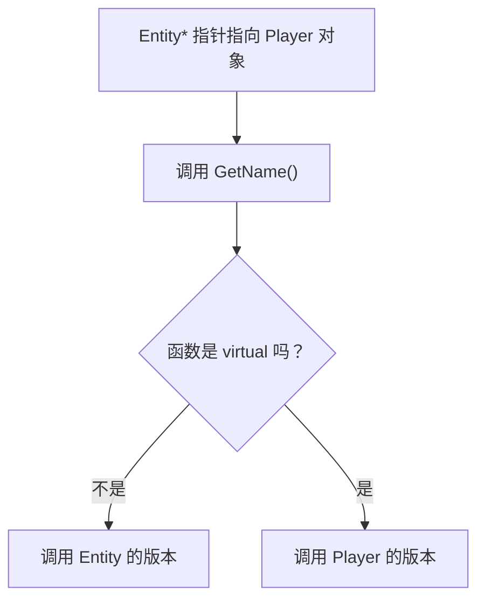
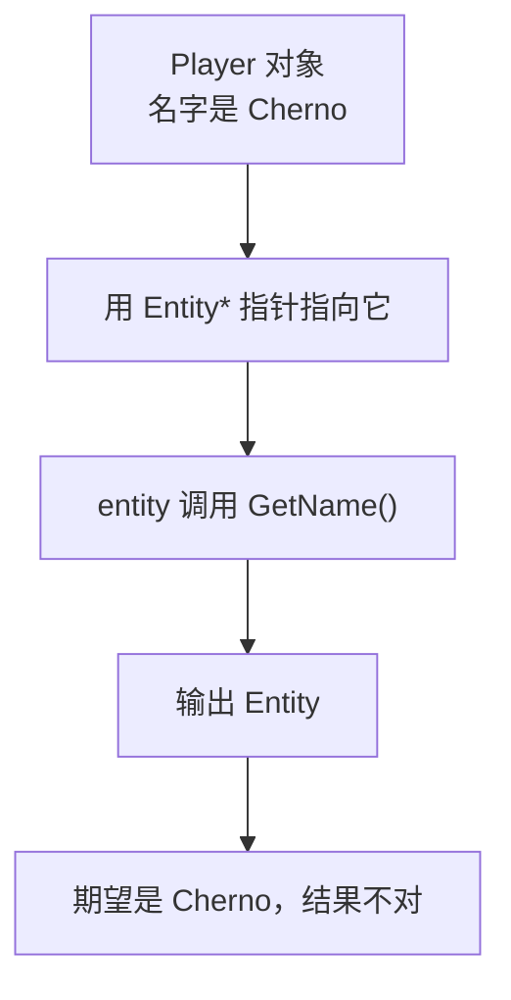
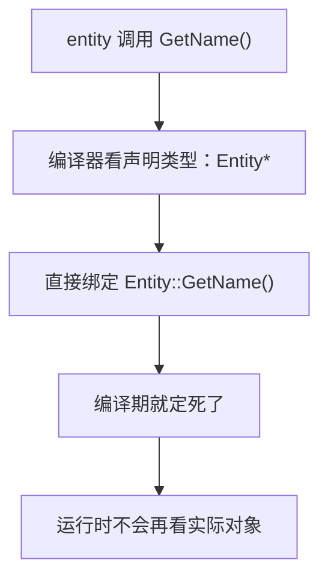
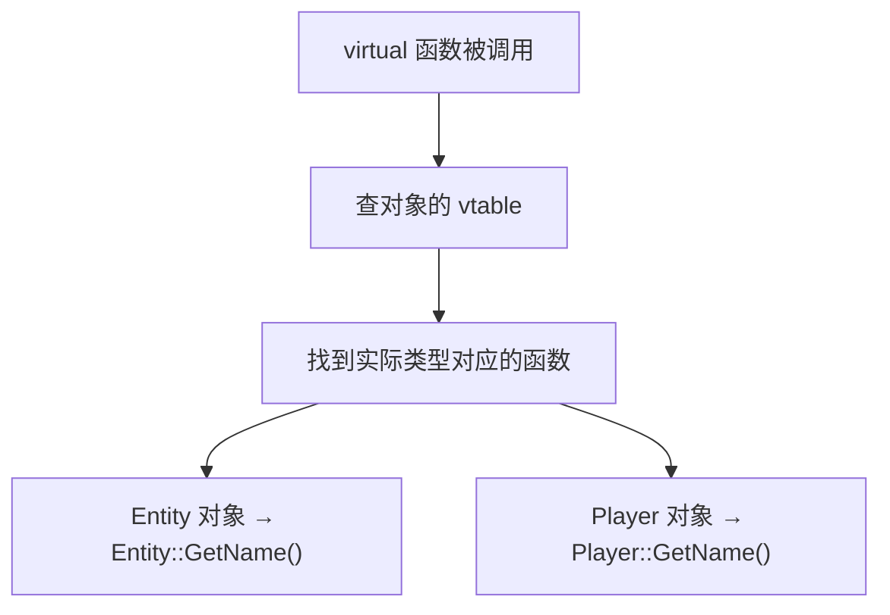
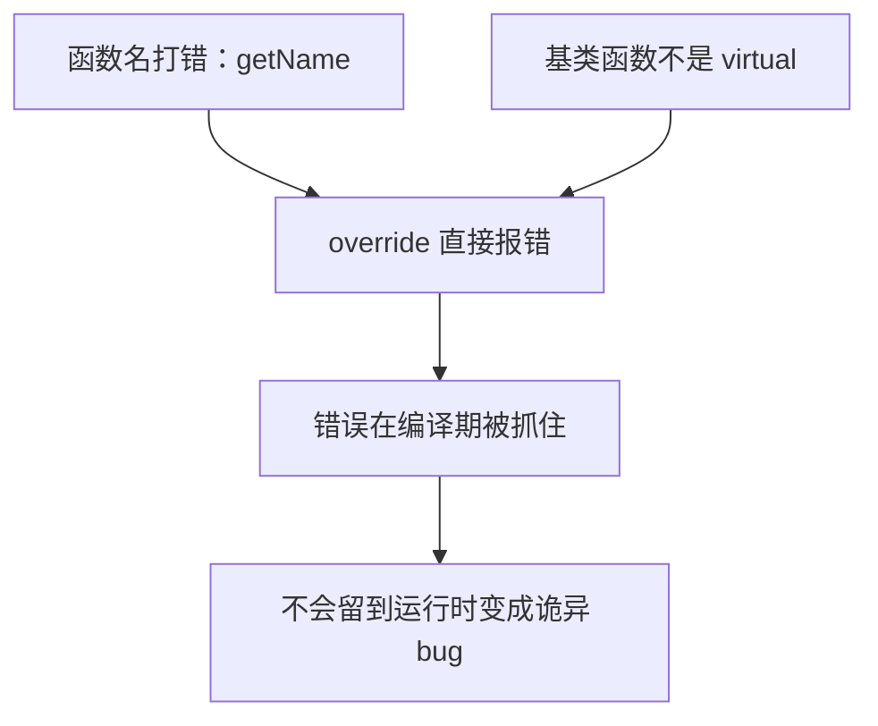
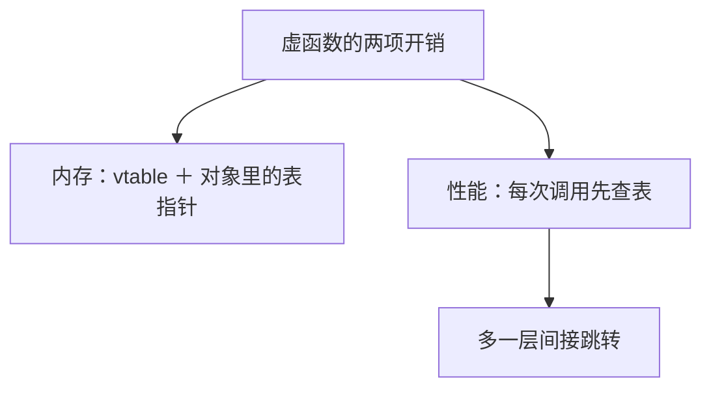

## 本节概述：虚函数让"父类指针"认出"子类真身"

上一节讲了继承——Player 继承 Entity 后，可以在任何需要 Entity 的地方使用 Player。但这带来一个问题：当用 `Entity*` 指针指向一个 Player 对象时，调用 `GetName()` 到底执行哪个版本？默认情况下 C++ 会**看指针类型办事**，调用 Entity 的版本——这往往不是你想要的。**虚函数（virtual function）** 就是解决这个问题的钥匙。



## 问题重现：不加 virtual 会怎样

先写两个类。基类 Entity 有一个 `GetName()` 方法，子类 Player 也定义了自己的 `GetName()`：

```cpp
class Entity
{
public:
    std::string GetName() { return "Entity"; }
};

class Player : public Entity
{
private:
    std::string m_Name;
public:
    Player(const std::string& name)
        : m_Name(name) {}

    std::string GetName() { return m_Name; }
};
```

直接用各自的对象调用，一切正常：

```cpp
Entity* e = new Entity();
std::cout << e->GetName() << std::endl;   // Entity

Player* p = new Player("Cherno");
std::cout << p->GetName() << std::endl;   // Cherno
```

但只要一上多态，程序就"崩"了——用 Entity 指针指向 Player 对象：

```cpp
Entity* entity = p;                        // 用 Entity 指针指向 Player
std::cout << entity->GetName() << std::endl;   // 输出 Entity！不是 Cherno
```



一个更真实的例子——写一个打印函数，接受任何 Entity：

```cpp
void PrintName(Entity* entity)
{
    std::cout << entity->GetName() << std::endl;
}

int main()
{
    Entity* e = new Entity();
    Player* p = new Player("Cherno");

    PrintName(e);   // Entity
    PrintName(p);   // Entity！期望 Cherno
}
```

`PrintName(p)` 编译完全没问题——上一节说过 Player 是 Entity 的子类，可以直接传。但输出的却是 `Entity`，打印了两次。

## 为什么不加 virtual 会出错

原因很直白：**普通成员函数在编译期就绑定了**。编译器看到 `entity->GetName()`，发现 `entity` 的类型是 `Entity*`，于是直接把调用绑定到 `Entity::GetName()`，完事。编译器压根不知道、也不关心这个指针实际指向的是不是 Player 对象。



我们想要的恰恰相反：**运行时才决定**——看看指针实际指向的对象到底是什么类型，是 Player 就调 Player 的版本。

## virtual：开启动态派发

解决办法简单到不可思议——**在基类的函数前面加 `virtual`**：

```cpp
class Entity
{
public:
    virtual std::string GetName() { return "Entity"; }   // 加 virtual
};

class Player : public Entity
{
private:
    std::string m_Name;
public:
    Player(const std::string& name)
        : m_Name(name) {}

    std::string GetName() { return m_Name; }   // 重写基类的虚函数
};
```

就这一个单词，输出立刻变成：

```
Entity
Cherno
```

`virtual` 告诉编译器：**这个函数可能被子类重写，请生成一张虚函数表（vtable），运行时通过它找到正确的版本**。这种运行时决定调用的机制叫**动态派发（dynamic dispatch）**。



vtable 本质上就是一张映射表，记录基类里每个虚函数应该映射到哪个重写版本。每个带虚函数的类，对象里会多存一个指向 vtable 的指针。具体实现细节后面专门展开，现在记住结论就行。

## override：给重写加上"保险"

C++11 引入了 `override` 关键字，标在子类重写的函数后面：

```cpp
class Player : public Entity
{
public:
    std::string GetName() override { return m_Name; }   // 显式声明这是重写
};
```

`override` 不是必须的——不加代码也能正常工作。但强烈建议加上，两个好处：

一是**可读性**，一眼看出这是重写基类的虚函数，不是新函数。二是**防 bug**，编译器会帮你检查：

```cpp
std::string getName() override { return m_Name; }
// 编译错误：基类里叫 GetName，没有 getName 可以重写
```



函数名拼错、大小写不对、基类忘了加 `virtual`——这些错误没有 `override` 时会**静默失败**（子类只是碰巧定义了个同名新函数），有了 `override` 编译器直接拦住。

> [!TIP]
> 重写虚函数时永远加 `override`，零成本，纯收益。

## 虚函数的代价

虚函数不是免费的，有两项运行时开销：

**内存开销**：每个含虚函数的对象要多存一个指向 vtable 的指针，类本身也要维护这张表。

**性能开销**：每次调用虚函数都要先查表，才能确定真正调哪个函数，比普通函数调用多一步间接跳转。



因为这些开销，有些人干脆完全不用虚函数。但说实话，在现代硬件上这点开销微乎其微，正常使用根本察觉不到。除非你在写性能极端敏感的嵌入式平台——每个 CPU 周期都要精打细算——否则完全没必要因噎废食。

> [!WARNING]
> 反过来更危险：需要多态却忘了加 `virtual`，程序会"正常运行但结果错误"，这种 bug 比性能损失难查得多。

## 完整示例代码

```cpp
#include <iostream>
#include <string>

class Entity
{
public:
    virtual std::string GetName() { return "Entity"; }   // 虚函数
};

class Player : public Entity
{
private:
    std::string m_Name;
public:
    Player(const std::string& name)
        : m_Name(name) {}

    std::string GetName() override { return m_Name; }    // 重写，加 override
};

void PrintName(Entity* entity)
{
    std::cout << entity->GetName() << std::endl;         // 运行时动态派发
}

int main()
{
    Entity* e = new Entity();
    Player* p = new Player("Cherno");

    PrintName(e);   // Entity
    PrintName(p);   // Cherno，多态生效

    Entity* entity = p;
    std::cout << entity->GetName() << std::endl;   // Cherno

    std::cin.get();
}
```


## 本章小结

**问题**：不加 `virtual` 时，成员函数在编译期按指针/引用的声明类型绑定。用 `Entity*` 指向 Player，调 `GetName()` 永远走 Entity 的版本。

**解决**：基类函数加 `virtual`，启用动态派发。编译器生成 vtable，运行时根据对象的实际类型决定调哪个版本。

**override**：C++11 引入，显式标记重写。非必需但强烈推荐——提高可读性，且函数名拼错、基类没加 `virtual` 等错误会在编译期直接报错。

**代价**：内存上要存 vtable 和表指针，调用时多一步查表。开销极小，正常使用无需顾虑，只有极端性能敏感的嵌入式场景才需要权衡。

**使用原则**：只要基类的函数可能被子类重写，就加 `virtual`；子类重写时永远加 `override`。
