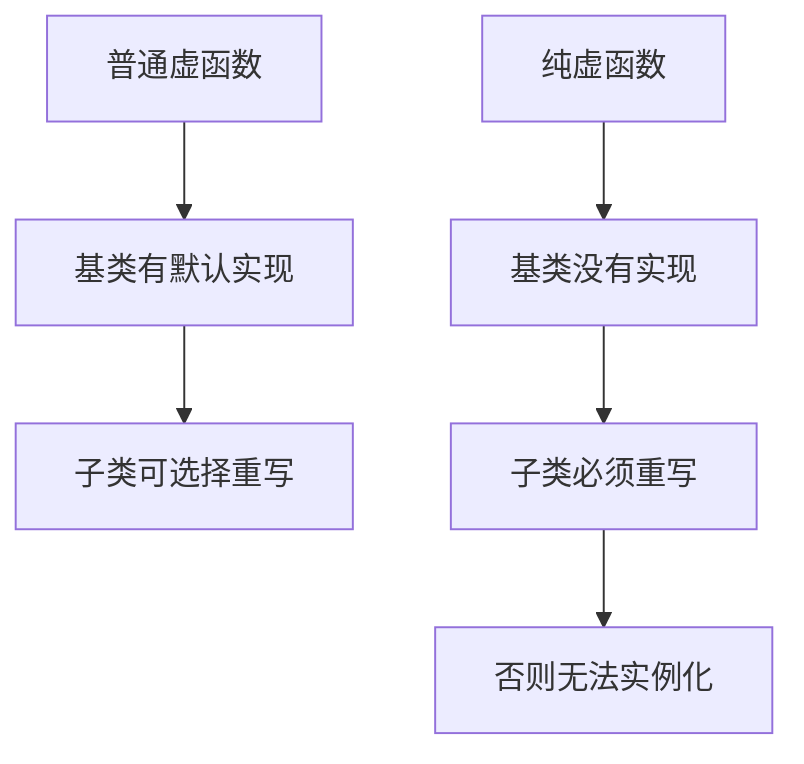
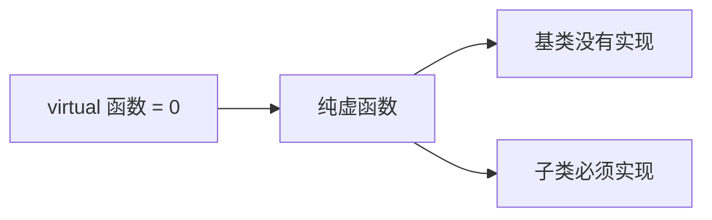
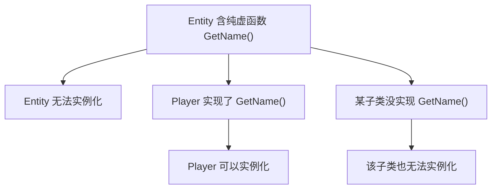
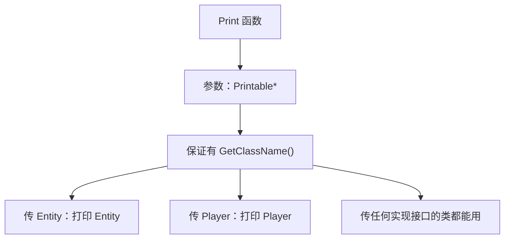
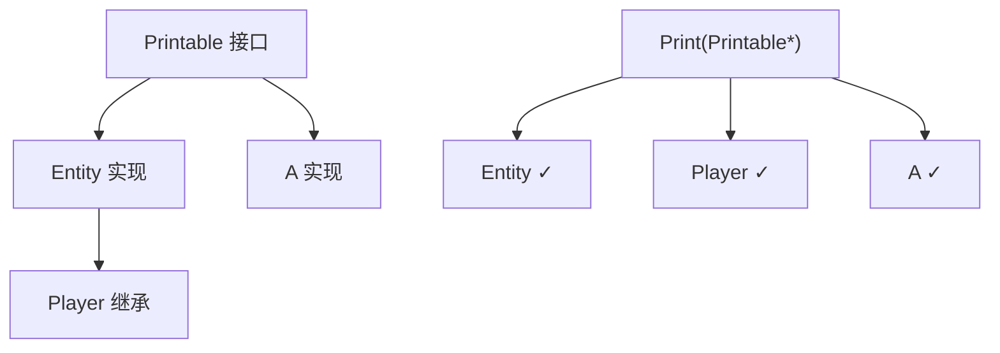
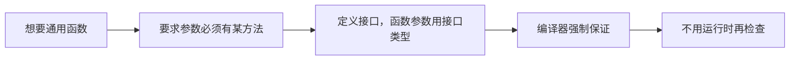

## 本节概述：纯虚函数就是 C++ 的"接口"

上一节讲了虚函数——基类提供默认实现，子类**可以选择**重写。但有时候基类根本给不出合理的默认实现，我们希望**强迫**子类必须自己写。这就是**纯虚函数（pure virtual function）**，它等价于 Java、C# 里的抽象方法和接口。



## 从虚函数到纯虚函数

回顾上一节的例子——Entity 有个虚函数 `GetName()`，Player 重写了它：

```cpp
class Entity
{
public:
    virtual std::string GetName() { return "Entity"; }   // 有默认实现
};
```

因为基类有实现，Player 重写它完全是**可选的**——不重写也能用，只是返回 `"Entity"`。

但某些场景下，基类提供默认实现**毫无意义**。比如"返回类名"这种函数，Entity 自己就不该有答案，每个具体类都该报自己的名字。这时候就要把"可选重写"升级成"必须实现"。

改法：去掉函数体，换成 `= 0`：

```cpp
class Entity
{
public:
    virtual std::string GetName() = 0;   // 纯虚函数
};
```



注意 `virtual` 关键字不能省——`= 0` 是在虚函数基础上的进一步约束。

## 纯虚函数的直接后果：不能实例化

一旦类里有纯虚函数，这个类就**无法被实例化**：

```cpp
Entity* e = new Entity();   // 编译错误：Entity 含有纯虚函数
```

想创建对象，必须找一个**把所有纯虚函数都实现了**的子类：

```cpp
class Player : public Entity
{
private:
    std::string m_Name;
public:
    Player(const std::string& name)
        : m_Name(name) {}

    std::string GetName() override { return m_Name; }   // 必须实现
};

Player* p = new Player("Cherno");   // 没问题，GetName 已实现
```



如果 Player 不实现 `GetName()`，Player 也照样实例化不了。这个约束会**沿继承链传递**——除非继承链上某个类把它实现了，否则谁都建不出对象。

> [!TIP]
> 只含纯虚函数、没有任何实现的类，就是**接口（interface）**。Java 和 C# 有专门的 `interface` 关键字，C++ 没有——**C++ 的接口就是普通类**，只是里面只写纯虚函数。

## 实战例子：Printable 接口

需求：写一个通用函数，能打印**任何类**的类名。

问题在于，参数类型该写什么？写 `Entity*` 就只能在继承体系内用，别的类传不进来。我们真正需要的是一个**保证拥有 `GetClassName()` 方法的类型**——这正是接口的用武之地。

定义一个 `Printable` 接口：

```cpp
class Printable
{
public:
    virtual std::string GetClassName() = 0;   // 纯虚函数，无实现
};
```

然后让 Entity 实现这个接口：

```cpp
class Entity : public Printable
{
public:
    virtual std::string GetName() { return "Entity"; }

    std::string GetClassName() override { return "Entity"; }   // 实现接口
};
```

Player 继承 Entity，自动也是 Printable。想让它报自己的名字，重写一下：

```cpp
class Player : public Entity
{
private:
    std::string m_Name;
public:
    Player(const std::string& name)
        : m_Name(name) {}

    std::string GetName() override { return m_Name; }

    std::string GetClassName() override { return "Player"; }   // 各自报名字
};
```

现在通用打印函数就能写了——参数类型用 `Printable*`：

```cpp
void Print(Printable* obj)
{
    std::cout << obj->GetClassName() << std::endl;
}
```



这个函数**不关心**传进来的到底是什么类——只要实现了 Printable 接口，就保证有 `GetClassName()` 可调。

## 接口的威力：完全不相关的类也能用

接口最妙的地方是，它能把**毫无继承关系**的类统一起来。随便写一个和 Entity 八竿子打不着的类：

```cpp
class A : public Printable
{
public:
    std::string GetClassName() override { return "A"; }
};
```

`A` 和 Entity 没有任何关系，但它实现了 Printable，所以照样能传给 `Print`：

```cpp
Entity* e = new Entity();
Player* p = new Player("Cherno");
A* a = new A();

Print(e);   // Entity
Print(p);   // Player
Print(a);   // A
```



反过来，哪个类继承了 Printable 却**没实现** `GetClassName()`，它就实例化不了——接口的强制性就在这里。

> [!TIP]
> 一个类可以同时实现多个接口，用逗号隔开：`class Player : public Entity, public Printable, public Serializable`。C++ 支持多继承，实现多接口正是它的经典用法之一。

## 什么时候用接口

接口最常见的用途就是本节的场景：**写一个通用函数，要求传进来的对象必须有某个方法**。用接口做参数类型，编译器帮你把关——没实现接口的类根本传不进来，传进来的保证有那个方法可调。



## 完整示例代码

```cpp
#include <iostream>
#include <string>

class Printable                            // 接口：只含纯虚函数
{
public:
    virtual std::string GetClassName() = 0;
};

class Entity : public Printable
{
public:
    virtual std::string GetName() { return "Entity"; }

    std::string GetClassName() override { return "Entity"; }
};

class Player : public Entity
{
private:
    std::string m_Name;
public:
    Player(const std::string& name)
        : m_Name(name) {}

    std::string GetName() override { return m_Name; }

    std::string GetClassName() override { return "Player"; }
};

class A : public Printable                 // 和 Entity 完全无关的类
{
public:
    std::string GetClassName() override { return "A"; }
};

void Print(Printable* obj)                 // 通用函数：只要实现了接口就能传
{
    std::cout << obj->GetClassName() << std::endl;
}

int main()
{
    Entity* e = new Entity();
    Player* p = new Player("Cherno");
    A* a = new A();

    Print(e);   // Entity
    Print(p);   // Player
    Print(a);   // A

    std::cin.get();
}
```

## 本章小结

**纯虚函数**：`virtual 返回类型 函数名() = 0;`——基类只声明不实现，强迫子类必须重写。

**不能实例化**：含纯虚函数的类无法创建对象；子类不实现纯虚函数，子类同样无法实例化，约束沿继承链传递。

**接口**：只含纯虚函数的类就是接口。C++ 没有 `interface` 关键字，接口就是普通类。一个类可用逗号实现多个接口。

**典型用途**：函数参数声明为接口类型，编译器保证传进来的对象一定有指定方法——把"有没有这个函数"的检查从运行时提前到编译期。

**和普通虚函数的分工**：基类能给出合理默认实现用普通虚函数（子类可选重写）；给不出合理默认、必须子类自己写的，用纯虚函数。
