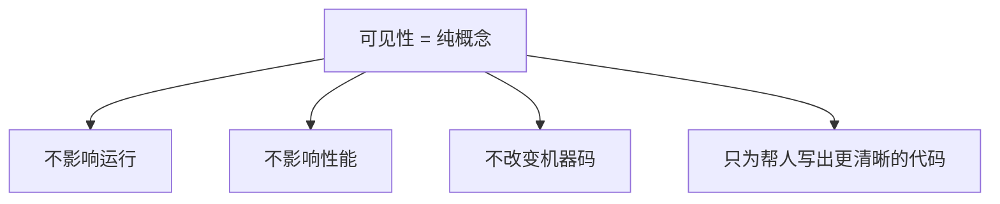
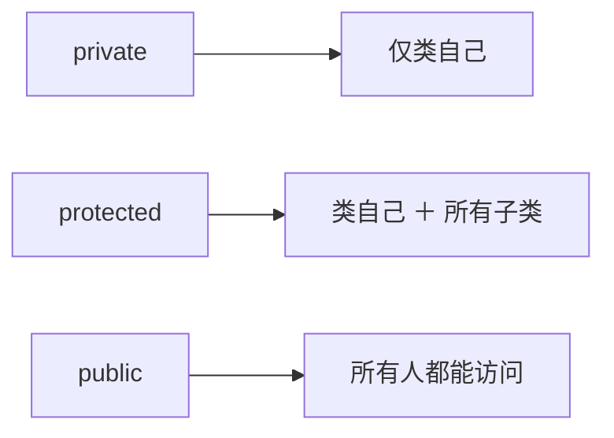
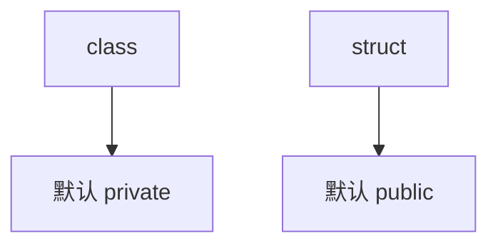
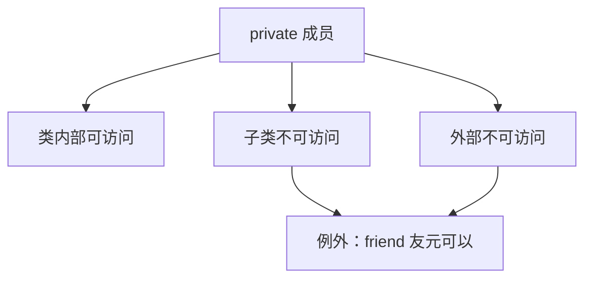
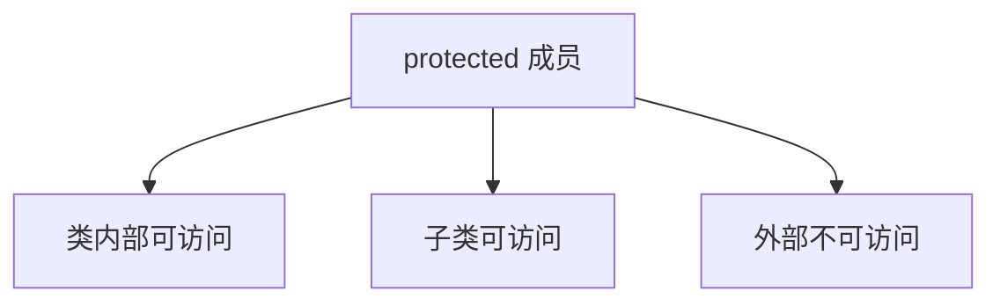
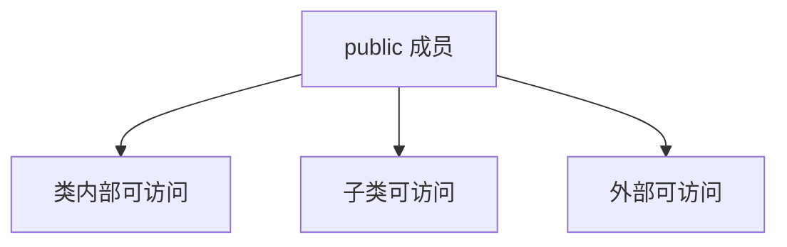
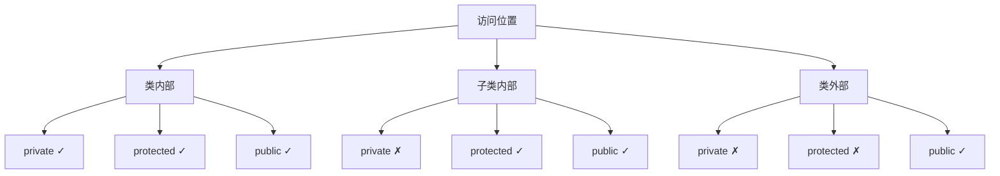
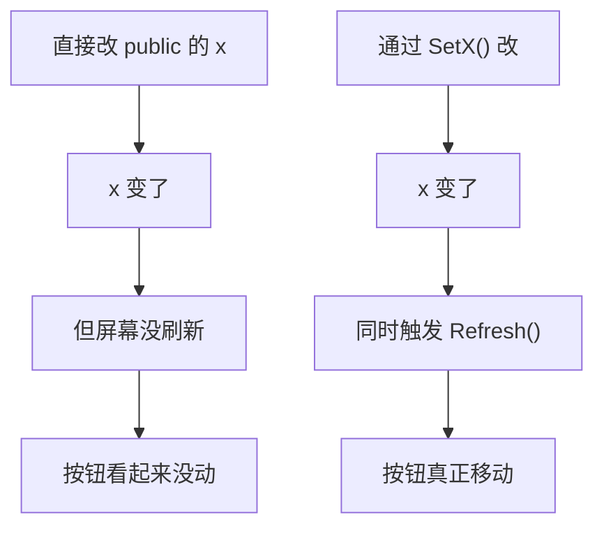
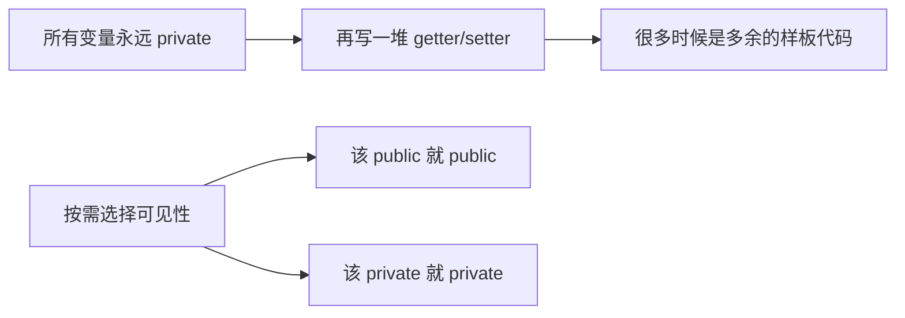

## 本节概述：可见性是写给人看的，不是写给机器看的

前几节的代码里反复出现 `public:`、`private:` 这些关键字，这节就把它们讲透。**可见性（visibility）** 指的是类的成员和方法对"谁"可见、可调用。先说最关键的结论：**可见性对程序运行没有任何影响**——不影响性能、不改变生成的机器码、CPU 根本不知道这玩意的存在。它纯粹是给程序员用的，目的是帮你把代码组织得更清楚、更好维护。



## 三种可见性

C++ 只有三个可见性修饰符：`private`、`protected`、`public`。相比之下 Java 有默认可见性，C# 有 `internal`，C++ 就这三个，干净利落。



### 不写也有默认值

在类里不写可见性修饰符并不代表"没有可见性"，编译器会隐式给一个：

- `class` 里默认为 `private`
- `struct` 里默认为 `public`

```cpp
class Entity
{
    float x, y;          // 等价于 private:
};

struct Entity
{
    float x, y;          // 等价于 public:
};
```



### private：只有类自己能用

`private` 成员只有**类内部**能读写。类外面不行，子类也不行。

```cpp
class Entity
{
private:
    float x, y;
    void Print() { std::cout << x << y; }
public:
    Entity() { x = 0; y = 0; Print(); }   // 类内部：可以
};

class Player : public Entity
{
public:
    Player() { x = 5; }                   // 编译错误：x 是 private
};

int main()
{
    Entity e;
    e.x = 10;                             // 编译错误：x 是 private
    e.Print();                            // 编译错误：Print 是 private
}
```



> [!TIP]
> 这里说"只有类自己"带个星号——C++ 有个 `friend` 关键字，可以把某个类或函数声明为友元，友元能访问 private 成员。这个后面单独讲。

### protected：类自己 + 继承链上的子类

`protected` 比 `private` 放宽一点：除了类自己，**所有子类**也能访问。

```cpp
class Entity
{
protected:
    float x, y;
    void Print() { std::cout << x << y; }
};

class Player : public Entity
{
public:
    Player()
    {
        x = 5;     // 可以：子类能访问 protected 成员
        Print();   // 可以
    }
};

int main()
{
    Entity e;
    e.x = 10;      // 编译错误：main 不是子类
}
```



### public：人人可用

`public` 最宽松，谁都能访问——类内部、子类、外部函数，全部放行。

```cpp
class Entity
{
public:
    float x, y;
};

class Player : public Entity
{
public:
    Player() { x = 5; }     // 可以
};

int main()
{
    Entity e;
    e.x = 10;               // 可以
}
```



## 一张图看清三者区别



## 为什么不全部 public

"既然不影响性能，为什么不把所有东西都设成 public？"——因为可见性的真正价值在于**给使用者（包括未来的自己）传达意图**。

考虑一个按钮类。如果位置 `x` 是 public 的，外部代码可以直接改 `x`。但改了 `x` 按钮真的会移动吗？未必——屏幕可能还在显示旧值，需要触发一次刷新。如果外部直接改 `x`，刷新逻辑就被跳过了，按钮看起来纹丝不动。

正确做法是把 `x` 设为 private，提供一个 public 的 `SetX()` 方法，在里面同时做赋值和刷新：

```cpp
class Button
{
private:
    float x;
    void Refresh() { /* 重绘屏幕 */ }
public:
    void SetX(float newX)
    {
        x = newX;
        Refresh();        // 赋值的同时刷新显示
    }
};
```



这样别人读代码时就明白：**直接改 `x` 是不对的，应该调 `SetX()`**。`private` 就是用编译器来强制这个约定，而不是靠口头提醒。

> [!TIP]
> 你写的代码过几个月再看，很可能已经忘了当初的设计意图。可见性就是给"未来的自己"留的路标——标成 private 的东西就是在说"别从外面碰这个"。

## 关于"永远用 private + getter/setter"的争论

网上有一派观点：**所有成员变量永远设为 private，只通过 public 的 getter/setter 访问**。对此我不赞同，尤其反对那个"永远"——编程里"永远正确"的规则几乎不存在，具体该用哪种可见性取决于实际场景。这个话题展开能说很久，先记住核心：可见性是工具，不是教条。



## 完整示例代码

```cpp
#include <iostream>

class Entity
{
private:
    float m_X, m_Y;             // private：仅类自己
protected:
    int m_Health;               // protected：类自己 + 子类
public:
    const char* Name;           // public：所有人

    Entity() : m_X(0), m_Y(0), m_Health(100) {}

    void Print()               // public 接口
    {
        std::cout << "X:" << m_X << " Y:" << m_Y
                  << " HP:" << m_Health << std::endl;
    }
};

class Player : public Entity
{
public:
    void TakeDamage(int dmg)
    {
        m_Health -= dmg;        // protected 子类可访问
    }
};

class Button
{
private:
    float m_X;
    void Refresh() { /* 重绘 */ }
public:
    void SetX(float x)
    {
        m_X = x;
        Refresh();              // 顺便刷新，保证 UI 正确
    }
};

int main()
{
    Entity e;
    e.Name = "Entity";          // public 可直接访问
    e.Print();

    Player p;
    p.Name = "Player";
    p.TakeDamage(30);           // 子类通过 protected 改血量
    p.Print();

    Button btn;
    btn.SetX(5.0f);             // 不能直接改 m_X，必须走 SetX

    std::cin.get();
}
```

## 本章小结

**三种可见性**：`private`（仅类自己，子类和外部都不行）、`protected`（类自己 + 所有子类）、`public`（所有人）。

**默认值**：`class` 成员默认 `private`，`struct` 成员默认 `public`。

**不影响运行**：可见性是纯编译期概念，不产生机器码、不影响性能，CPU 完全不知道它的存在。

**核心价值**：把成员的"正确用法"用编译器强制下来。`private` 告诉使用者"别从外面碰这个"，引导他们走你设计好的 public 接口。

**典型场景**：按钮的位置不能直接改，要通过 `SetX()` 顺便刷新屏幕——把位置设 private，方法设 public，就能保证使用者不会跳过刷新逻辑。

**不是教条**：不必把所有变量都设成 private 再写一堆 getter/setter，根据实际需求选择。
