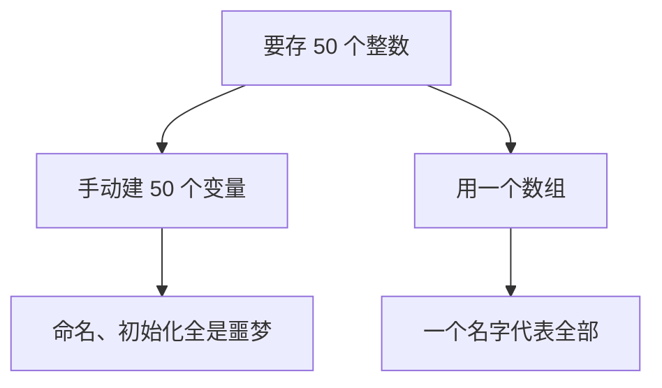
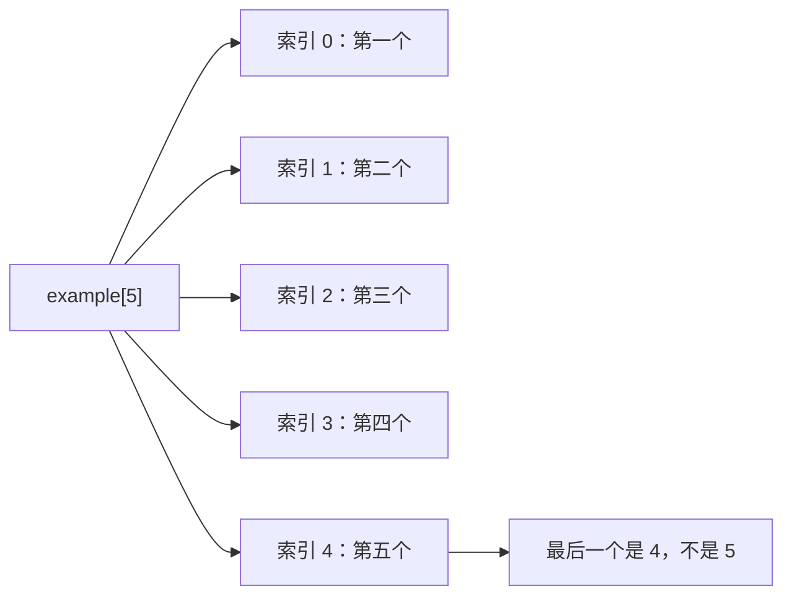
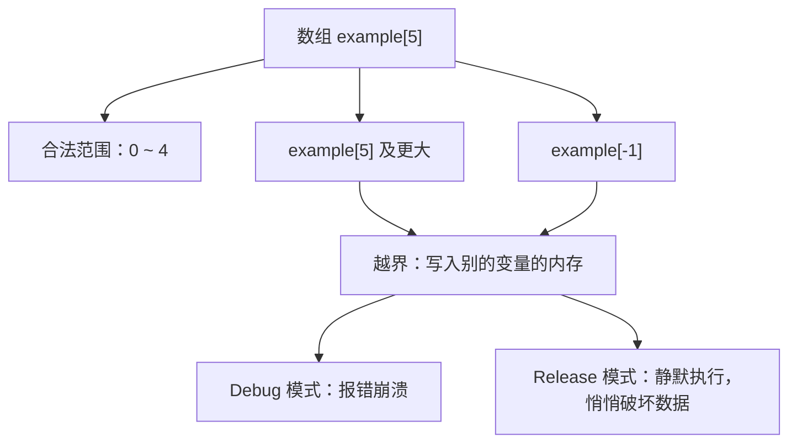
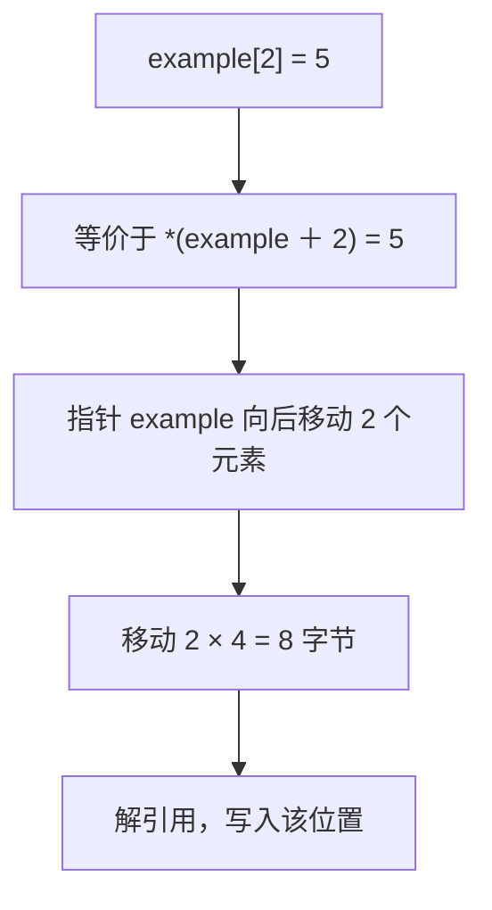
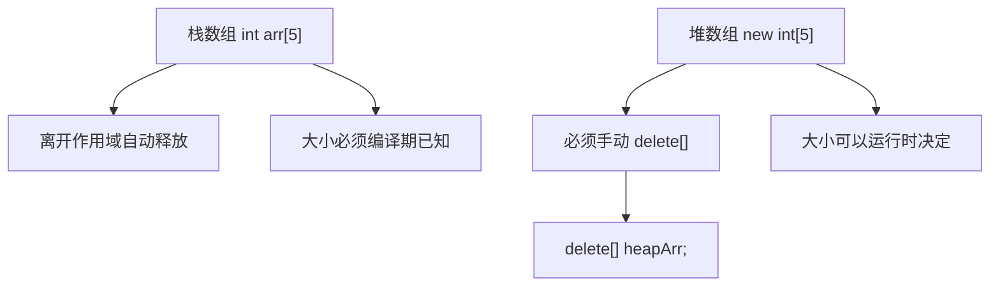
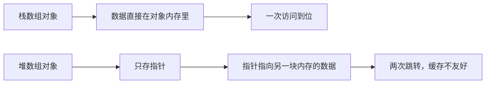
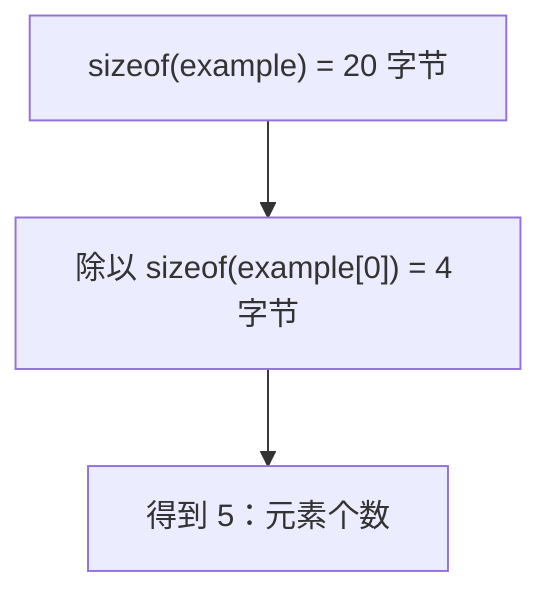
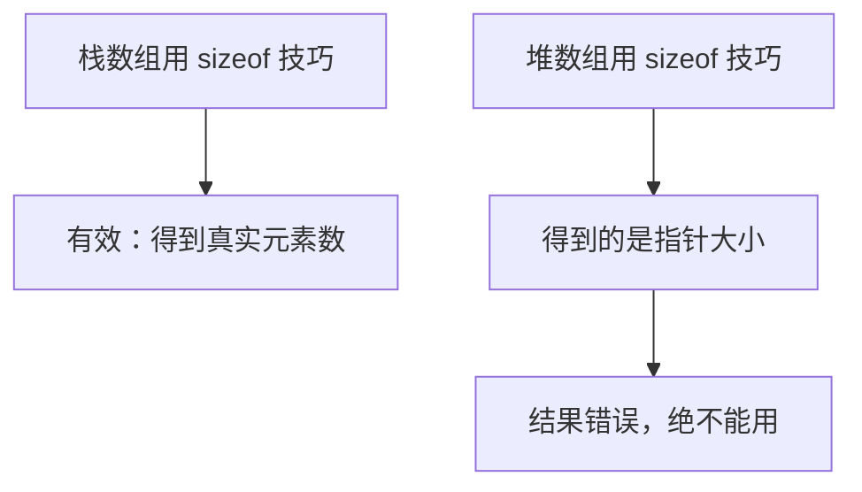

## 本节概述：数组就是一组同类型变量排排坐

想象你要存 50 个整数表示一组数据。手动创建 50 个变量？给它们一个个起名字？再写 50 行代码把它们清零？这完全不可行、无法维护。**数组（array）** 就是为了解决这个问题——**一个名字代表同一类型的多个变量，按顺序排成一排**。



## 声明和访问

声明很简单：类型 + 名字 + 方括号里写元素个数。

```cpp
int example[5];   // 5 个 int 的数组
```

访问用**索引（index）**，方括号里写第几个。注意索引从 0 开始——`example[0]` 是第一个，`example[4]` 才是第五个（最后一个）。

```cpp
example[0] = 2;
example[4] = 4;

std::cout << example[0] << std::endl;   // 2
```



数组名本身是一个指针——直接打印 `example` 得到的是内存地址。但用 `example[i]` 访问时，返回的是数组元素的实际类型（这里是 `int`）。

> [!TIP]
> 有些语言（比如 Lua）数组从 1 开始，但 C、C++、Java、C# 等绝大多数语言都从 0 开始，记住这个约定。

## 越界访问：千万别干

数组只分配了 5 个元素的空间。访问 `example[-1]` 或 `example[5000]` 就是在操作**不属于你的内存**，叫**越界访问（out of bounds）**。



Debug 模式下编译器会帮你抓住这个错误，程序直接崩溃。但 Release 模式下很可能不报错——你以为在改数组，实际上把别的变量的内存改写了，程序还能继续跑，只是结果莫名其妙。这种 bug 极难调试。所以访问数组前一定要做边界检查。

## 数组和 for 循环是绝配

数组可以通过索引访问，for 循环正好是按索引遍历的，两者天生一对。把数组全部设为 2：

```cpp
for (int i = 0; i < 5; i++)
{
    example[i] = 2;
}
```

循环条件写 `i < 5` 而不是 `i <= 4`——后者多一次相等比较，性能略差，而且不是业界习惯写法。


## 数组在内存里是连续的

数组最重要的特性：**数据在内存中连续存放**。5 个 int，每个 4 字节，总共 20 字节，紧挨着排成一行。


`example[2]` 到底在内存的哪个位置？就是从数组开头往后偏移 **2 × sizeof(int) = 8 字节**。

## 数组就是指针，索引就是指针运算

数组名本质上是一个指向首元素的指针。`example[i]` 等价于 `*(example + i)`：

```cpp
int* ptr = example;           // 数组名赋值给指针，没问题
example[2] = 5;               // 正常索引写法
*(ptr + 2) = 6;               // 完全等价
```



指针运算的偏移量**按元素类型的大小计算**，不是按字节。`ptr + 2` 对 `int*` 来说就是移动 8 字节。如果想按字节偏移，得先转成 `char*`：

```cpp
*(int*)((char*)ptr + 8) = 6;   // 手动按字节偏移，效果一样
```

但这行代码又长又绕，正常情况直接用索引 `ptr[2]` 就行。索引不是魔法，它就是指针运算的语法糖。

## 栈数组 vs 堆数组

数组可以在栈上创建，也可以在堆上创建：

```cpp
int stackArr[5];              // 栈数组：离开作用域自动销毁
int* heapArr = new int[5];    // 堆数组：需要手动 delete[]
```



堆数组用 `new[]` 分配，销毁时必须用 `delete[]`（带方括号），不能用普通 `delete`。

为什么要用堆数组？最主要的原因是**生命周期**——栈数组随作用域结束就没了，堆数组活到你 `delete[]` 为止。如果函数要返回一个新创建的数组，只能用堆数组。

## 堆数组的间接访问开销

堆数组有个隐藏代价：对象里存的只是一个指针，指针再指向实际数据。访问数据要先跳到对象、再跳转到数组，多了一层间接。



在类里内嵌栈数组，数据就在对象旁边，CPU 缓存友好。用堆数组则要先取指针、再跳转，容易造成缓存未命中。**所以能在栈上分配就尽量在栈上分配**。

## 数组大小：raw 数组没法直接知道

raw 数组没有内置的 `.size()` 方法，这是它最大的痛点。

对于**栈数组**，可以用 `sizeof` 技巧算元素个数：

```cpp
int example[5];
int count = sizeof(example) / sizeof(example[0]);   // 20 / 4 = 5
```



但这个技巧**只对栈数组有效**。对堆数组用 `sizeof(heapArr)` 得到的是指针大小（4 或 8 字节），除以元素大小得到错误结果。



而且数组一旦传进函数，就退化成指针，`sizeof` 技巧也失效了。所以用 raw 数组的常规做法是：**自己维护一个 size 常量**。

```cpp
static const int ExampleSize = 5;
int example[ExampleSize];
for (int i = 0; i < ExampleSize; i++) { ... }
```

栈数组的大小必须是**编译期常量**，所以用 `static const` 或 `constexpr`。

## std::array：C++11 给的安全选项

C++11 引入了 `std::array`，是对 raw 数组的封装，提供了边界检查和 `.size()` 方法：

```cpp
#include <array>

std::array<int, 5> another;
another.size();            // 返回 5
another[2] = 2;            // 用法和 raw 数组一样
```

`std::array` 比 raw 数组安全，但有一点额外开销（内部维护了 size 整数）。追求极致性能可以用 raw 数组，求稳妥用 `std::array`。两种都合法，看场景选择。

## 完整示例代码

```cpp
#include <iostream>
#include <array>

int main()
{
    int example[5];                         // 栈数组
    for (int i = 0; i < 5; i++)
        example[i] = 2;

    std::cout << example[2] << std::endl;   // 2

    int* ptr = example;                     // 数组名就是指针
    *(ptr + 2) = 6;                         // 等价于 example[2] = 6
    std::cout << example[2] << std::endl;   // 6

    int count = sizeof(example) / sizeof(example[0]);   // 5

    int* heapArr = new int[5];              // 堆数组
    for (int i = 0; i < 5; i++)
        heapArr[i] = 2;
    delete[] heapArr;                       // 必须用 delete[]

    std::array<int, 5> another;             // std::array
    std::cout << another.size() << std::endl;   // 5

    std::cin.get();
}
```

## 本章小结

**数组是什么**：同一类型的多个变量按顺序连续存放在一起，用一个名字通过索引访问。

**索引从 0 开始**：大小为 N 的数组，合法索引是 0 到 N-1。越界访问在 Debug 模式会崩溃，Release 模式可能静默破坏其他变量的内存。

**内存连续**：数组元素在内存中紧挨排列，`arr[i]` 等价于 `*(arr + i)`，偏移量为 `i × sizeof(元素类型)` 字节。

**栈数组 vs 堆数组**：栈数组 `int arr[5]` 离开作用域自动释放，大小必须编译期已知；堆数组 `new int[5]` 生命周期由你控制，必须用 `delete[]` 释放。

**间接访问开销**：堆数组在对象里只存一个指针，访问数据多一次跳转，缓存不友好；能用栈数组就用栈数组。

**大小获取**：raw 数组没有 `.size()`。栈数组可用 `sizeof(arr) / sizeof(arr[0])` 求元素个数，堆数组和传进函数的数组都不行——只能自己维护一个 size 常量。

**std::array**：C++11 提供的安全数组，有边界检查和 `.size()`，稍有开销，求稳首选。
