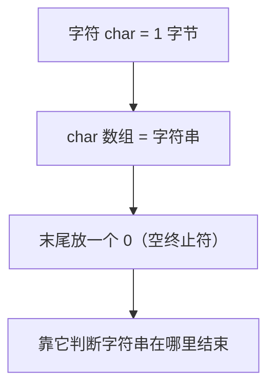
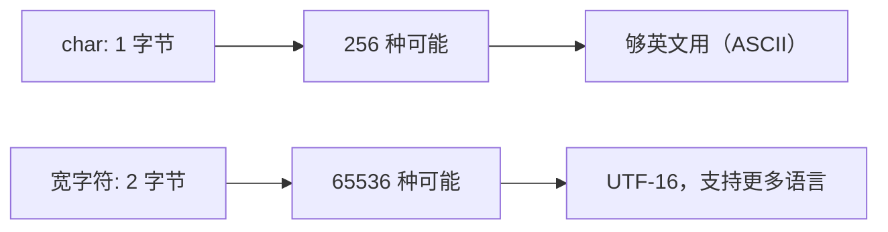
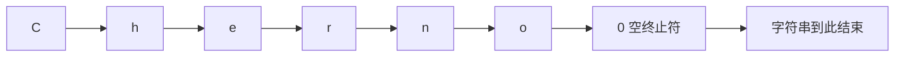
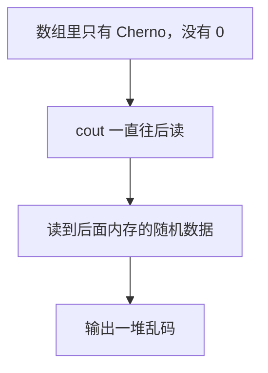
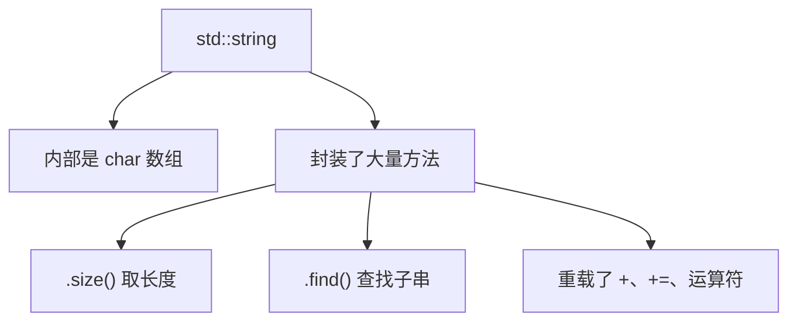
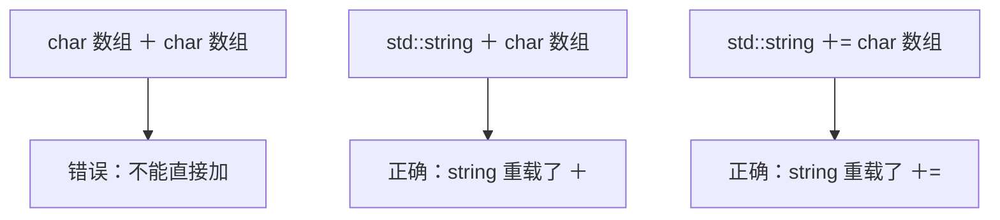
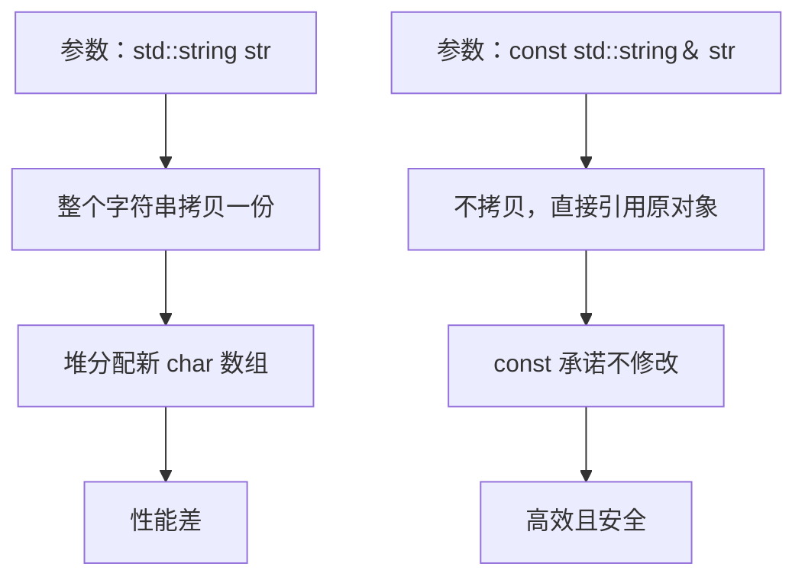

## 本节概述：字符串就是一排字符，末尾加个零

字符串（string）就是一组字符——字母、数字、符号，也就是文本。小到一个字符，大到一整段文字，都叫字符串。理解字符串的关键是先理解**字符**，而 C++ 里字符的基础是 `char` 类型（1 字节），所以最基础的字符串本质上就是**一个 char 数组**。



## 字符和编码

`char` 是 1 字节（8 位），能表示 256 种可能——刚好够装下英文字母、数字和常见符号，这就是 ASCII。但日语、韩语、中文等语言的字符远超 256 个，需要更大的编码（UTF-16 用 2 字节一个字符，能表示 65536 种）。C++ 普通的 `char` 字符串主要面向英文，处理其他语言需要别的编码方案。



## C 风格字符串：char 指针

最原始的写法是用 `const char*`：

```cpp
const char* name = "Cherno";
```

这就是一个指向字符数组的指针。用 `const` 是因为这种字符串字面量是**不可变**的——它是一块固定大小的内存，想变大就得重新分配。

> [!TIP]
> 这里**不需要 `delete`**。规则很简单：没用 `new` 就不用 `delete`。字符串字面量 `"Cherno"` 不是你用 `new` 分配的，所以也别去删它。

## 关键：空终止符

字符串字面量 `"Cherno"` 在内存里到底长什么样？不是 6 个字节，而是 **7 个**——6 个字符后面还跟着一个值为 0 的字节，叫**空终止符（null terminator）**，写成 `'\0'`。



为什么需要它？因为 `name` 只是个指针，指向开头。程序怎么知道字符串在哪里结束？答案就是**一直读到遇到 0 为止**。打印 `name` 时，`cout` 就是靠这个 0 判断"打印到这里可以停了"。

来做个实验证明。手动写一个 char 数组，**故意不加空终止符**：

```cpp
char name2[6] = { 'C', 'h', 'e', 'r', 'n', 'o' };
std::cout << name2 << std::endl;
```

输出会是 `Cherno` 后面跟一堆乱码——因为 `cout` 找不到 0，就一直往后读，把后面内存里的垃圾数据也当字符打印出来，直到碰巧遇到某个 0 才停。



只要补上 0 就正常了：

```cpp
char name2[7] = { 'C', 'h', 'e', 'r', 'n', 'o', 0 };
// 或者写成 '\0'，和 0 完全等价
```

> [!TIP]
> 字符字面量用**单引号** `'C'`，字符串字面量用**双引号** `"Cherno"`。双引号会自动在末尾加上空终止符。

## std::string：C++ 推荐的字符串类

C 风格字符串虽然底层简单，但用起来麻烦——要自己记得加 0、拷贝要手动处理、获取长度要调 `strlen`。C++ 标准库提供了 `std::string`，底层还是 char 数组，但封装了一堆好用的方法。

```cpp
#include <string>
#include <iostream>

int main()
{
    std::string name = "Cherno";
    std::cout << name << std::endl;

    std::cout << name.size() << std::endl;   // 6
}
```



> [!WARNING]
> 用 `std::string` 必须 `#include <string>`。虽然 `<iostream>` 里可能也有 `std::string` 的定义，但 `<<` 运算符的重载在 `<string>` 里——不包含就没法把 string 输出到 `cout`。

## 字符串拼接

想把两个字符串拼起来。注意：**两个字符串字面量不能直接相加**——它们是 `const char[]`，不是 `std::string`，对指针做加法毫无意义。

```cpp
std::string name = std::string("Cherno") + " hello";   // 正确
name += " welcome";                                     // 正确，+= 已重载
```

两种写法都行：把其中一个用 `std::string()` 构造一下，或者用 `+=` 追加。只要其中一个操作数是 `std::string`，运算就走 string 的重载。



## 查找子串

`std::string` 没有直接的 `contains` 方法，查找用 `find`：

```cpp
std::string name = "Cherno hello";
if (name.find("no") != std::string::npos)
{
    std::cout << "找到子串" << std::endl;
}
```

`find` 返回子串的起始位置；如果没找到，返回 `std::string::npos`（一个特殊的非法位置值）。

## 传字符串给函数：用 const 引用

写一个打印字符串的函数，参数别直接写 `std::string`——那样会**拷贝一份**，动态分配内存存同样的文本，很慢。只读场景一律用 `const std::string&`：

```cpp
void PrintString(const std::string& str)
{
    std::cout << str << std::endl;
}
```



`&` 表示引用，不拷贝；`const` 承诺不修改。这是传字符串的标准写法。

## 完整示例代码

```cpp
#include <iostream>
#include <string>

void PrintString(const std::string& str)
{
    std::cout << str << " 长度:" << str.size() << std::endl;
}

int main()
{
    const char* name = "Cherno";              // C 风格字符串
    std::cout << name << std::endl;

    char name2[7] = { 'C', 'h', 'e', 'r', 'n', 'o', 0 };   // 手动加 0
    std::cout << name2 << std::endl;

    std::string s = "Cherno";                 // std::string
    PrintString(s);

    s += " hello";                            // 拼接
    std::cout << s << std::endl;

    if (s.find("hello") != std::string::npos) // 查找
        std::cout << "包含 hello" << std::endl;

    std::cin.get();
}
```

## 本章小结

**字符串本质**：一组字符排成一排，就是 char 数组。`char` 是 1 字节，ASCII 编码够英文用，其他语言需要更大的编码。

**空终止符**：C 风格字符串末尾必有一个值为 0 的字节（`'\0'`），程序靠它判断字符串结束。没有它，打印会越界读出乱码。

**C 风格字符串**：`const char* name = "Cherno"`，不可变、固定大小，不需要 `delete`（没用 `new`）。

**std::string**：C++ 推荐用法，底层是 char 数组，封装了 `.size()`、`.find()`、`+=` 等方法。必须 `#include <string>`。

**字符串拼接**：两个字符串字面量不能直接相加，至少一个得是 `std::string`，用 `+` 或 `+=`。

**查找**：`str.find(sub)` 返回位置，找不到返回 `std::string::npos`。

**传参**：只读场景用 `const std::string&`，避免拷贝带来的堆分配开销。
