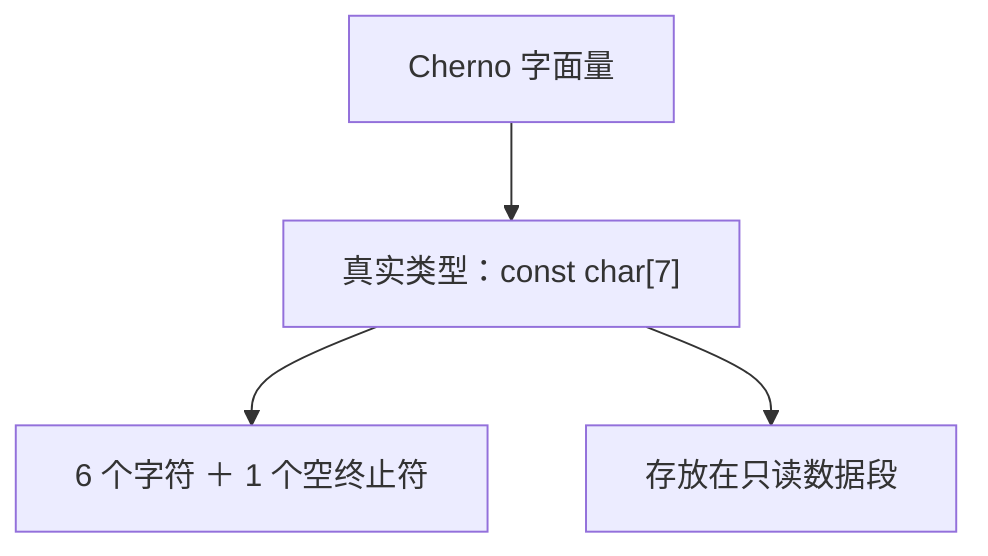
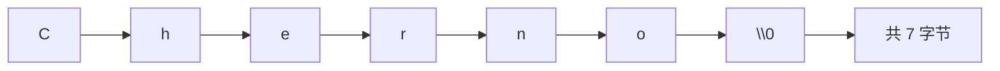
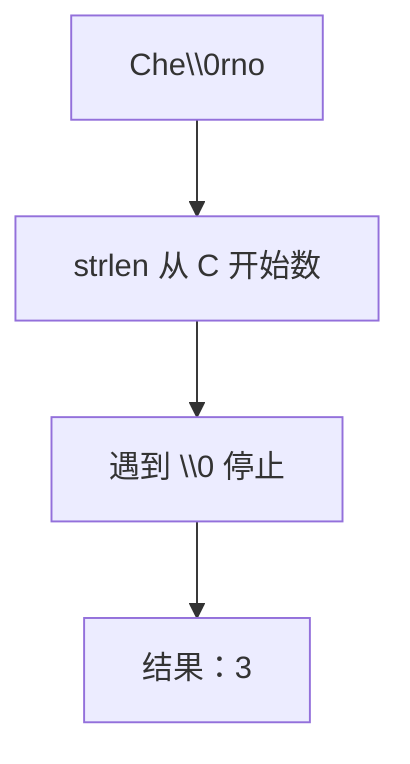
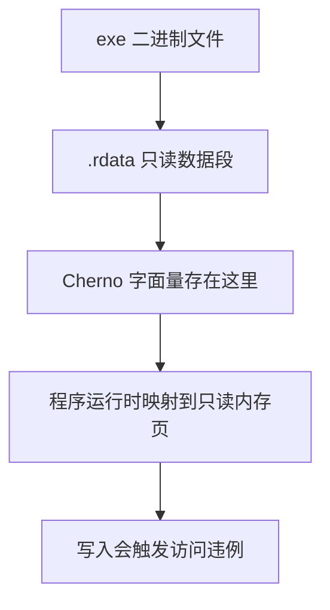
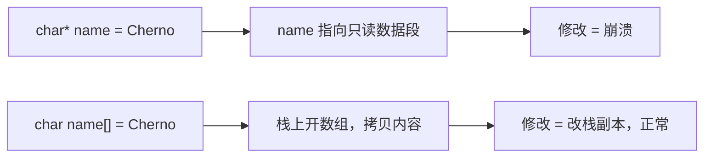
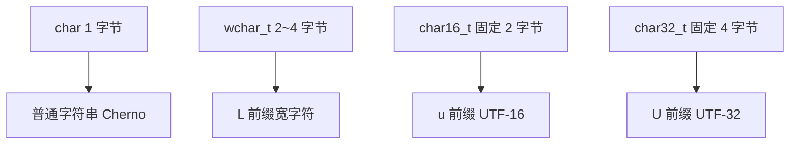
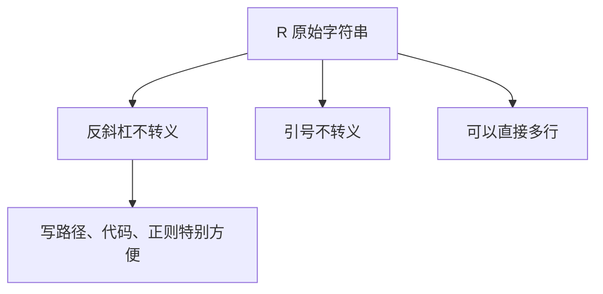

## 本节概述：双引号里的文字就是只读的 char 数组

上一节讲了字符串怎么用，这一节深入它的底层——**字符串字面量（string literal）**，就是双引号括起来的那段文字，比如 `"Cherno"`。看似简单，背后却有不少门道：它的真实类型是什么？能不能改？存在内存的哪里？



## 字符串字面量的真实类型

把鼠标悬停在 `"Cherno"` 上，编译器告诉你它的类型是 `const char[7]`。明明只有 6 个字符，为什么是 7？因为末尾**自动加了一个空终止符** `'\0'`（数值就是 0）。



注意 `'\0'` 是数值 0，不是字符 `'0'`（字符 '0' 的 ASCII 值是 48）。空终止符的作用是告诉程序"字符串到这里结束"。

## 空终止符放在中间会怎样

如果手动在字符串中间插一个 `\0`，`strlen` 等 C 函数会认为字符串在那里就结束了：

```cpp
const char* name = "Che\0rno";
std::cout << strlen(name) << std::endl;   // 输出 3，不是 6
```

`strlen` 从开头数，遇到第一个 0 就停，所以只数到 "Che" 三个字符。但数组本身仍然有 8 个字节（Cherno 6 个 + 中间的 0 + 末尾的 0）。



## 字符串字面量存在只读内存

这是本节最重要的知识点。字符串字面量被编译后，存放在二进制文件的**常量数据段（.rdata）**，这块内存是**只读**的。

你可以用十六进制编辑器打开编译出的 exe，直接找到 "Cherno" 这几个字符——它们被嵌在程序里。



所以把字符串字面量赋给 `char*`（非 const）然后修改它，是**未定义行为**：

```cpp
char* name = "Cherno";       // 不推荐，某些编译器会警告
name[2] = 'a';               // 未定义行为！试图写只读内存
```

Debug 模式下会直接崩溃（访问违例），Release 模式下可能"看起来没生效"。无论哪种，都不应该这么写。

> [!WARNING]
> 字符串字面量永远是只读的。想修改就别用指针指向字面量，而要用**数组**——数组会把字面量的内容**拷贝**到栈上，栈内存可写。

## 想修改就用数组

```cpp
char name[] = "Cherno";      // 数组：拷贝到栈上，可修改
name[2] = 'a';               // 正常工作，变成 "Cha no"
```

指针版本 `char* name = "Cherno"` 只是指向只读区里的字面量；数组版本 `char name[] = "Cherno"` 则是在栈上开了一块新内存，把字面量的内容复制过去，你改的是栈上的副本，自然没问题。



所以记住：**需要修改的字符串，用数组；只读的字符串，用 `const char*`**。

## 宽字符和其他字符类型

除了普通的 `char`（1 字节），C++ 还有几种字符类型，对应不同的字符串字面量前缀：

```cpp
const wchar_t* wide = L"Cherno";         // 宽字符，Windows 上 2 字节，Linux/Mac 上 4 字节
const char16_t* u16 = u"Cherno";         // 固定 2 字节，UTF-16
const char32_t* u32 = U"Cherno";         // 固定 4 字节，UTF-32
const char* utf8 = u8"Cherno";           // UTF-8
```



`wchar_t` 的大小由编译器决定（Windows 上 2 字节，Linux/Mac 上 4 字节），不固定。要保证 2 字节就用 `char16_t`。

## std::string 字面量后缀

C++14 引入了一个便捷后缀 `s`，加在字符串字面量后面直接得到 `std::string`：

```cpp
using namespace std::string_literals;
std::string name = "Cherno"s;            // 直接是 std::string
name += " hello";                        // 可以直接拼接
```

这样就不用再写 `std::string("Cherno") + " hello"` 了，更简洁。


## 原始字符串字面量 R"()"

写多行文本或含大量转义符的字符串很痛苦，C++11 提供了**原始字符串字面量**，用 `R"()"` 包裹，里面的反斜杠和引号都按字面意义处理，不做转义：

```cpp
const char* path = R"(C:\Users\Cherno\file.txt)";   // 不用写双反斜杠
const char* multi = R"(line1
line2
line3)";                                             // 直接多行
```



普通字符串要写 Windows 路径得是 `"C:\\Users\\Cherno"`，原始字符串里直接写 `R"(C:\Users\Cherno)"` 就行。如果字符串本身含有 `)"`，还可以用自定义分隔符：`R"delim(...)delim"`。

## 相邻字符串自动拼接

两个相邻的字符串字面量会自动拼在一起，中间不需要 `+`：

```cpp
const char* s = "line1" "line2";          // 等价于 "line1line2"
```

想让它们分行显示就加 `\n`：

```cpp
const char* s = "line1\n" "line2\n";      // 两行
```

## 完整示例代码

```cpp
#include <iostream>
#include <string>
#include <cstring>

int main()
{
    const char* name = "Cherno";                       // 只读，不能改
    std::cout << strlen(name) << std::endl;             // 6

    char nameArr[] = "Cherno";                          // 数组，可改
    nameArr[2] = 'a';
    std::cout << nameArr << std::endl;                  // Cha no

    using namespace std::string_literals;
    std::string s = "Cherno"s;                          // std::string 字面量
    s += " hello";

    const char* path = R"(C:\Users\Cherno\file.txt)";   // 原始字符串
    std::cout << path << std::endl;

    const wchar_t* wide = L"Cherno";                    // 宽字符

    std::cin.get();
}
```

## 本章小结

**真实类型**：`"Cherno"` 的类型是 `const char[7]`，6 个字符 + 1 个空终止符 `'\0'`。

**空终止符**：数值 0，标志字符串结束。`strlen` 数到第一个 0 就停；在中间插 `\0` 会截断字符串。

**只读内存**：字符串字面量存在二进制的常量数据段，运行时映射到只读内存页。修改它是未定义行为，Debug 会崩溃。

**指针 vs 数组**：`char* p = "Cherno"` 指向只读区，不能改；`char arr[] = "Cherno"` 在栈上拷贝一份，可以改。需要修改就用数组。

**字符类型前缀**：`L` 宽字符（大小不固定）、`u` 固定 2 字节 char16_t、`U` 固定 4 字节 char32_t、`u8` UTF-8。

**`s` 后缀**（C++14）：`"Cherno"s` 直接得到 `std::string`。

**原始字符串 `R"()"`**（C++11）：不解析转义符，可直接多行，写路径和代码片段特别方便。

**相邻拼接**：两个字符串字面量相邻会自动拼接，无需 `+`。
