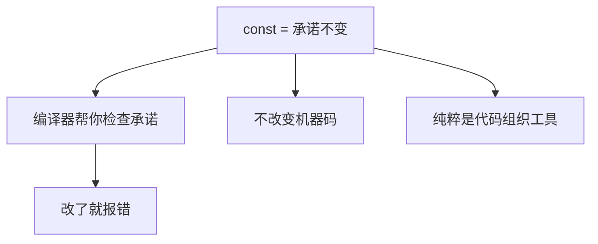
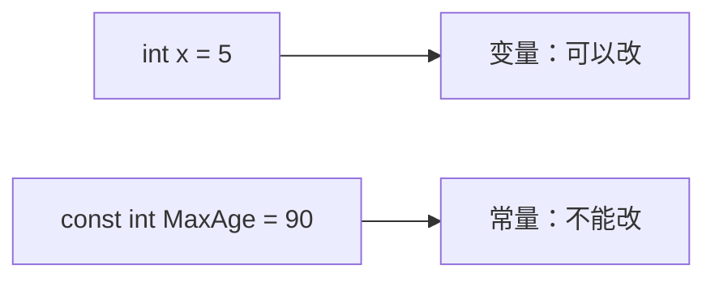
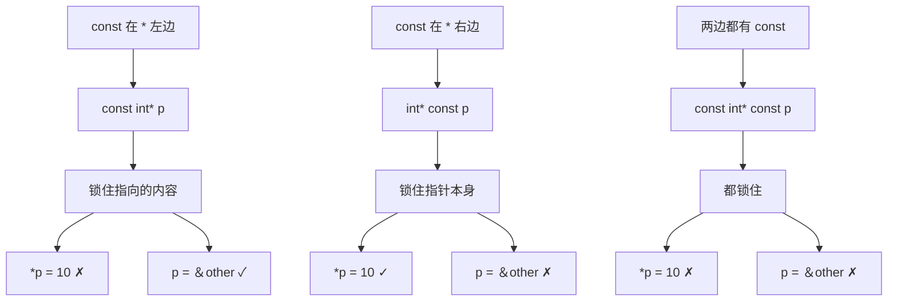
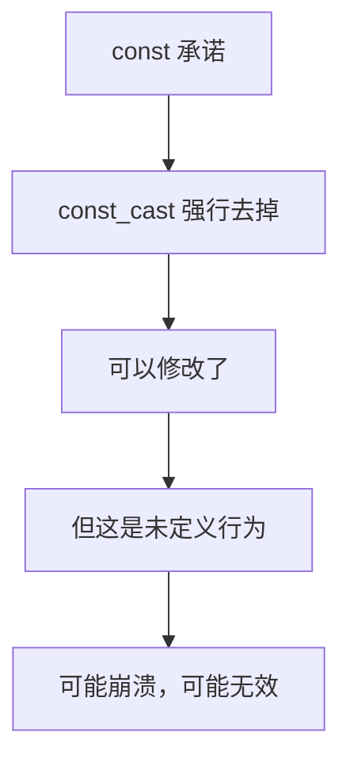
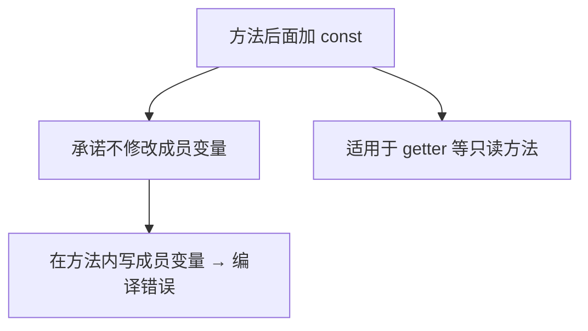
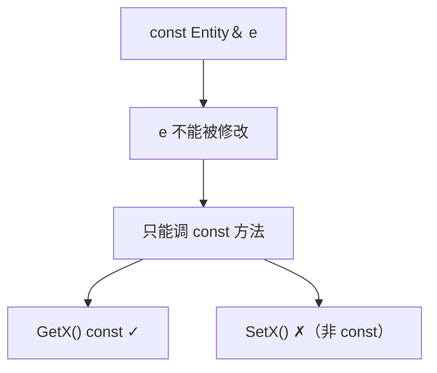
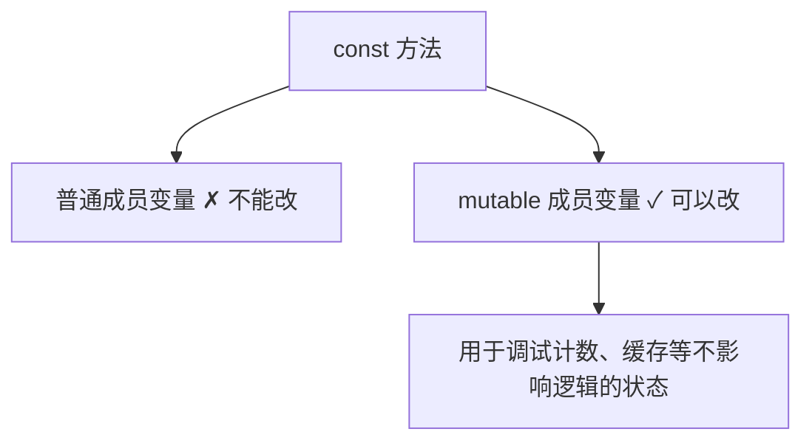
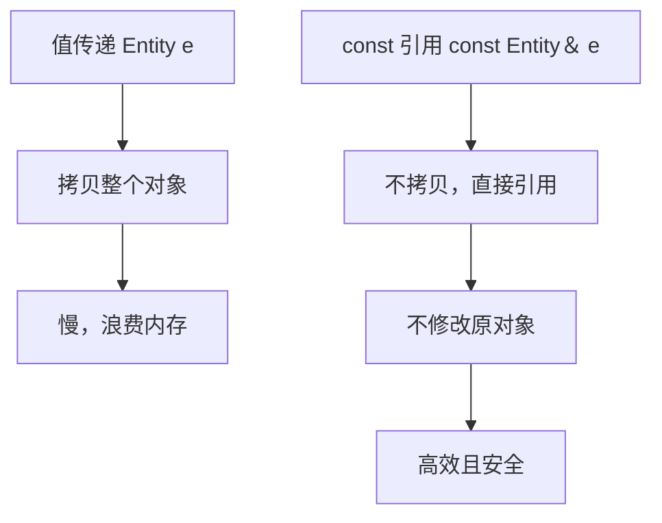

## 本节概述：const 是一个承诺，编译器帮你盯着

`const` 是 C++ 里最容易让人困惑的关键字之一。先说结论：**const 本质上是个"假"关键字**——和可见性一样，它几乎不改变生成的机器码，而是程序员对编译器和同事的一个**承诺**："这个东西不会变"。承诺可以被打破，但正常情况下你应该遵守，因为它能让代码更清晰、更安全。



## 最基本的用法：常量

```cpp
const int MaxAge = 90;
MaxAge = 100;        // 编译错误：不能改
```

"变量"这个词暗示它可以变，但 `MaxAge` 显然不该变——它是个固定的数字。用 `const` 声明，它就从"变量"变成了"常量"，编译器帮你守住这个约定。



## 指针和 const：位置决定含义

指针涉及两个东西：**指针本身**（存的地址）和**指针指向的内容**。const 放在哪一侧，决定了锁住哪一侧。

```cpp
int a = 5;

const int* p1 = &a;       // 锁住内容：不能改 *p1，但能改 p1 指向哪
int* const p2 = &a;       // 锁住指针：能改 *p1，但不能改 p2 = &其他
const int* const p3 = &a; // 两个都锁：都不能改
```



> [!TIP]
> `const int* p` 和 `int const* p` 完全等价——只要 const 在 `*` 左边，就是锁内容。把 const 放在 `*` 右边才是锁指针。这个位置规则是关键。

## 打破承诺：const_cast

const 是可以绕过的，用 `const_cast`：

```cpp
const int MaxAge = 90;
int* p = const_cast<int*>(&MaxAge);
*p = 100;        // 技术上能编译，但行为未定义
```



但**别这么干**。如果 const 变量被编译器优化成只读常量，强行写入会崩溃。const_cast 只在极少数特殊场景（比如和老接口对接）才用。

## 类的方法也能 const

const 还能放在类的**成员函数后面**，表示这个方法**不会修改类的成员变量**：

```cpp
class Entity
{
private:
    int m_X;
public:
    int GetX() const { return m_X; }   // getter：只读，加 const
    void SetX(int x) { m_X = x; }      // setter：要写，不加 const
};
```

`GetX()` 后面的 `const` 承诺：这个方法只读不改。如果在里面写 `m_X = 2`，编译器直接报错。



## const 引用只能调 const 方法

const 方法的真正价值体现在这里。写一个打印函数，用 const 引用传参避免拷贝：

```cpp
void PrintEntity(const Entity& e)
{
    std::cout << e.GetX() << std::endl;   // 只有 GetX 是 const 才能调
}
```

`e` 是 `const Entity&`，意味着这个对象不能被修改。那它就**只能调用 const 方法**——因为非 const 方法有可能修改对象，编译器不允许。



所以规则是：**只要方法不修改类，就一定加 const**。否则别人拿 const 引用传你的对象时，连 getter 都调不了，等于把自己的功能封死了。

> [!TIP]
> 有时候你会看到同一个方法有两个版本——一个 const、一个非 const。const 对象调 const 版，非 const 对象调非 const 版。虽然看着重复，但这是 const 正确性的标准做法。

## mutable：const 方法里的例外

极少数情况：方法逻辑上是只读的，但确实需要改某个成员变量（比如调试计数器、缓存标记）。这时用 `mutable` 关键字声明那个变量，const 方法就可以改它：

```cpp
class Entity
{
private:
    mutable int m_DebugCount = 0;   // mutable：const 方法也能改
public:
    int GetX() const
    {
        m_DebugCount++;             // 合法：m_DebugCount 是 mutable
        return m_X;
    }
};
```



`mutable` 是 const 体系里唯一的"后门"，只在确实需要时用。

## const 引用传参

这是 const 最常用的场景之一。传对象给函数时，值传递会拷贝整个对象，很慢。用引用就不拷贝了，再加 const 承诺不修改：

```cpp
void PrintEntity(const Entity& e)   // 不拷贝，不修改
{
    std::cout << e.GetX() << std::endl;
}
```



## 完整示例代码

```cpp
#include <iostream>

class Entity
{
private:
    int m_X;
    mutable int m_DebugCount = 0;
public:
    int GetX() const
    {
        m_DebugCount++;    // mutable 允许在 const 方法中修改
        return m_X;
    }

    void SetX(int x)
    {
        m_X = x;
    }
};

void PrintEntity(const Entity& e)
{
    std::cout << e.GetX() << std::endl;   // const 引用只能调 const 方法
}

int main()
{
    const int MaxAge = 90;

    int a = 5;
    const int* p1 = &a;      // 锁内容
    int* const p2 = &a;      // 锁指针
    const int* const p3 = &a; // 都锁

    Entity e;
    e.SetX(42);
    PrintEntity(e);

    std::cin.get();
}
```

## 本章小结

**const 的本质**：程序员做出的"不会修改"的承诺，编译器帮忙检查。几乎不影响机器码，纯粹是代码组织和安全工具。

**基本用法**：`const int MaxAge = 90`，声明后不可修改。

**指针 const**：const 在 `*` 左边锁内容（不能改 `*p`），在 `*` 右边锁指针（不能改 `p` 的指向）。`const int*` 和 `int const*` 等价。

**方法 const**：成员函数后面加 const，表示不修改类成员。getter 应该加，setter 不加。

**const 引用**：`const Entity& e` 传参不拷贝、不修改。const 对象只能调用 const 方法——所以不修改类的方法一定要加 const。

**mutable**：标记的成员变量可以在 const 方法中修改，用于调试计数、缓存等不影响逻辑的状态。

**const_cast**：可以强行去掉 const，但属于未定义行为，正常情况绝不要用。
