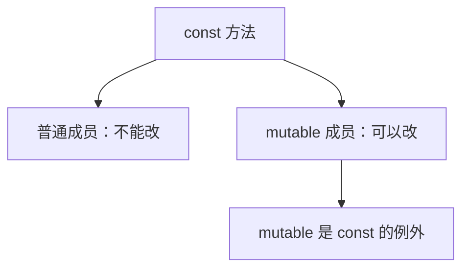
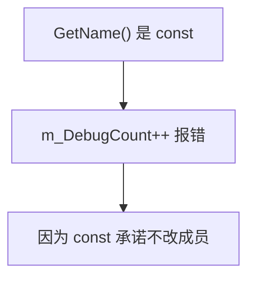
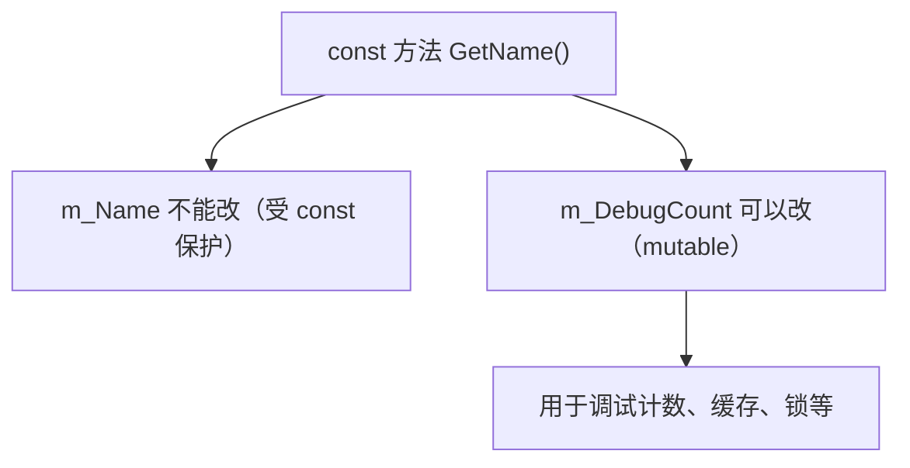
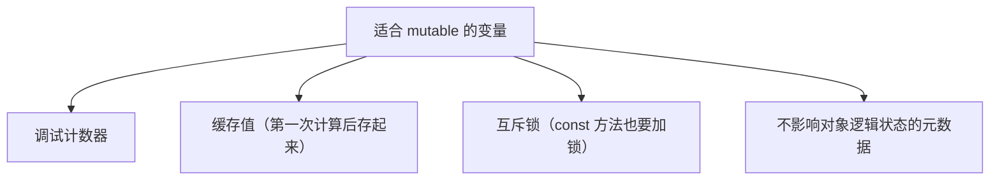
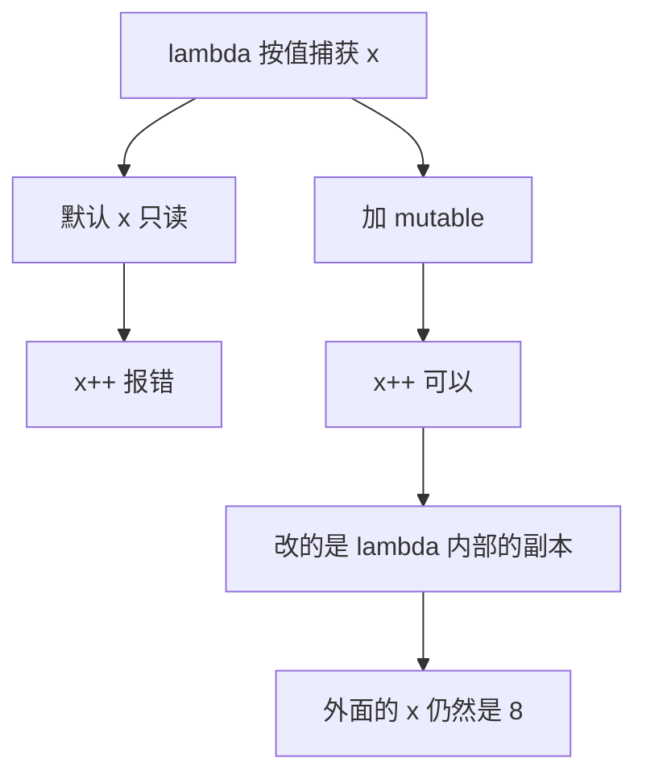

## 本节概述：mutable 是 const 的唯一后门

上一节讲了 const——承诺不修改。但现实中总有例外：某个方法逻辑上是只读的，却确实需要改一下某个不影响对象逻辑状态的变量（比如调试计数器）。这时候 `mutable` 就派上用场了——**它允许 const 方法修改被标记的成员变量，是 const 体系里唯一的合法后门**。



`mutable` 这个词本身的意思就是"可变的"，和 immutable（不可变）相对。它有两个用途：和 const 配合用于类成员，以及用于 lambda。前者占 90% 以上的使用场景。

## 问题：const 方法想改个计数器

假设有一个 Entity 类，带一个返回名字的 getter：

```cpp
class Entity
{
private:
    std::string m_Name;
public:
    const std::string& GetName() const
    {
        return m_Name;
    }
};
```

`GetName()` 加了 const，因为它确实只读不改。现在想加个调试功能——统计这个函数被调用了多少次：

```cpp
class Entity
{
private:
    std::string m_Name;
    int m_DebugCount = 0;
public:
    const std::string& GetName() const
    {
        m_DebugCount++;     // 编译错误！const 方法不能改成员
        return m_Name;
    }
};
```



怎么解决？去掉 const？不行——去掉之后 const 对象就调不了这个 getter 了。把计数器搬到类外面？太乱。正确答案：**把 `m_DebugCount` 标记为 `mutable`**。

## mutable 成员变量

```cpp
class Entity
{
private:
    std::string m_Name;
    mutable int m_DebugCount = 0;   // mutable：const 方法也能改
public:
    const std::string& GetName() const
    {
        m_DebugCount++;             // 现在合法了
        return m_Name;
    }
};
```

`mutable` 的意思就是："这个成员即使在 const 方法里也允许修改。" 它专门用于那些**不影响对象逻辑状态**的变量——调试计数器、缓存标记、互斥锁等。`m_Name` 仍然受 const 保护，不能改。



> [!TIP]
> mutable 只能用于类的成员变量，不能用于局部变量或函数参数。

## 什么时候该用 mutable

mutable 的适用场景很明确：**变量需要被 const 方法修改，但修改它不改变对象的逻辑状态**。



如果一个变量的修改会改变对象对外表现的状态，那就不该用 mutable，而该把方法的 const 去掉。mutable 是给"技术上需要改、逻辑上不算改"的变量准备的。

## mutable 的第二个用途：lambda

`mutable` 还能用在 lambda 上。先简单说下 lambda——就是一个可以赋给变量的匿名小函数：

```cpp
int x = 8;
auto f = [x]() { std::cout << x << std::endl; };   // lambda，按值捕获 x
f();
```

`[x]` 表示把 `x` 按值捕获进 lambda。按值捕获的变量在 lambda 里默认是只读的，想修改会报错：

```cpp
auto f = [x]() { x++; std::cout << x << std::endl; };   // 编译错误
```

加 `mutable` 就能改了：

```cpp
auto f = [x]() mutable { x++; std::cout << x << std::endl; };   // 可以改了
f();                       // 输出 9
std::cout << x << std::endl;   // 还是 8，外面的 x 没变
```



注意：mutable lambda 改的是**捕获进来的副本**，不影响外面的原始变量。想改外面的变量，得按引用捕获 `[&x]`。

> [!TIP]
> 实际上 mutable lambda 在真实代码里极其少见，绝大多数人一辈子也不会写一次。mutable 关键字 90% 以上的使用场景都是和类成员 + const 配合。

## 完整示例代码

```cpp
#include <iostream>
#include <string>

class Entity
{
private:
    std::string m_Name;
    mutable int m_DebugCount = 0;   // const 方法也能修改
public:
    Entity(const std::string& name)
        : m_Name(name) {}

    const std::string& GetName() const
    {
        m_DebugCount++;             // 合法：m_DebugCount 是 mutable
        return m_Name;
    }

    int GetDebugCount() const { return m_DebugCount; }
};

int main()
{
    const Entity e("Cherno");       // const 对象
    std::cout << e.GetName() << std::endl;   // 调用 const 方法
    std::cout << e.GetName() << std::endl;
    std::cout << e.GetDebugCount() << std::endl;   // 2

    int x = 8;
    auto f = [x]() mutable { x++; std::cout << x << std::endl; };
    f();                         // 9
    std::cout << x << std::endl; // 8，外面的 x 没变

    std::cin.get();
}
```

## 本章小结

**mutable 的核心作用**：允许 const 方法修改被标记的成员变量，是 const 体系唯一的合法后门。

**主要用途**：标记类成员变量，让 const 方法可以修改它。适用于调试计数器、缓存值、互斥锁等不影响对象逻辑状态的变量。

**不能滥用**：如果变量修改会改变对象对外表现的状态，就不该用 mutable，而应该去掉方法的 const。

**lambda 用途**：lambda 按值捕获的变量默认只读，加 `mutable` 后可以修改，但改的是副本，不影响外部原变量。这个用法在实际代码中极为罕见。

**使用频率**：90% 以上的 mutable 用法都是类成员 + const 场景，lambda mutable 几乎见不到。
