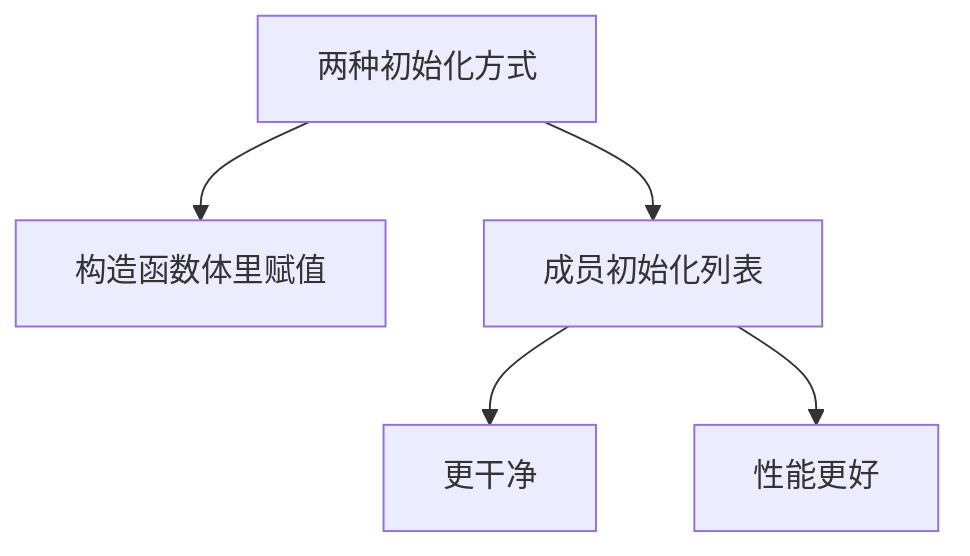
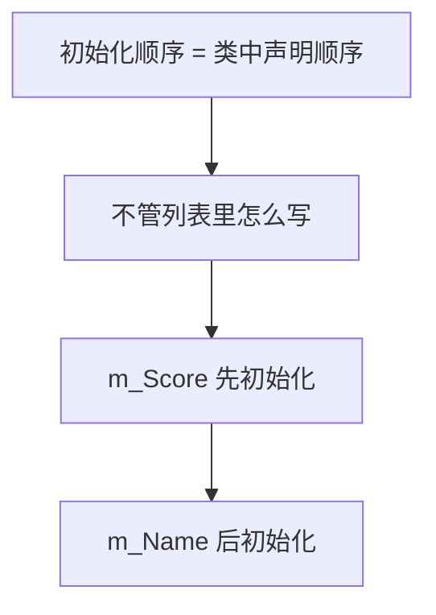
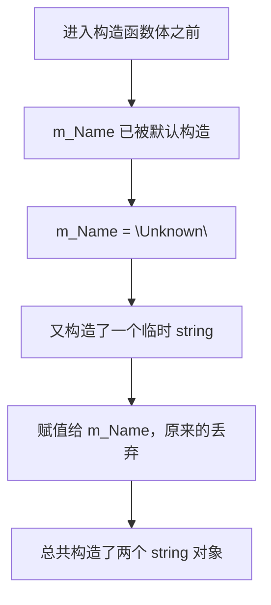
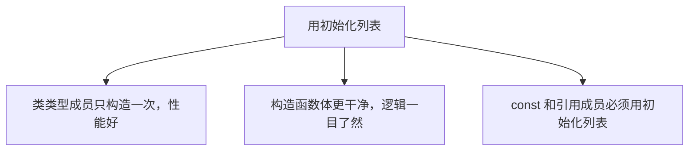

## 本节概述：初始化列表让成员"一次成型"，不浪费

写构造函数时，有两种方式给成员赋值。第一种是最常见的——在构造函数体里用等号赋值：

```cpp
class Entity
{
private:
    std::string m_Name;
public:
    Entity()
    {
        m_Name = "Unknown";        // 构造函数体里赋值
    }
};
```

第二种叫**成员初始化列表（member initializer list）**，在构造函数参数列表后面加个冒号，直接列出要初始化的成员：

```cpp
class Entity
{
private:
    std::string m_Name;
public:
    Entity()
        : m_Name("Unknown")        // 初始化列表
    {
    }
};
```

两种写法结果一样，但初始化列表不只是风格问题——它有实实在在的性能优势。



## 初始化列表的语法

冒号后面列出成员，用括号传值，多个成员用逗号分隔：

```cpp
Entity(const std::string& name)
    : m_Name(name)
{
}
```

如果有多个成员：

```cpp
class Entity
{
private:
    std::string m_Name;
    int m_Score;
public:
    Entity(const std::string& name)
        : m_Name(name), m_Score(0)   // 多个成员用逗号
    {
    }
};
```


就是把 `m_Name = name` 的等号换成括号，挪到冒号后面。语法很简单。

## 初始化顺序：听类声明的，不听列表的

初始化列表里成员的**书写顺序不重要**，真正的初始化顺序由它们**在类中声明的顺序**决定：

```cpp
class Entity
{
private:
    int m_Score;          // 声明在前
    std::string m_Name;   // 声明在后
public:
    Entity()
        : m_Name("Unknown"), m_Score(0)   // 列表顺序反着写
    {
    }
};
```

上面的列表里 `m_Name` 写在前面，但实际初始化时**先初始化 `m_Score`，再初始化 `m_Name`**——因为类声明里 `m_Score` 在前面。



有些编译器在列表顺序和声明顺序不一致时会发出警告。如果成员之间有依赖关系（比如一个成员的初始化值依赖另一个成员），顺序错了会出 bug。所以**养成习惯：按声明顺序写初始化列表**。

## 关键区别：类类型成员会被构造两次

这是初始化列表最重要的优势。在构造函数体里赋值，对于类类型成员（比如 `std::string`），实际上发生了两次构造：

```cpp
Entity()
{
    m_Name = "Unknown";   // 看似一行，实则两次构造
}
```

过程是这样的：



先调用 `std::string` 的默认构造函数创建一个空字符串，然后再构造一个 `"Unknown"` 临时对象赋值过去，第一个白造了。

用初始化列表就不一样了：

```cpp
Entity()
    : m_Name("Unknown")
{
}
```

直接用 `"Unknown"` 构造 `m_Name`，**只构造一次**，没有浪费。

```mermaid
flowchart TB
    A["初始化列表 m_Name(\"Unknown\")"] --> B["直接用 Unknown 构造 m_Name"]
    B --> C["只构造一次"]
    C --> D["没有中间临时对象"]
```

来做个实验验证。造一个打印构造信息的类：

```cpp
class Example
{
public:
    Example() { std::cout << "Created Example" << std::endl; }
    Example(int x) { std::cout << "Created Example with " << x << std::endl; }
};

class Entity
{
private:
    Example m_Example;
public:
    Entity()
    {
        m_Example = Example(8);   // 赋值方式
    }
};
```

运行输出：

```
Created Example
Created Example with 8
```

打印了两行——`m_Example` 被构造了两次。改成初始化列表：

```cpp
Entity()
    : m_Example(8)
{
}
```

运行输出：

```
Created Example with 8
```

只构造一次。这就是性能差异的来源。

> [!TIP]
> 对于 `int`、`float` 等基本类型，赋值方式不会有"双重构造"的问题（基本类型没有默认构造函数），但统一用初始化列表更一致、更规范。

## 为什么应该到处用初始化列表



还有一个硬性理由：**const 成员和引用成员只能用初始化列表**，不能在构造函数体里赋值。因为它们一旦创建就不能被重新赋值，必须在创建时就确定值：

```cpp
class Entity
{
private:
    const int m_Id;
    int& m_Ref;
public:
    Entity(int id, int& ref)
        : m_Id(id), m_Ref(ref)   // 必须用初始化列表
    {
    }
};
```

## 完整示例代码

```cpp
#include <iostream>
#include <string>

class Example
{
public:
    Example() { std::cout << "Created Example" << std::endl; }
    Example(int x) { std::cout << "Created Example with " << x << std::endl; }
};

class Entity
{
private:
    std::string m_Name;
    int m_Score;
    Example m_Example;
public:
    Entity()
        : m_Name("Unknown"), m_Score(0), m_Example(8)
    {
    }

    Entity(const std::string& name)
        : m_Name(name), m_Score(0), m_Example(8)
    {
    }

    const std::string& GetName() const { return m_Name; }
};

int main()
{
    Entity e1;
    std::cout << e1.GetName() << std::endl;

    Entity e2("Cherno");
    std::cout << e2.GetName() << std::endl;

    std::cin.get();
}
```

## 本章小结

**两种方式**：构造函数体里赋值 `m_Name = "Unknown"`，或成员初始化列表 `: m_Name("Unknown")`。

**语法**：构造函数参数列表后加冒号，成员名加括号传值，多个用逗号分隔。

**初始化顺序**：按成员在类中声明的顺序初始化，与初始化列表中的书写顺序无关。列表顺序最好和声明顺序一致。

**性能差异**：对类类型成员，赋值方式会先默认构造、再赋值，构造两次；初始化列表直接构造一次，省掉一次无用构造。基本类型无此问题，但统一用列表更规范。

**硬性要求**：const 成员和引用成员必须用初始化列表，不能在构造函数体里赋值。

**建议**：到处用成员初始化列表，不只是风格，更有性能和正确性的实际收益。
