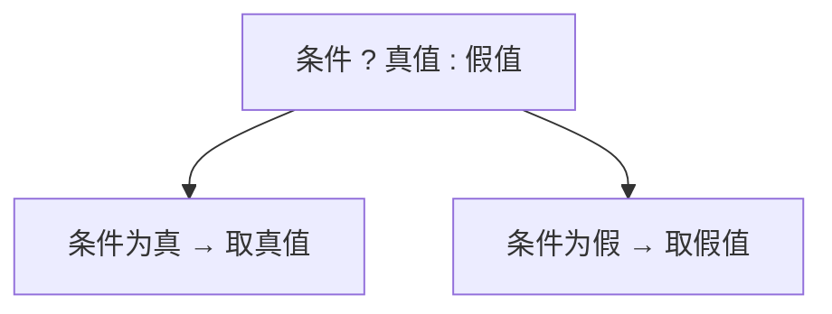
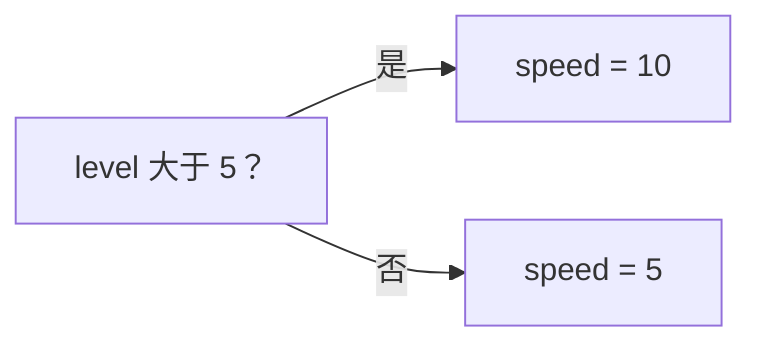
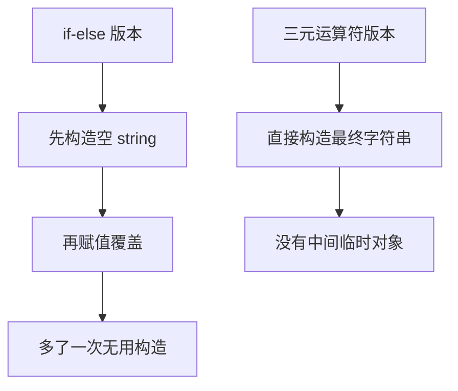
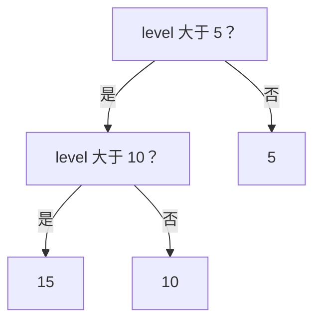

## 本节概述：三元运算符就是 if-else 的一行版

第一次在代码里看到问号 `?` 和冒号 `:` 组合，很多人会懵——"这是什么鬼符号？"其实它很简单，就是 **if-else 的语法糖**，专门用来根据条件给变量赋值。它叫**三元运算符（ternary operator）**，因为它需要三个操作数：条件、真值、假值。



## 基本用法

假设要根据等级设置速度——等级大于 5 速度为 10，否则为 5。用 if-else 写要四行：

```cpp
int speed;
if (level > 5)
    speed = 10;
else
    speed = 5;
```

用三元运算符一行搞定：

```cpp
int speed = level > 5 ? 10 : 5;
```



结构就是：`条件 ? 条件为真时的值 : 条件为假时的值`。

## 字符串场景：还能省一次构造

三元运算符不只是少写几行，对类类型还有性能好处。比如根据等级设置头衔：

```cpp
std::string rank = level > 10 ? "Master" : "Beginner";
```

如果用 if-else 写：

```cpp
std::string rank;                    // 先默认构造一个空字符串
if (level > 10)
    rank = "Master";                 // 再赋值覆盖
else
    rank = "Beginner";
```



if-else 版本会先构造一个空 string，再用新值覆盖，白造了一个。三元运算符直接用最终值构造，更高效（背后是返回值优化 RVO，后面会讲）。

## 嵌套三元运算符：能不用就别用

技术上可以嵌套，但代码会变难看。比如三级速度：

```cpp
int speed = level > 5 ? (level > 10 ? 15 : 10) : 5;
```



逻辑是对的，但这行代码读起来很费劲。Cherno 自己的说法是：**几乎从不嵌套三元运算符**。简单的条件赋值用它很爽，一嵌套就得不偿失了，不如老老实实写 if-else 或用查找表。

> [!WARNING]
> 三元运算符嵌套虽然合法，但可读性极差。除非条件非常简单，否则别嵌套。

## 优先级注意

三元运算符的优先级很低，比逻辑运算符 `&&`、`||` 还低。所以条件里的逻辑运算会先算，再整体作为三元的条件：

```cpp
int speed = (level > 5 && level < 100) ? 10 : 5;
```

即使不写括号，`level > 5 && level < 100` 也会作为一个整体先求值，然后再走三元。不过为了清楚，加上括号更保险。

## 完整示例代码

```cpp
#include <iostream>
#include <string>

int main()
{
    int level = 8;

    // 简单条件赋值
    int speed = level > 5 ? 10 : 5;
    std::cout << "speed: " << speed << std::endl;   // 10

    // 字符串场景，避免空构造
    std::string rank = level > 10 ? "Master" : "Beginner";
    std::cout << "rank: " << rank << std::endl;     // Beginner

    // 嵌套三元（不推荐但能跑）
    int speed2 = level > 5 ? (level > 10 ? 15 : 10) : 5;
    std::cout << "speed2: " << speed2 << std::endl; // 10

    // 带逻辑运算的条件
    int speed3 = (level > 5 && level < 100) ? 10 : 5;
    std::cout << "speed3: " << speed3 << std::endl; // 10

    std::cin.get();
}
```

## 本章小结

**本质**：三元运算符 `条件 ? 真值 : 假值` 是 if-else 的语法糖，专门用于条件赋值。

**优势**：把四行 if-else 压缩成一行，意图更清晰——"给变量赋一个取决于条件的值"。

**性能好处**：对类类型（如 `std::string`），三元运算符直接用最终值构造，不产生中间临时对象，比 if-else 先构造再赋值更高效。

**嵌套**：技术上可以嵌套三元运算符，但可读性极差，几乎从不推荐。复杂逻辑用 if-else 或查找表。

**优先级**：三元运算符优先级低于逻辑运算符，条件里的 `&&`、`||` 会先整体求值。建议加括号增强可读性。
