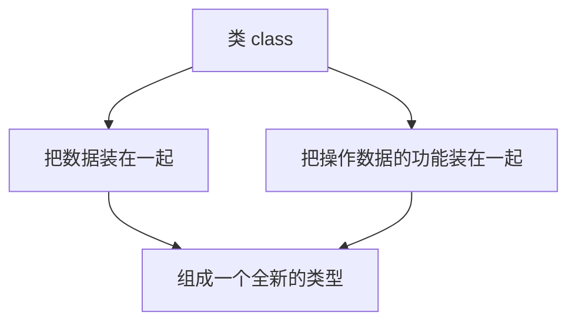
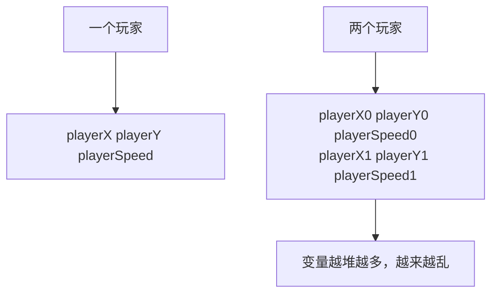
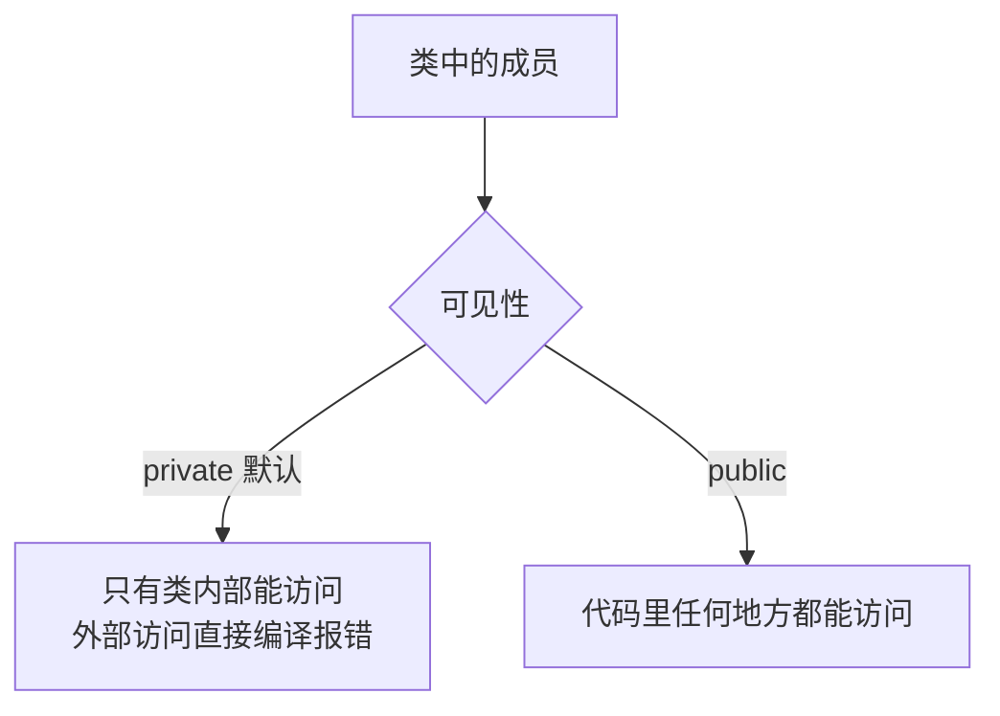
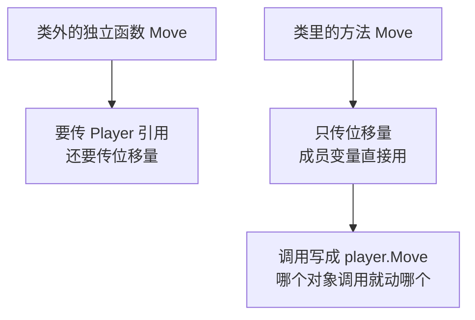
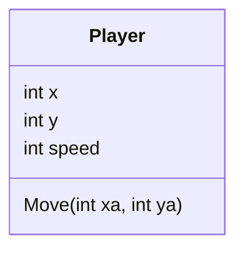
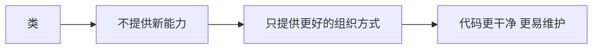

## 本节概述：类就是把数据和功能打包成一个新类型

从这节开始进入**面向对象编程（OOP）**的世界。面向对象只是一种写代码的风格，C# 和 Java 这类语言基本上强制你用这种风格，而 C++ 不一样——**它不强迫你**，想用就用。C 语言本身不支持面向对象，因为它没有类和对象这些概念，C++ 则把这一套功能加了进来，而且绝大多数时候用它都是值得的。

一句话说清楚类是什么：**类就是把数据和功能组织在一起的一种方式**。



## 不用类会有多乱

假设要做一个游戏，游戏里得有个**玩家**。表示一个玩家需要哪些东西？位置（x、y 坐标）、移动速度，可能还有显示在屏幕上的模型。先不用类，直接用变量写：

```cpp
int main()
{
    int playerX = 0;       // 玩家 x 坐标
    int playerY = 0;       // 玩家 y 坐标
    int playerSpeed = 2;   // 玩家移动速度
}
```

问题马上就来：变量名取得越来越长，而且如果游戏里要**两个玩家**呢？那就得复制一遍，变成 `playerX0`、`playerX1` 这样往下堆。就算用数组，本质也一样——**一堆没有组织起来的变量散落在代码里**。



更烦的是写函数。想写一个"移动玩家"的函数，参数得把 x、y、速度一个个全传进去，代码又多又难维护。

## 定义一个类：把变量收进一个类型

用类来收拾这个烂摊子。用关键字 `class` 加一个**独一无二的名字**（因为类就是类型，等于在创造一种新的变量类型），然后一对花括号，**注意花括号结尾要加分号**——这一点和函数不一样：

```cpp
class Player
{
public:
    int x, y;      // 位置
    int speed;     // 速度
};
```


`Player` 现在是一个**全新的类型**，可以像用 `int` 一样用它：

```cpp
int main()
{
    Player player;         // 用 Player 类型创建变量
}
```

这里有几个术语要分清：用类类型造出来的变量叫**对象（object）**，新造出来的对象叫这个类的一个**实例（instance）**，这个动作叫**实例化（instantiate）**。上面这行代码就是实例化了一个 `Player` 对象。


## 可见性：默认 private

想给成员的 `x` 赋值，用点号就行：

```cpp
player.x = 5;
```

但这时候编译会报错：**无法访问 Player 类中声明的私有成员**。原因是**可见性（visibility）**——类里的东西默认是 **private（私有）** 的，意思是**只有类内部的函数才能碰这些变量**。想从 `main` 函数这种外部地方访问，就得把它们标成 **public（公有）**：



> [!TIP]
> 可见性还有更细的内容，先记住这两条够用：不写就默认 private，想开放就写 public。

改成 public 之后，代码顺利编译通过。第一个目标达成：**所有和玩家相关的变量收进了一个类型里**，代码干净多了。

## 把函数写进类里：方法

数据组织好了，接下来让玩家**动起来**——写一个修改 x、y 的函数。先按老办法，在类外面写一个独立函数。因为要真正改到那个玩家对象，所以**按引用传参**：

```cpp
void Move(Player& player, int xa, int ya)
{
    player.x += xa * player.speed;   // 位移量乘以速度
    player.y += ya * player.speed;
}
```

调用时要把玩家对象和位移量都传进去：

```cpp
Move(player, 1, -1);
```

这样能工作，但可以更好。既然类能装功能，就把 `Move` **挪进类里面**——类里面的函数有个专门的名字，叫**方法（method）**：

```cpp
class Player
{
public:
    int x, y;
    int speed;

    void Move(int xa, int ya)    // 类里的函数叫方法
    {
        x += xa * speed;         // 直接用当前对象的成员
        y += ya * speed;
    }
};
```

注意两个变化：一是**不用再传 Player 参数**了，因为代码已经身在某个玩家对象内部，`x`、`y`、`speed` 指的就是**当前这个对象自己的**成员；二是调用方式变成了点号调用：

```cpp
player.Move(1, -1);    // 移动的就是 player 这个对象
```



功能上两种写法**没有区别**，但挪进类里之后代码更清爽。代码量越大、项目越复杂，这种整洁带来的可维护性就越值钱。



## 类的本质：语法糖

最后要记住一个重要事实：**类没有带来任何"做不到就变得到"的新功能**。用类能做的事，不用类也都能做——C 语言没有类，照样是门完全可用的语言。类存在的意义是**让程序员的日子好过一点**，本质上就是一种**语法糖（syntactic sugar）**，用来组织代码、让代码更容易维护，仅此而已。



## 完整示例代码

```cpp
#include <iostream>

class Player
{
public:
    int x, y;          // 位置
    int speed;         // 速度

    void Move(int xa, int ya)    // 方法：移动玩家
    {
        x += xa * speed;
        y += ya * speed;
    }
};

int main()
{
    Player player;               // 实例化一个 Player 对象

    player.x = 0;                // 通过点号访问成员变量
    player.y = 0;
    player.speed = 2;

    player.Move(1, -1);          // 哪个对象调用就动哪个

    std::cout << player.x << " " << player.y << std::endl;   // 2 -2

    std::cin.get();
}
```

## 本章小结

**类的定义**：把数据和操作数据的功能打包在一起的方式，用 `class` 加类名声明，花括号结尾必须加分号。

**类就是新类型**：定义一个类等于创造一种新的变量类型。用类类型造出的变量叫对象，新造的对象叫实例，这个动作叫实例化。

**默认私有**：类成员默认是 private，只有类内部能访问，外部访问直接编译报错；标成 public 之后才能在 `main` 等外部代码中通过点号访问。

**方法是类里的函数**：把操作成员的函数挪进类里就叫方法。方法不用再传对象参数，直接操作当前对象的成员，调用写成 `player.Move(1, -1)`，哪个对象调用就作用于哪个对象。

**类是语法糖**：类不提供任何新能力，用它能做的事不用它也能做。它的价值在于组织代码，让代码更干净、更易维护。
