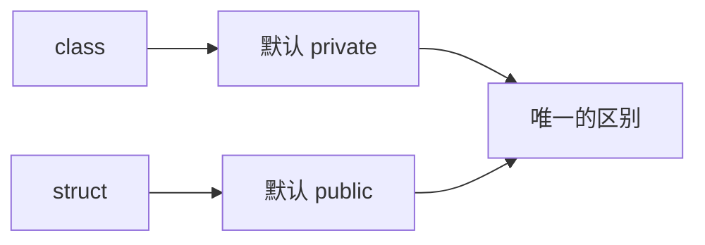
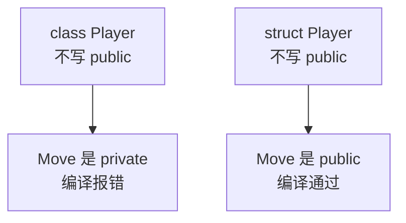
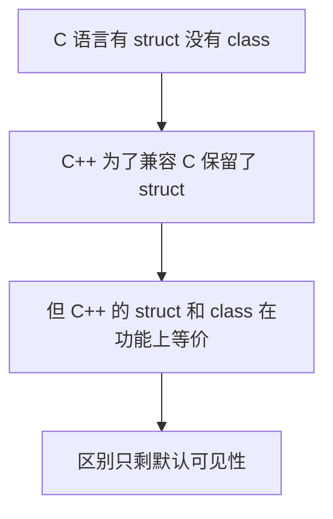
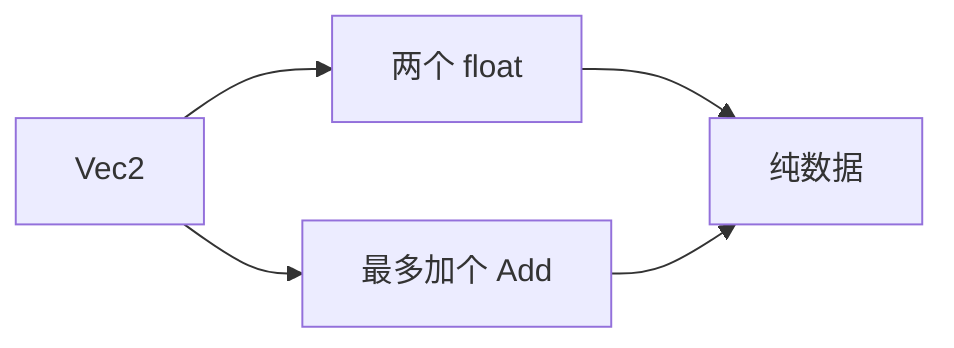
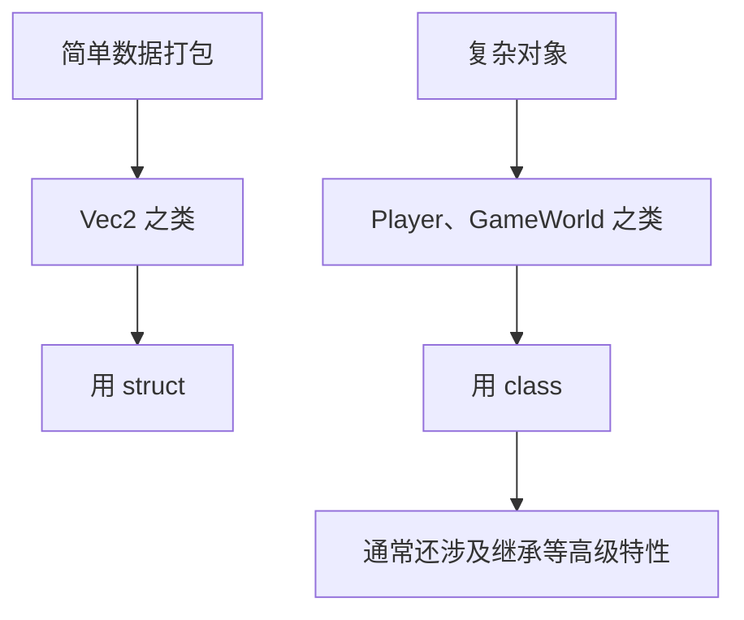
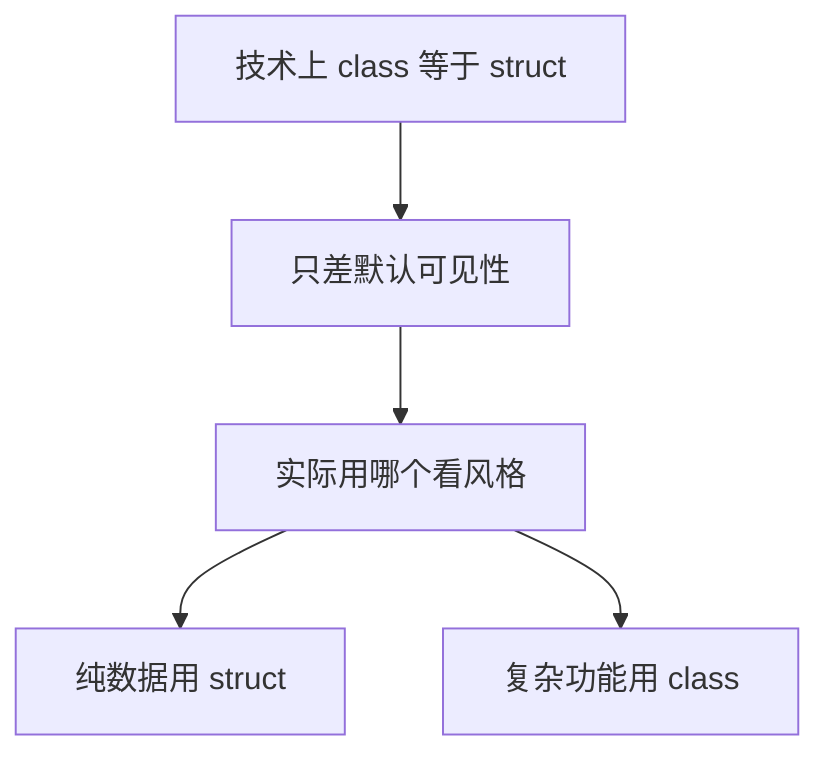

## 本节概述：class 和 struct 只差一个默认可见性

上一节讲了类的基本概念，这节回答一个很多人困惑的问题：**class 和 struct 到底有什么区别？**

答案简单到难以置信：**技术上几乎没有区别，唯一不同的是默认可见性**。class 的成员默认 private，struct 的成员默认 public，仅此而已。



## 唯一的区别：默认可见性

回忆上一节的 Player 类，如果不写 `public`，直接实例化后调用 `player.Move(1, -1)` 会编译报错，因为 class 的所有成员**默认是私有**的：

```cpp
class Player
{
    int x, y;          // 默认 private
    int speed;

    void Move(int xa, int ya)  // 默认 private，外部无法调用
    {
        x += xa * speed;
        y += ya * speed;
    }
};
```

现在把 `class` 换成 `struct`，其他一字不改：

```cpp
struct Player
{
    int x, y;          // 默认 public
    int speed;

    void Move(int xa, int ya)  // 默认 public，外部直接调用
    {
        x += xa * speed;
        y += ya * speed;
    }
};
```

代码直接编译通过，正常执行。**仅仅是换了一个关键字，报错就消失了。**



反过来，如果想让 struct 里的某个成员私有，**显式写 `private`** 就行，效果和 class 一模一样：

```cpp
struct Player
{
private:
    int x, y;          // 显式标为私有
public:
    void Move(int xa, int ya) { x += xa; y += ya; }
};
```


## struct 为什么存在：兼容 C 语言

既然 class 和 struct 几乎一样，struct 存在的意义是什么？答案是**向后兼容 C 语言**。C 没有类，但有结构体。C++ 想保持和 C 代码的兼容性，如果把 struct 关键字删掉，所有用 struct 写的 C 代码就全废了。

理论上甚至可以用宏强行"统一"：

```cpp
#define struct class
```

这样预处理器会把代码里所有 `struct` 替换成 `class`，struct 的默认 public 也就变成了 class 的默认 private，编译器照样报错。当然这只是个思想实验，实际项目里**千万别这么干**。



## 什么时候用 struct，什么时候用 class

既然技术上没区别，那实际开发里怎么选？这完全取决于**编程风格**，没有标准答案。作者本人的风格也是业界很多人的习惯：**struct 只用来装纯数据，class 用来装数据和操作数据的功能**。

### struct：纯数据的打包

比如要表示一个二维向量 `Vec2`，本质上就是**两个 float 捆在一起**：

```cpp
struct Vec2
{
    float x, y;    // 就两个变量，没别的

    void Add(const Vec2& other)    // 最多加个简单操作
    {
        x += other.x;
        y += other.y;
    }
};
```

这个 `Vec2` 的核心就是那两个 `float`，加不加 `Add` 方法都不改变这个本质。它只是**让代码更好用一点**，不代表什么复杂的对象。



### class：数据和功能的组合体

再看 `Player` 类，它要处理 3D 模型、渲染代码、键盘输入、地图移动……**功能一大堆**，早就不是"几个变量捆在一起"了。这种复杂实体就该用 class：

```cpp
class Player
{
public:
    void Move(int xa, int ya);
    void Render();
    void HandleInput();
    // ……一大堆功能
private:
    int x, y;
    int speed;
    Model m_Model;    // 3D 模型
};
```



### 继承：struct 的禁区

作者**绝不会**给 struct 用继承。一旦要搞类层级、继承体系，就必须用 class。如果搞混了，比如 `class A` 然后 `struct B : A`，某些编译器会给出警告，提醒你一个 struct 继承了 class。虽然代码通常还能跑，但语义上已经很别扭了。


## 对比表

| 对比项 | class | struct |
| --- | --- | --- |
| 默认可见性 | private | public |
| 能否写 public/private | 可以 | 可以 |
| 能否有方法 | 可以 | 可以 |
| 能否继承 | 可以 | 可以但风格上不推荐 |
| 典型用途 | 复杂对象、功能丰富 | 纯数据打包 |
| 存在原因 | C++ 核心特性 | 兼容 C 语言 |



## 本章小结

**技术上几乎没区别**：class 和 struct 在功能上完全等价，唯一的不同是默认可见性——class 默认 private，struct 默认 public。

**struct 存在的原因**：为了兼容 C 语言。C 有 struct 没有 class，C++ 保留 struct 是为了让 C 代码能直接在 C++ 里编译。

**风格上的分工**：业界常见习惯是 struct 只装纯数据（POD），比如 Vec2 这种就是几个变量捆在一起；class 用来装数据和操作数据的功能，比如 Player 这种有渲染、输入、移动的复杂对象。

**继承不用 struct**：一旦涉及类层级和继承，用 class。struct 继承 class 会让编译器发出警告，虽然能跑但语义混乱。

**选哪个不重要**：技术上用哪个都行，关键是团队统一风格，别混着用让别人猜你的意图。
