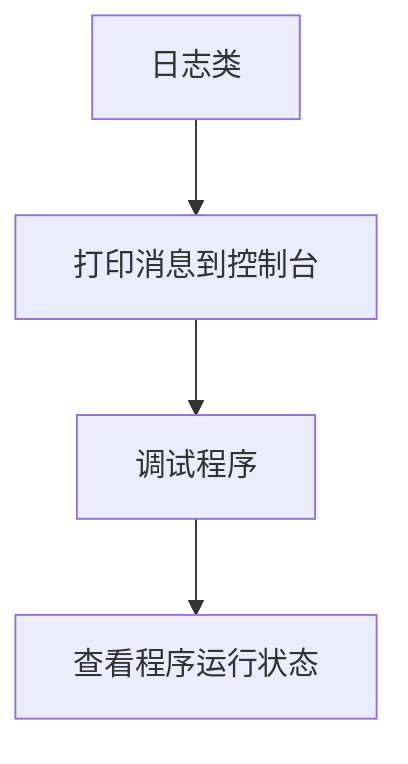
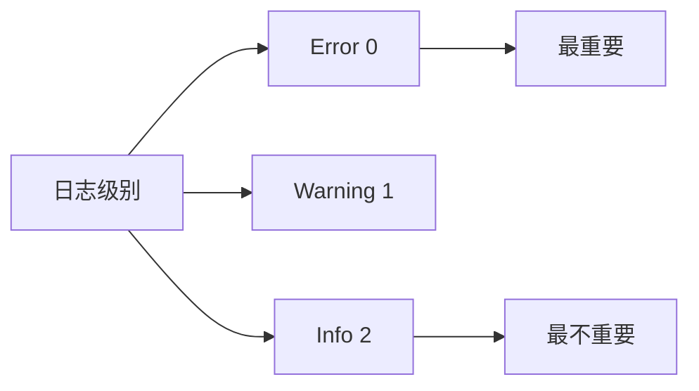
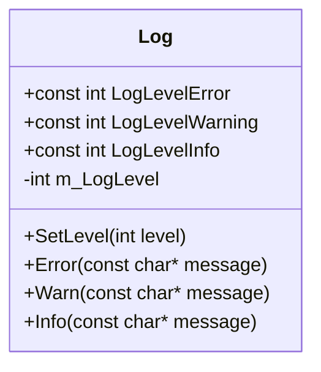
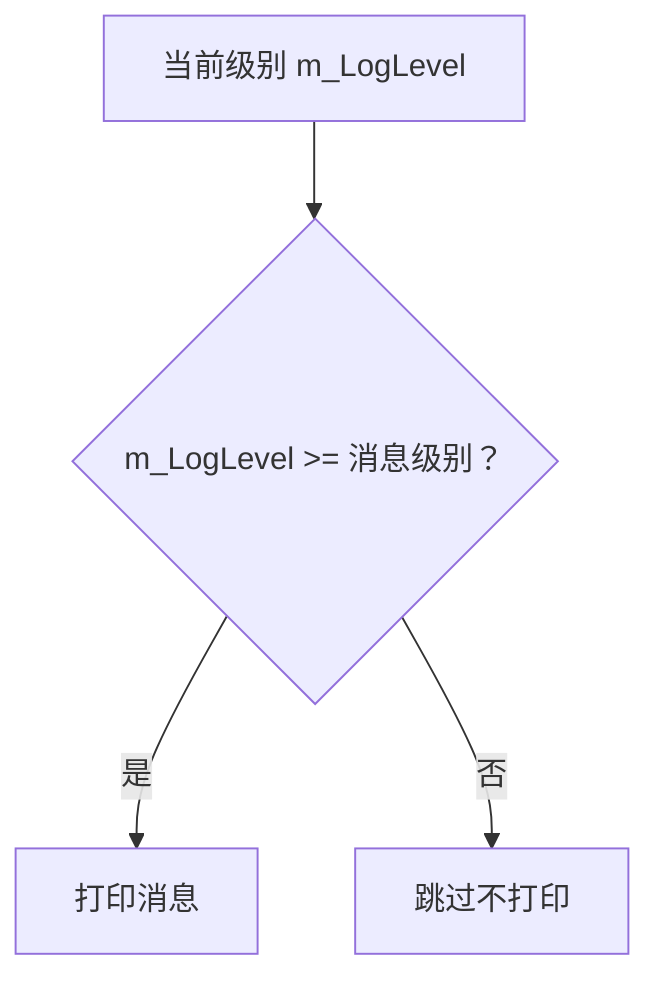
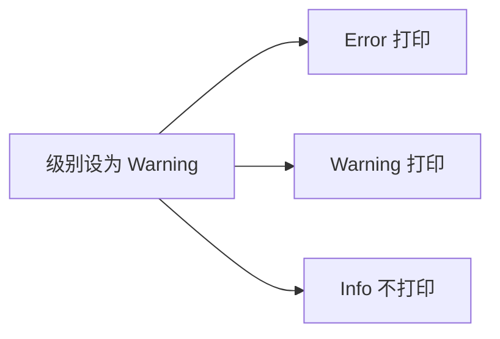

## 本节概述：从零写一个日志类

前面学了类的基本概念，这节来实战——**从零开始写一个 Log 日志类**。不会写得很复杂，但会把目前学过的类特性都用上：可见性、成员变量、成员函数、常量。

日志类是管理日志消息的工具，程序运行时的各种信息通过它打印到控制台，通常用于**调试**。控制台几乎是操作系统自带的，基本不会出问题，比游戏里的图形界面可靠得多。日志系统可以简单到十行代码，也可以复杂到上万行，是个非常好的练手例子。



## 日志级别：过滤不重要的消息

日志系统核心功能是**级别过滤**。设定一个级别，只有达到这个级别的消息才会打印。设三个级别：

- **Error（错误）**：最严重，必须打印
- **Warning（警告）**：需要注意
- **Info（信息）**：普通跟踪消息

把级别设为 Warning，意味着**警告和错误会打印，但普通信息不会**。这样调试时就不会被一堆 Info 消息刷屏，只看重要的。



## 设计 API：先写使用代码

设计类的最佳方式是**先写怎么用它**。在 `main` 里把理想的使用方式写出来，再回头填实现：

```cpp
int main()
{
    Log log;
    log.SetLevel(Log::LogLevelWarning);
    log.Warn("Hello!");

    std::cin.get();
}
```

从这段代码能看出来：需要一个 `SetLevel` 函数，需要 `LogLevelWarning` 这个常量，还需要 `Warn`、`Error`、`Info` 这些打印函数。现在回去把这些实现补上。

## 类的骨架

```cpp
class Log
{
public:
    const int LogLevelError = 0;
    const int LogLevelWarning = 1;
    const int LogLevelInfo = 2;

private:
    int m_LogLevel = LogLevelInfo;   // 默认级别：Info

public:
    void SetLevel(int level)
    {
        m_LogLevel = level;
    }

    void Error(const char* message)
    {
        if (m_LogLevel >= LogLevelError)
            std::cout << "[ERROR]: " << message << std::endl;
    }

    void Warn(const char* message)
    {
        if (m_LogLevel >= LogLevelWarning)
            std::cout << "[WARNING]: " << message << std::endl;
    }

    void Info(const char* message)
    {
        if (m_LogLevel >= LogLevelInfo)
            std::cout << "[INFO]: " << message << std::endl;
    }
};
```



## 几个设计细节

### 为什么用 const int 而不是枚举

这里为了简单直接用 `const int`。`LogLevelError = 0`、`LogLevelWarning = 1`、`LogLevelInfo = 2`，数字越小级别越高。用常量名代替魔法数字，代码可读性天差地别——没人能一眼看出 `1` 是什么意思，但 `LogLevelWarning` 一看就懂。

### m_ 前缀约定

成员变量 `m_LogLevel` 前面的 `m_` 是**成员变量命名约定**，一眼看出这是类的私有成员，不是局部变量。大项目里这种约定救命的，强烈建议养成习惯。

### 级别过滤的逻辑

每个打印函数里就一个 `if`：

```cpp
if (m_LogLevel >= LogLevelWarning)
    std::cout << "[WARNING]: " << message << std::endl;
```

当前级别设为 Warning（值 1），调用 `Info`（级别 2），`1 >= 2` 为 false，不打印。调用 `Error`（级别 0），`1 >= 0` 为 true，打印。逻辑非常直白。



## 测试一下

```cpp
int main()
{
    Log log;
    log.SetLevel(Log::LogLevelWarning);

    log.Error("Hello!");
    log.Warn("Hello!");
    log.Info("Hello!");    // 不会打印

    std::cin.get();
}
```

运行结果：

```
[ERROR]: Hello!
[WARNING]: Hello!
```

`Info` 被过滤掉了，因为级别不够。如果不调用 `SetLevel`，默认是 `LogLevelInfo`，三个都会打印。



## 完整示例代码

```cpp
#include <iostream>

class Log
{
public:
    const int LogLevelError = 0;
    const int LogLevelWarning = 1;
    const int LogLevelInfo = 2;

private:
    int m_LogLevel = LogLevelInfo;   // 默认显示所有消息

public:
    void SetLevel(int level)
    {
        m_LogLevel = level;
    }

    void Error(const char* message)
    {
        if (m_LogLevel >= LogLevelError)
            std::cout << "[ERROR]: " << message << std::endl;
    }

    void Warn(const char* message)
    {
        if (m_LogLevel >= LogLevelWarning)
            std::cout << "[WARNING]: " << message << std::endl;
    }

    void Info(const char* message)
    {
        if (m_LogLevel >= LogLevelInfo)
            std::cout << "[INFO]: " << message << std::endl;
    }
};

int main()
{
    Log log;
    log.SetLevel(Log::LogLevelWarning);

    log.Error("Hello!");
    log.Warn("Hello!");
    log.Info("Hello!");

    std::cin.get();
}
```

## 本章小结

**日志类的核心功能**：把程序运行时的消息打印到控制台，用于调试和追踪程序状态。

**级别过滤**：设定一个级别，只有达到该级别的消息才打印。三个级别 Error、Warning、Info，数字越小越重要。

**设计 API 的方法**：先在 `main` 里写理想的使用代码，再回头实现类。这样设计出来的接口最实用。

**m_ 前缀约定**：私有成员变量加 `m_` 前缀，一眼区分类成员和局部变量，大项目里特别有用。

**const int 代替魔法数字**：`LogLevelWarning` 比 `1` 可读性好得多，别人看代码不用猜。

**这只是一个起点**：这个 Log 类非常简单，后续会逐步引入更多 C++ 特性把它改写成更专业、更健壮的版本。
