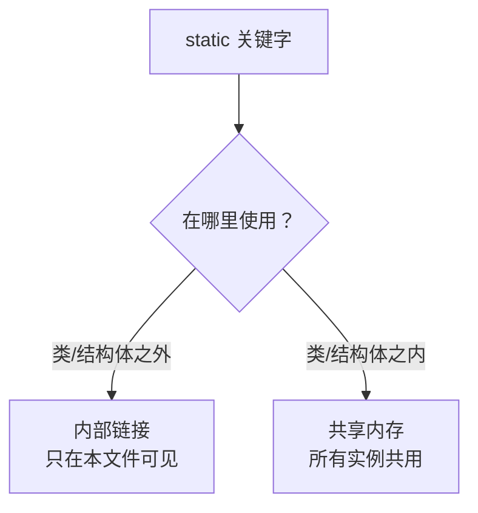
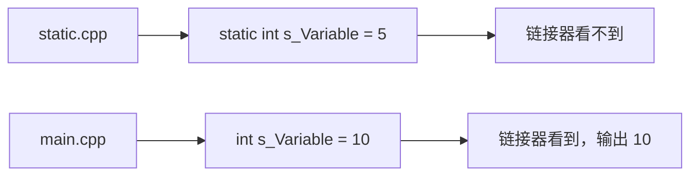
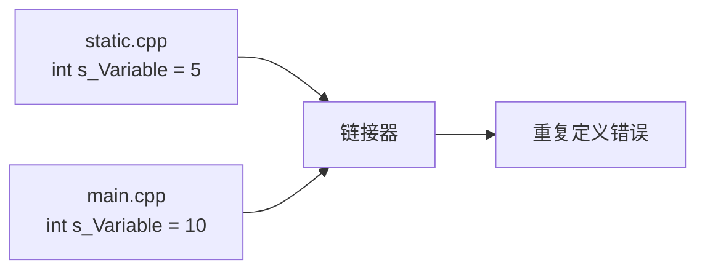
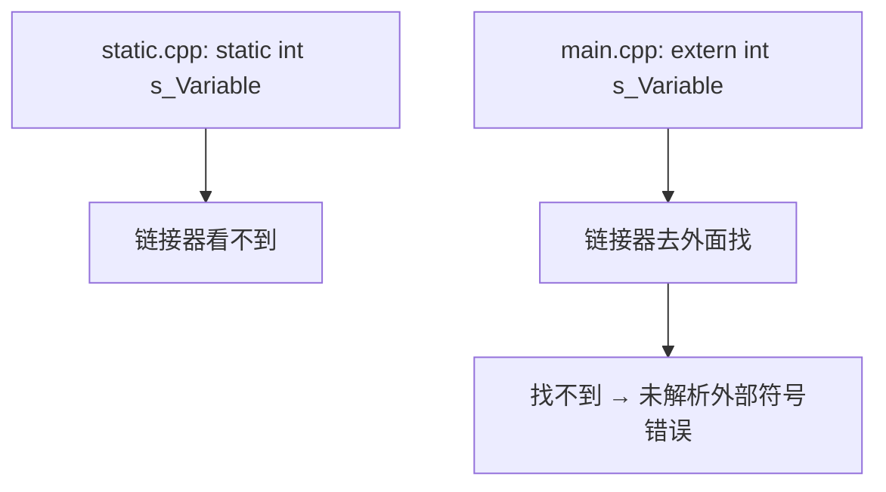
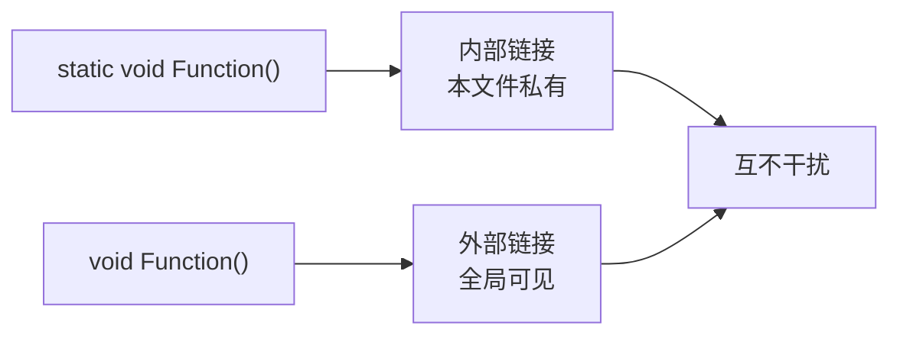
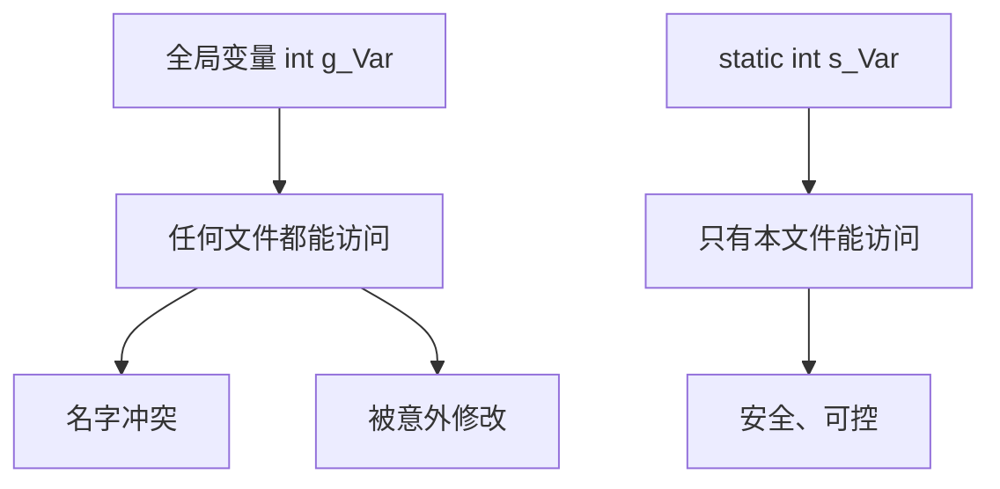
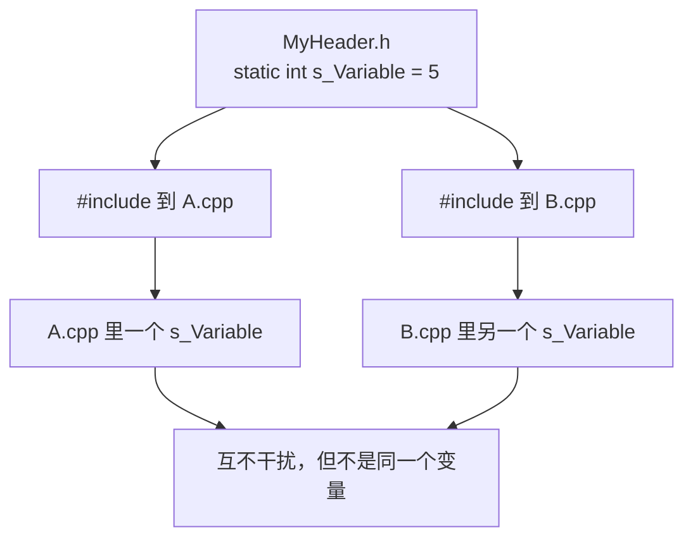

## 本节概述：static 关键字在 C++ 里的两种含义

`static` 在 C++ 中有**两个完全不同的含义**，取决于使用位置：

- **类/结构体之外**：表示**内部链接（internal linkage）**，符号只在当前翻译单元内可见
- **类/结构体之内**：表示该变量**在所有实例之间共享内存**，所有实例共用同一个变量

这节只讲**类/结构体之外**的 static，也就是内部链接。类/结构体之内的 static 会在后续视频单独讲。



## 内部链接：让符号"私有"到当前文件

在全局作用域（任何函数之外）写一个 `static` 变量，它就和当前翻译单元绑死了，**其他文件完全看不到**。

### 场景一：同名全局变量不冲突

`static.cpp` 里：

```cpp
static int s_Variable = 5;   // static：只在本文件可见
```

`main.cpp` 里：

```cpp
int s_Variable = 10;         // 另一个完全独立的全局变量

int main()
{
    std::cout << s_Variable << std::endl;   // 输出 10
}
```

两个文件各有一个 `s_Variable`，**编译链接都正常**，因为 static 那个被"藏"起来了，链接器不会把它暴露出去。



如果把 `static.cpp` 里的 `static` 去掉：

```cpp
int s_Variable = 5;          // 全局变量，外部链接
```

链接阶段直接报错：**重复定义符号**。两个翻译单元各有一个 `s_Variable`，链接器不知道该用哪个。



### 场景二：extern 引用外部变量

`main.cpp` 想引用 `static.cpp` 里的变量，可以用 `extern`：

```cpp
extern int s_Variable;       // 声明：这个变量定义在其他地方

int main()
{
    std::cout << s_Variable << std::endl;
}
```

这时候 `static.cpp` 里的变量**不能是 static**，否则链接器找不到它：



### 函数也一样

static 对函数的作用和变量完全一致：

```cpp
// static.cpp
static void Function()       // 只在本文件可见
{
    // ...
}

// main.cpp
void Function()              // 另一个完全独立的函数
{
    // ...
}
```

两个同名函数，一个 static 一个不是，**编译链接正常**。如果两个都不是 static，链接器报重复符号错误。



## 为什么要用 static：控制可见范围

把 static 想象成类里的 `private`——它让符号只对当前文件"可见"。

全局变量不加 static 就是**完全全局**的，任何文件都能访问。名字一旦冲突就是链接错误，更可怕的是别的文件不小心改了你的全局变量，调试起来会非常痛苦。



> [!TIP]
> 能标 static 就标 static。除非这个变量或函数确实需要被其他翻译单元用到，否则一律加 static。这是控制符号可见范围、减少链接冲突和意外副作用的最佳实践。

## 头文件里的 static 陷阱

如果在头文件里写：

```cpp
// MyHeader.h
static int s_Variable = 5;
```

然后两个 `.cpp` 文件都包含了这个头文件，**等于在两个翻译单元里各创建了一个独立的 static 变量**。预处理器把头文件内容复制粘贴到每个 `.cpp` 里，static 让每个副本都互相独立。



这通常不是你想要的结果。头文件里应该放声明（`extern`），定义放在某个 `.cpp` 里。

## 完整示例代码

```cpp
// static.cpp
static int s_Variable = 5;

static void InternalFunction()
{
    std::cout << "Only visible in static.cpp" << std::endl;
}

// main.cpp
#include <iostream>

int s_Variable = 10;

void InternalFunction()
{
    std::cout << "Only visible in main.cpp" << std::endl;
}

int main()
{
    std::cout << s_Variable << std::endl;           // 输出 10
    InternalFunction();                              // 调用 main.cpp 里的版本

    std::cin.get();
}
```

## 本章小结

**static 在类/结构体之外表示内部链接**：符号只对当前翻译单元可见，链接器不会把它暴露给其他文件。

**解决重复定义**：两个文件可以拥有同名的 static 变量或函数，互不干扰。去掉 static 就会变成全局符号，同名就会冲突。

**extern 是它的反义词**：`extern` 声明一个变量定义在其他翻译单元，要求那个变量不能是 static。

**最佳实践**：全局变量和函数能标 static 就标 static，除非确实需要跨文件访问。这能有效避免命名冲突和意外副作用。

**头文件慎用 static**：头文件里的 static 变量被包含到多个 `.cpp` 里会产生多个独立副本，通常不是你想要的行为。
