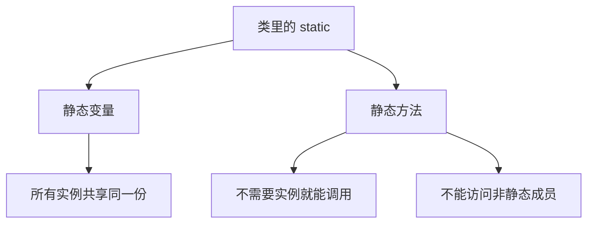
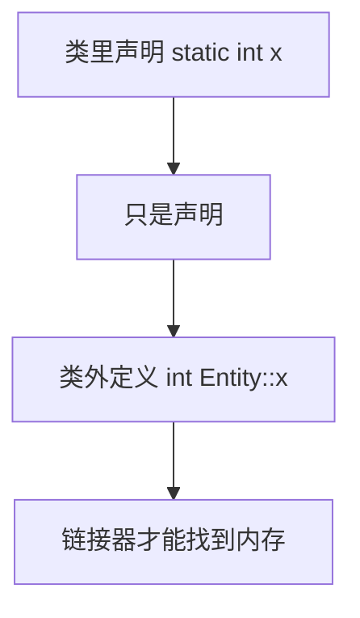
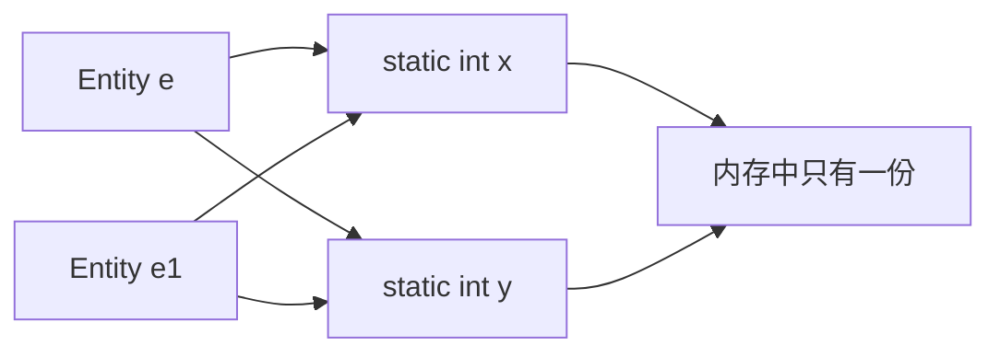
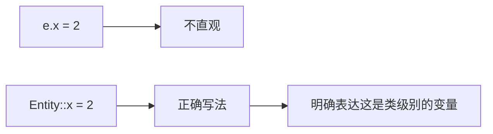
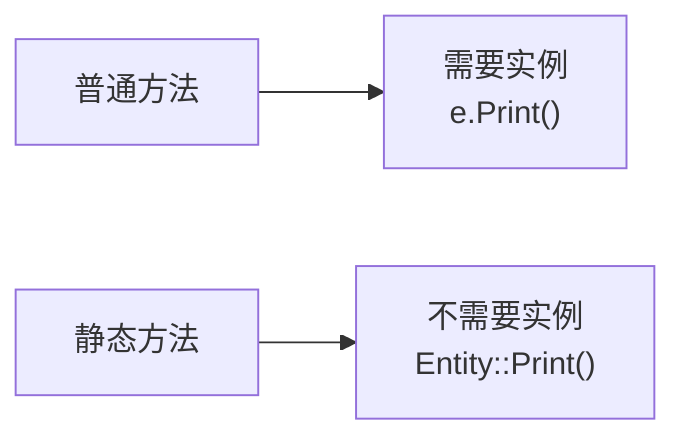
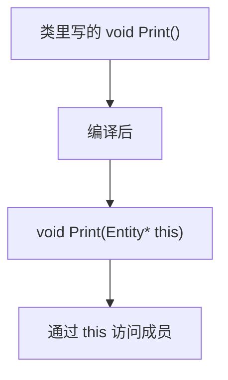
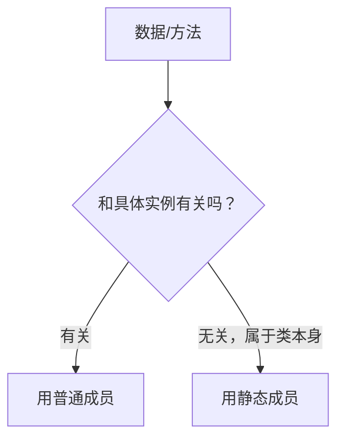

## 本节概述：static 在类里意味着什么

上一节讲了 static 在类/结构体**之外**的作用（内部链接）。这节讲 static 在类/结构体**之内**的含义，这是几乎所有面向对象语言里 static 的标准语义。

一句话总结：**类里的 static 变量，所有实例共享同一个；类里的 static 方法，不需要实例就能调用，也不能访问非静态成员。**



## 静态变量：所有实例共享同一份

定义一个 `Entity` 结构体，两个普通成员变量 `x` 和 `y`：

```cpp
struct Entity
{
    int x, y;

    void Print()
    {
        std::cout << x << ", " << y << std::endl;
    }
};
```

创建两个实例，各赋各的值，完全独立：

```cpp
int main()
{
    Entity e;
    e.x = 2;
    e.y = 3;

    Entity e1 = { 5, 8 };    // 初始化列表

    e.Print();    // 2, 3
    e1.Print();   // 5, 8
}
```

现在把 `x` 和 `y` 改成 `static`：

```cpp
struct Entity
{
    static int x, y;    // 静态变量

    void Print()
    {
        std::cout << x << ", " << y << std::endl;
    }
};
```

**初始化列表直接失效**，因为 `x` 和 `y` 不再属于任何实例。而且光声明还不够，**必须在类外定义**：

```cpp
int Entity::x;    // 类外定义，分配内存
int Entity::y;
```



现在再创建两个实例，分别赋值：

```cpp
int main()
{
    Entity e;
    e.x = 2;
    e.y = 3;

    Entity e1;
    e1.x = 5;
    e1.y = 8;

    e.Print();    // 5, 8
    e1.Print();   // 5, 8
}
```

**两个都输出 5, 8**，因为 `x` 和 `y` 在内存里只有一份。`e.x = 2` 和 `e1.x = 5` 改的是**同一个变量**。



既然所有实例共享，通过实例访问就没意义了。正确的写法是直接通过类名访问：

```cpp
Entity::x = 5;
Entity::y = 8;
```



本质上这就像在一个叫 `Entity` 的命名空间里放了两个变量，只不过它们还在类里，可以设 public/private。

## 静态方法：不需要实例就能调用

把 `Print` 也改成 `static`：

```cpp
struct Entity
{
    static int x, y;

    static void Print()
    {
        std::cout << x << ", " << y << std::endl;
    }
};
```

现在**不需要实例**，直接通过类名调用：

```cpp
Entity::Print();
```



因为方法里的 `x` 和 `y` 也是静态的，所以工作正常。两次调用打印的是同一份数据。

## 静态方法不能访问非静态成员

这是最容易困惑的地方。把 `x` 和 `y` 改回非静态，但保留 `Print` 为静态：

```cpp
struct Entity
{
    int x, y;                // 非静态

    static void Print()      // 静态方法
    {
        std::cout << x << ", " << y << std::endl;   // 编译错误
    }
};
```

编译报错：**非法引用非静态成员**。原因一句话：**静态方法没有"当前实例"的概念**。

### 底层原理：隐藏参数

每个非静态方法在编译后都会** secretly 接收一个隐藏参数**——当前对象的指针（也就是 `this`）。所以：

```cpp
struct Entity
{
    int x, y;
    void Print() { std::cout << x << std::endl; }
};
```

编译后本质上等价于：

```cpp
void Print(Entity* this)
{
    std::cout << this->x << std::endl;
}
```



而静态方法**没有这个隐藏参数**。它就像一个写在类外面的普通函数，完全不知道你在指哪个对象：

```cpp
// 静态方法编译后的样子
void Print()    // 没有 Entity* 参数
{
    std::cout << x << std::endl;   // x 是谁的？不知道
}
```


> [!TIP]
> 判断能不能访问很简单：**静态方法没有 this，所以只能访问静态成员**。非静态成员必须通过某个具体实例来访问。

## 什么时候用静态成员

**静态变量**：某个数据属于类本身，不属于任何实例，但逻辑上又和类强相关。比如所有 `Entity` 共享的一个计数器、配置项等。

**静态方法**：操作只涉及静态成员，或者纯粹是一个工具函数，不需要访问任何实例状态。



## 完整示例代码

```cpp
#include <iostream>

struct Entity
{
    static int x, y;         // 静态变量：所有实例共享

    static void Print()      // 静态方法：不需要实例
    {
        std::cout << x << ", " << y << std::endl;
    }
};

// 类外定义，分配内存
int Entity::x;
int Entity::y;

int main()
{
    Entity::x = 5;           // 通过类名访问
    Entity::y = 8;

    Entity::Print();         // 5, 8

    Entity e;                // 实例也可以访问，但没必要
    Entity e1;
    e.x = 2;                 // 改的是同一份
    e1.Print();              // 2, 8

    std::cin.get();
}
```

## 本章小结

**静态变量**：类里声明 `static` 的成员变量，**所有实例共享同一份内存**。一个实例改了，所有实例都看到变化。

**类外定义**：静态变量在类里只是声明，必须在类外写 `int Entity::x;` 来定义分配内存，否则链接报错。

**通过类名访问**：`Entity::x` 比 `e.x` 更直观，明确表达这是类级别的共享数据。

**静态方法**：不需要实例就能调用，`Entity::Print()` 即可。

**静态方法不能访问非静态成员**：因为静态方法没有隐藏参数 `this`，不知道访问哪个对象的成员。静态方法只能操作静态成员。

**使用场景**：数据属于类本身而非实例，或者方法纯粹是工具函数不依赖实例状态，就用 static。
