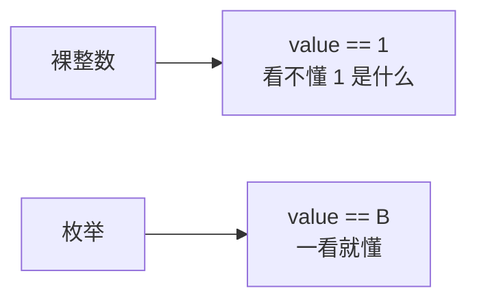
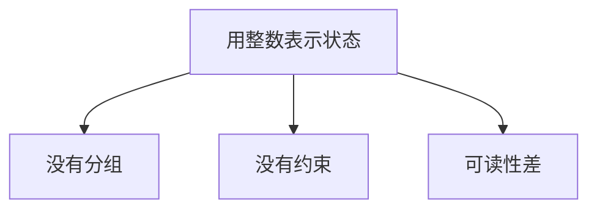
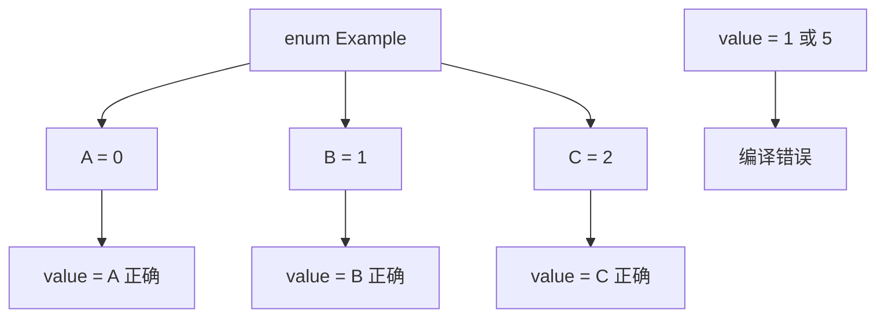
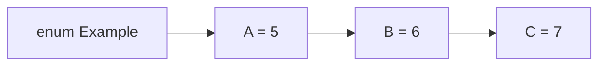
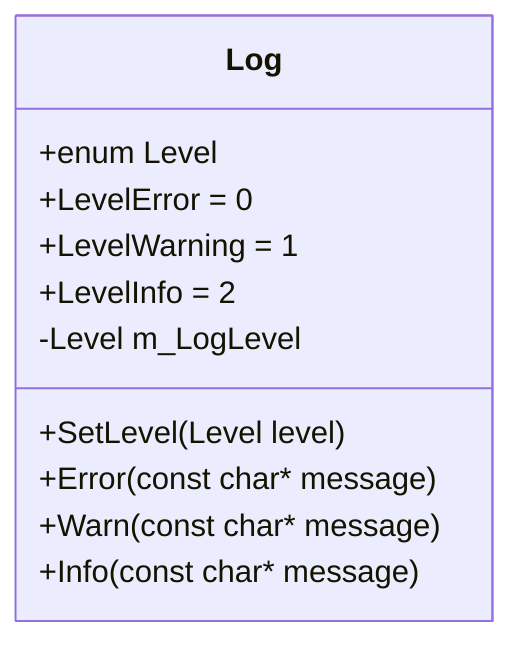
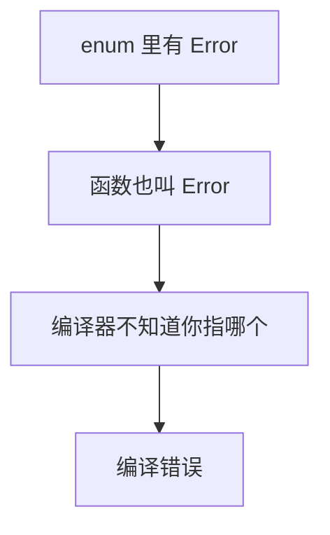
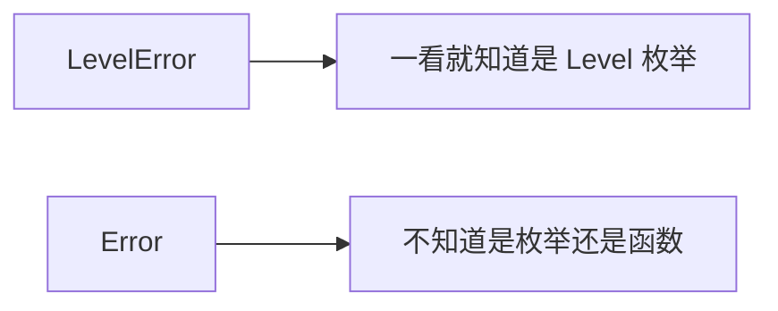
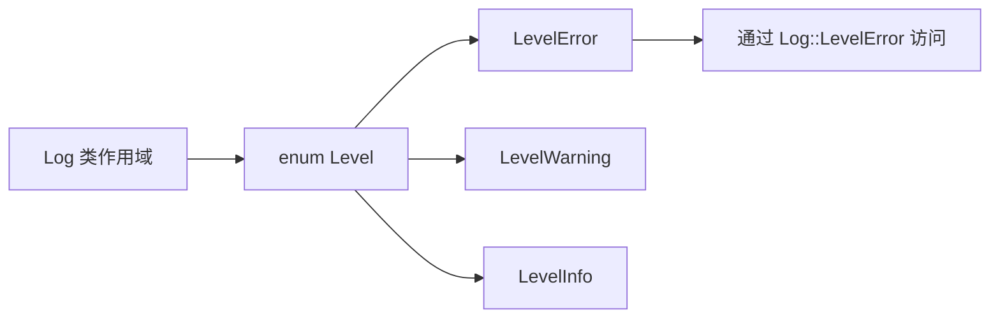

## 本节概述：枚举就是给整数值起名字

`enum` 是 enumeration 的缩写，核心作用一句话：**给一组整数值起名字，让代码更可读**。

比如有三个值 A=0、B=1、C=2，不用枚举就得用裸整数，代码里看到 `value == 1` 根本不知道 `1` 是什么意思。用了枚举，直接写 `value == B`，一目了然。



## 不用枚举的问题

假设要处理三个状态，用整数表示：

```cpp
int value = 0;    // 0 代表 A，1 代表 B，2 代表 C

if (value == 1)
{
    // 做点什么
}
```

问题很明显：

- **没有分组**：A、B、C 只是三个独立的整数，代码里任何地方都能冒出个 D 或者重复定义 A
- **没有约束**：`value` 是 `int`，完全可以赋成 `5`，但 `5` 根本不在合法范围内
- **可读性差**：看到 `0` 和 `1` 要猜它们代表什么



## 枚举的基本用法

用 `enum` 把这三个值打包成一个类型：

```cpp
enum Example
{
    A, B, C    // A = 0, B = 1, C = 2（默认从 0 开始递增）
};
```

现在 `Example` 就是一个**类型**，变量只能取这三个值：

```cpp
Example value = A;    // 正确

Example value = 1;    // 错误：不能直接把整数赋给枚举
Example value = 5;    // 错误：5 不在枚举范围内
```



枚举底层就是整数，所以比较操作完全没问题：

```cpp
if (value == B) { }       // 正确
if (value == 1) { }       // 也正确，B 的值就是 1
```

## 指定枚举值和底层类型

### 自定义值

默认从 0 开始递增，但可以**显式指定**：

```cpp
enum Example
{
    A = 0, B = 2, C = 6
};
```

如果第一个值不从 0 开始，后面不指定的会**接着递增**：

```cpp
enum Example
{
    A = 5, B, C    // A = 5, B = 6, C = 7
};
```



### 指定底层类型

枚举默认是 **32 位整数（int）**。如果值很小，没必要浪费 4 个字节，可以指定更小的类型：

```cpp
enum Example : unsigned char
{
    A, B, C    // 只占 1 个字节
};
```

> [!TIP]
> 必须是整数类型，不能是 `float` 这种浮点类型。枚举底层就是整数，只是可以选 int、short、char 等不同尺寸。

## 实际例子：改造 Log 类

上一节的 Log 类用了三个 `const int` 表示日志级别，现在用枚举改造：

```cpp
class Log
{
public:
    enum Level
    {
        LevelError = 0, LevelWarning, LevelInfo
    };

private:
    Level m_LogLevel = LevelInfo;

public:
    void SetLevel(Level level)
    {
        m_LogLevel = level;
    }

    void Error(const char* message)
    {
        if (m_LogLevel >= LevelError)
            std::cout << "[ERROR]: " << message << std::endl;
    }

    void Warn(const char* message)
    {
        if (m_LogLevel >= LevelWarning)
            std::cout << "[WARNING]: " << message << std::endl;
    }

    void Info(const char* message)
    {
        if (m_LogLevel >= LevelInfo)
            std::cout << "[INFO]: " << message << std::endl;
    }
};
```

改动点：

- 三个 `const int` 换成一个 `enum Level`
- `m_LogLevel` 的类型从 `int` 改成 `Level`，**只能取 LevelError、LevelWarning、LevelInfo**
- `SetLevel` 参数从 `int` 改成 `Level`
- 比较逻辑完全不变，因为枚举底层就是整数



## 命名冲突：枚举值和函数同名

枚举值 `LevelError` 和成员函数 `Error()` 不会冲突，因为加了 `Level` 前缀。但如果直接写：

```cpp
enum Level
{
    Error, Warning, Info    // 和函数 Error() 冲突！
};

void Error(const char* message) { }
```

编译器会报错，因为 `Error` 既是枚举值又是函数名，**无法区分**。



解决办法：**给枚举值加前缀**，比如 `LevelError`、`LevelWarning`、`LevelInfo`。这是业界非常常见的做法，一眼就知道这是 `Level` 枚举里的值。



## 枚举不是命名空间

注意：`Level` 这个枚举**不是一个命名空间**，不能写 `Level::Error`（那是 C++11 的 `enum class` 的用法，后续会讲）。普通枚举的值直接暴露在**定义它的作用域**里。

在 Log 类里定义枚举，枚举值就在 Log 类的作用域里，通过 `Log::LevelError` 访问。



## 完整示例代码

```cpp
#include <iostream>

class Log
{
public:
    enum Level
    {
        LevelError = 0, LevelWarning, LevelInfo
    };

private:
    Level m_LogLevel = LevelInfo;

public:
    void SetLevel(Level level)
    {
        m_LogLevel = level;
    }

    void Error(const char* message)
    {
        if (m_LogLevel >= LevelError)
            std::cout << "[ERROR]: " << message << std::endl;
    }

    void Warn(const char* message)
    {
        if (m_LogLevel >= LevelWarning)
            std::cout << "[WARNING]: " << message << std::endl;
    }

    void Info(const char* message)
    {
        if (m_LogLevel >= LevelInfo)
            std::cout << "[INFO]: " << message << std::endl;
    }
};

int main()
{
    Log log;
    log.SetLevel(Log::LevelWarning);

    log.Error("Hello!");
    log.Warn("Hello!");
    log.Info("Hello!");    // 不会打印

    std::cin.get();
}
```

## 本章小结

**枚举的核心作用**：给一组整数值起名字，让代码更可读、更易维护。

**默认行为**：从 0 开始递增，可以显式指定值，不指定的接着递增。

**指定底层类型**：`enum Name : unsigned char`，默认是 int，可以选更小的整数类型节省内存。

**类型约束**：枚举类型的变量只能取枚举里定义的值，比裸 int 安全得多。

**命名冲突**：枚举值和函数同名会冲突，加前缀（如 `LevelError`）是常见做法。

**普通枚举不是命名空间**：枚举值直接暴露在定义它的作用域里，`enum class` 才有自己的作用域，后续再讲。

**使用场景**：只要有一组固定的整数值代表某种状态或选项，就是枚举的用武之地。
