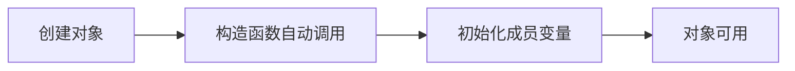
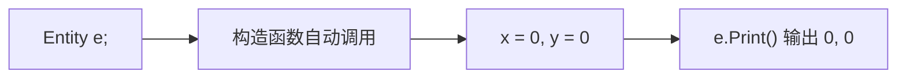
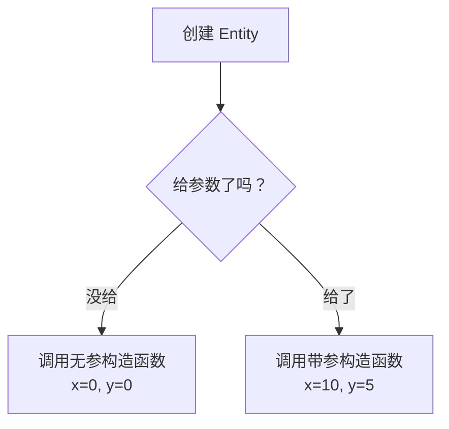
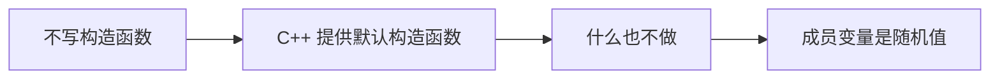
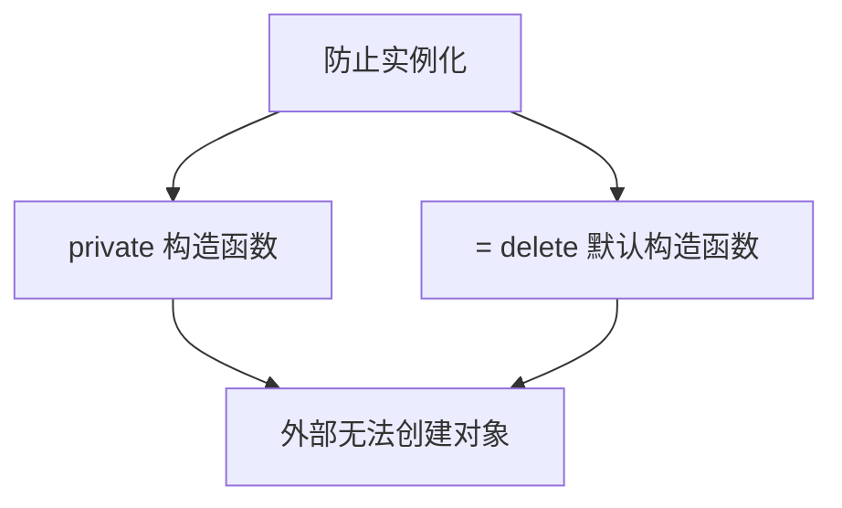

## 本节概述：构造函数就是实例化时自动跑的初始化代码

`constructor`（构造函数）是一种**特殊方法**，每次创建对象实例时自动调用。核心用途：**初始化对象，确保内存被正确设置**。



## 为什么需要构造函数

定义一个 `Entity` 类，两个成员变量 `x` 和 `y`：

```cpp
class Entity
{
public:
    float x, y;

    void Print()
    {
        std::cout << x << ", " << y << std::endl;
    }
};
```

创建实例但不初始化：

```cpp
int main()
{
    Entity e;
    e.Print();    // 输出随机值
}
```

输出的是**随机值**——创建对象时只是分配了内存，**没有初始化**。内存里原来是什么就是什么，可能是上次程序留下的垃圾数据。

直接访问还会编译报错：

```cpp
Entity e;
std::cout << e.x << std::endl;   // 错误：使用了未初始化的局部变量
```

> [!WARNING]
> C++ **不会**自动初始化基本类型（int、float 等）。Java 会默认设为 0，C++ 不会。忘记初始化是新手最容易踩的坑之一。

## 笨办法：手动写 Init 函数

```cpp
class Entity
{
public:
    float x, y;

    void Init()
    {
        x = 0.0f;
        y = 0.0f;
    }
};

int main()
{
    Entity e;
    e.Init();      // 每次都要手动调用
    e.Print();
}
```

能用，但**每次创建对象都要记得调 Init**，代码冗余且容易忘。

## 构造函数：自动初始化

构造函数就是**实例化时自动调用的初始化方法**。写法：方法名和类名相同，**没有返回类型**：

```cpp
class Entity
{
public:
    float x, y;

    Entity()               // 构造函数
    {
        x = 0.0f;
        y = 0.0f;
    }
};
```

现在创建对象时自动初始化，不需要手动调任何函数：

```cpp
int main()
{
    Entity e;    // 构造函数自动调用，x = 0, y = 0
    e.Print();   // 0, 0
}
```



## 带参数的构造函数

可以写多个构造函数，只要参数不同（重载）：

```cpp
class Entity
{
public:
    float x, y;

    Entity()                   // 无参构造函数
    {
        x = 0.0f;
        y = 0.0f;
    }

    Entity(float x, float y)   // 带参构造函数
    {
        this->x = x;
        this->y = y;
    }
};
```

创建时选择调用哪个：

```cpp
Entity e1;              // 调用无参构造函数，x=0, y=0
Entity e2(10.0f, 5.0f); // 调用带参构造函数，x=10, y=5
```



## 默认构造函数：不写也有，但什么也不做

如果不写任何构造函数，C++ 会**隐式提供一个默认构造函数**——但它**什么也不做**，成员变量依然是未初始化的垃圾值。

```cpp
class Entity
{
public:
    float x, y;    // 默认构造函数不会初始化它们
};
```



> [!TIP]
> 只要你写了任何构造函数（不管带不带参数），C++ 就不会再提供默认构造函数。如果想保留无参构造，需要自己显式写出来。

## 什么时候不会调用构造函数

**只调用静态方法，不创建实例**：

```cpp
class Log
{
public:
    static void Write(const char* message)
    {
        std::cout << message << std::endl;
    }
};

int main()
{
    Log::Write("Hello");   // 没有创建对象，构造函数不会调用
}
```

**用 `new` 创建堆对象时构造函数照常调用**：

```cpp
Entity* e = new Entity();   // 构造函数会调用
```

## 禁止实例化：删除构造函数

如果一个类**只有静态方法**，根本不该被实例化，有两种办法：

### 方法一：把构造函数设为 private

```cpp
class Log
{
private:
    Log() {}    // 私有构造函数，外部无法调用

public:
    static void Write(const char* message)
    {
        std::cout << message << std::endl;
    }
};

Log log;    // 编译错误：无法访问私有构造函数
```

### 方法二：显式删除默认构造函数

```cpp
class Log
{
public:
    Log() = delete;    // 明确告诉编译器：不要默认构造函数

    static void Write(const char* message)
    {
        std::cout << message << std::endl;
    }
};

Log log;    // 编译错误：默认构造函数已被删除
```



## 完整示例代码

```cpp
#include <iostream>

class Entity
{
public:
    float x, y;

    Entity()                   // 无参构造函数
    {
        x = 0.0f;
        y = 0.0f;
    }

    Entity(float x, float y)   // 带参构造函数
    {
        this->x = x;
        this->y = y;
    }

    void Print()
    {
        std::cout << x << ", " << y << std::endl;
    }
};

class Log
{
public:
    Log() = delete;            // 禁止实例化

    static void Write(const char* message)
    {
        std::cout << message << std::endl;
    }
};

int main()
{
    Entity e1;              // 0, 0
    e1.Print();

    Entity e2(10.0f, 5.0f); // 10, 5
    e2.Print();

    Log::Write("Hello");    // 静态方法，不需要实例

    std::cin.get();
}
```

## 本章小结

**构造函数的作用**：实例化对象时自动调用，用于初始化成员变量和做必要的设置。

**不写构造函数的后果**：成员变量是未初始化的垃圾值，C++ 不会自动初始化基本类型。

**构造函数语法**：方法名和类名相同，没有返回类型，可以重载多个版本。

**默认构造函数**：不写任何构造函数时 C++ 会提供一个，但它什么也不做。一旦写了任何构造函数，默认的就没有了。

**静态方法不触发构造函数**：只有创建实例才会调用构造函数。

**禁止实例化**：`Log() = delete;` 或把构造函数设为 private，防止别人创建不该实例化的类的对象。

**构造函数的类型**：还有拷贝构造函数和移动构造函数，后续单独讲。
