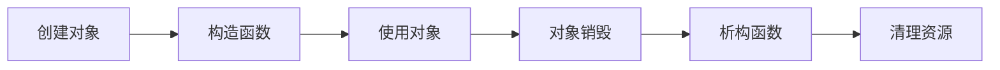
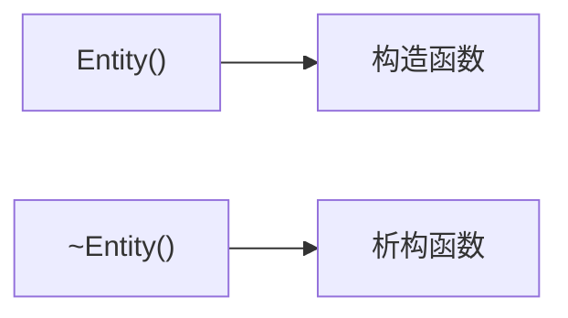
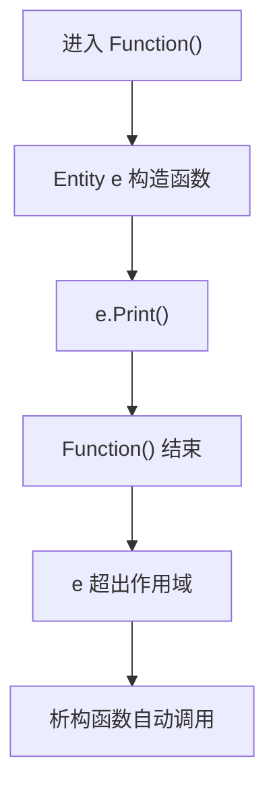
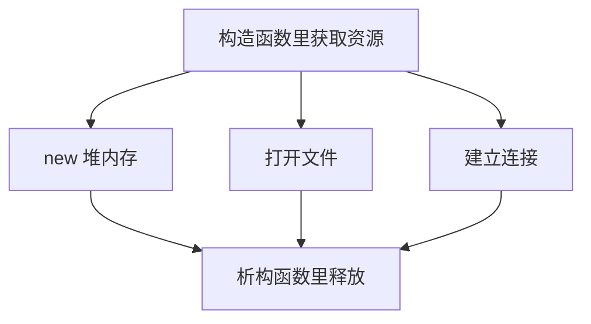
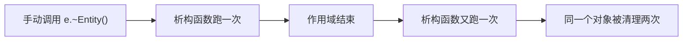

## 本节概述：析构函数就是对象销毁时自动跑的清理代码

上一节讲了构造函数——对象创建时自动调用。这节讲它的"邪恶双胞胎"——**析构函数（destructor）**：对象销毁时自动调用。

构造函数负责初始化，析构函数负责**清理**——释放内存、关闭文件、断开连接，任何在构造函数里"打开"的东西，析构函数里都要"关掉"。



## 析构函数的语法

声明方式和构造函数几乎一样，唯一区别是**名字前面加 `~`**：

```cpp
class Entity
{
public:
    float x, y;

    Entity()                   // 构造函数
    {
        x = 0.0f;
        y = 0.0f;
        std::cout << "Created Entity" << std::endl;
    }

    ~Entity()                  // 析构函数
    {
        std::cout << "Destroyed Entity" << std::endl;
    }
};
```



## 栈对象：作用域结束自动销毁

```cpp
void Function()
{
    Entity e;        // 构造函数调用
    e.Print();       // 使用对象
}                    // 作用域结束，析构函数自动调用

int main()
{
    Function();
    std::cin.get();
}
```

输出：

```
Created Entity
0, 0
Destroyed Entity
```



栈对象**不需要手动 delete**，离开作用域时析构函数自动被调用。

## 堆对象：delete 时触发析构函数

用 `new` 在堆上创建的对象，必须**手动 delete**，delete 时析构函数被调用：

```cpp
Entity* e = new Entity();    // 构造函数调用
e->Print();
delete e;                     // 析构函数调用
```

> [!WARNING]
> 只写 `new` 不写 `delete`，内存就泄漏了。构造函数里分配的资源，析构函数里必须释放。

## 什么时候写析构函数

**不是所有类都需要析构函数**。`Entity` 这种只有两个 `float` 的类，析构函数没什么可清理的——那两个 `float` 是栈分配的，随对象一起自动释放。

需要析构函数的典型场景：

- 构造函数里用 `new` 分配了堆内存 → 析构函数里 `delete`
- 打开了文件句柄 → 析构函数里关闭
- 建立了网络连接 → 析构函数里断开
- 申请了任何资源 → 析构函数里释放



## 手动调用析构函数：可以但别这么干

技术上可以手动调用析构函数：

```cpp
e.~Entity();    // 手动调用析构函数
```

但**几乎没人这么干**。手动调用后对象还在，作用域结束时析构函数会**再跑一次**，同一个对象被析构两次，很容易出问题。



唯一可能用到的地方是配合某些特殊的内存分配方式（比如 placement new），但那种场景极少，知道有这回事就行。

## 完整示例代码

```cpp
#include <iostream>

class Entity
{
public:
    float x, y;

    Entity()
    {
        x = 0.0f;
        y = 0.0f;
        std::cout << "Created Entity" << std::endl;
    }

    ~Entity()
    {
        std::cout << "Destroyed Entity" << std::endl;
    }

    void Print()
    {
        std::cout << x << ", " << y << std::endl;
    }
};

void Function()
{
    Entity e;        // 构造函数
    e.Print();
}                    // 作用域结束，析构函数自动调用

int main()
{
    Function();

    Entity* e = new Entity();   // 堆分配
    e->Print();
    delete e;                    // 手动触发析构函数

    std::cin.get();
}
```

## 本章小结

**析构函数的作用**：对象销毁时自动调用，用于清理构造函数里分配的资源。

**语法**：`~ClassName()`，和构造函数同名但前面加 `~`，没有返回类型，没有参数。

**栈对象**：离开作用域时自动调用析构函数，不需要手动干预。

**堆对象**：`delete` 时调用析构函数。有 `new` 就要有 `delete`，否则内存泄漏。

**不是所有类都需要析构函数**：如果类里没有需要手动管理的资源（堆内存、文件句柄、网络连接等），可以不写析构函数。

**别手动调用析构函数**：`e.~Entity()` 技术上可行但几乎没人用，手动调用后作用域结束还会再调一次，导致同一对象被析构两次。
