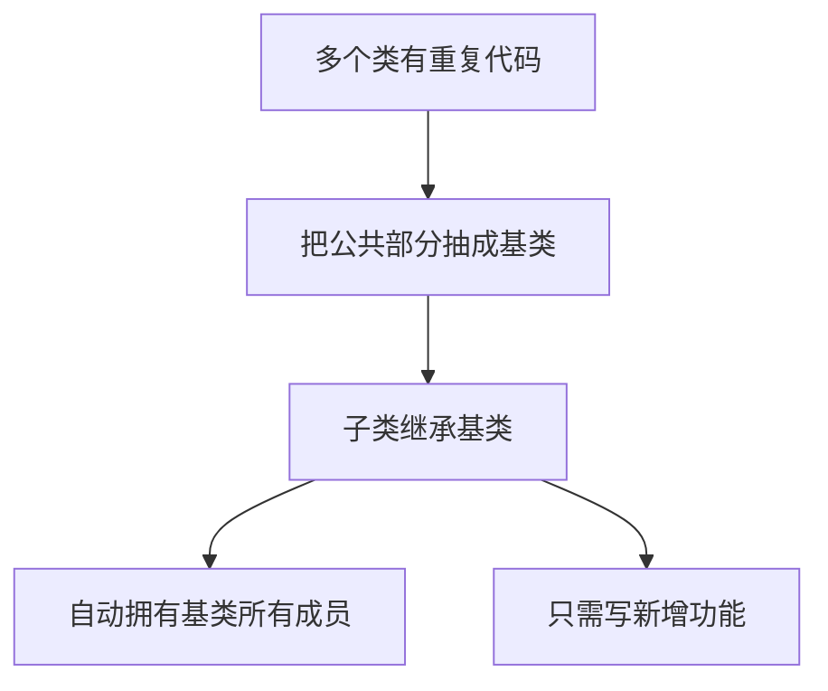
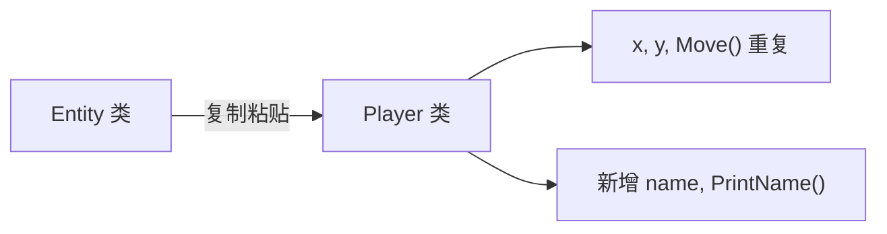
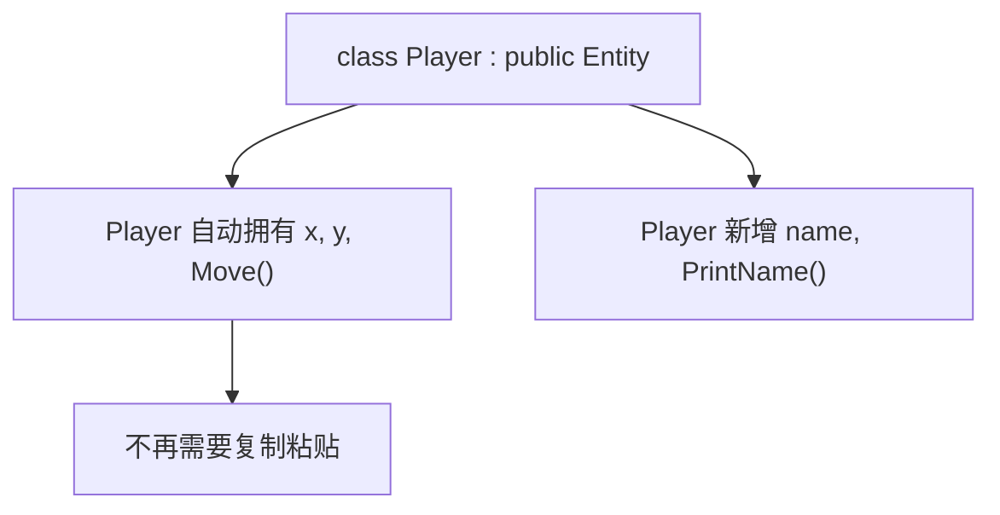
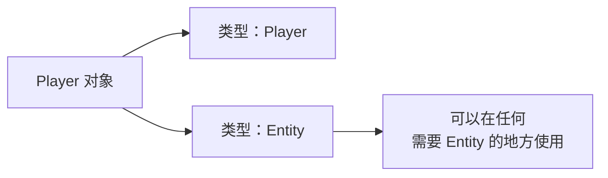
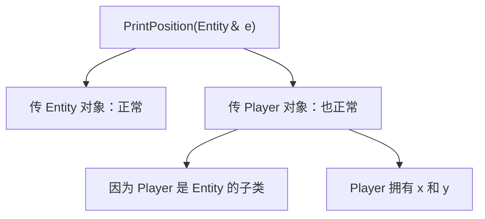
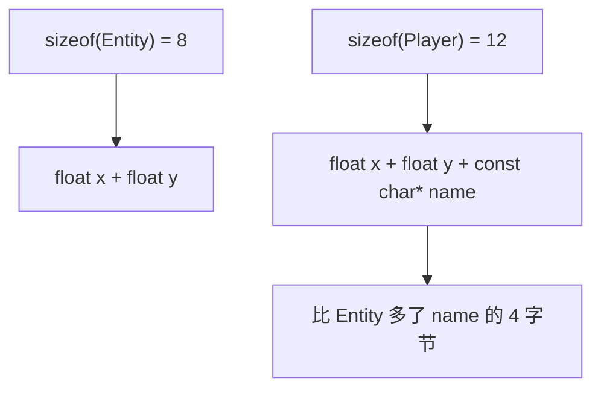
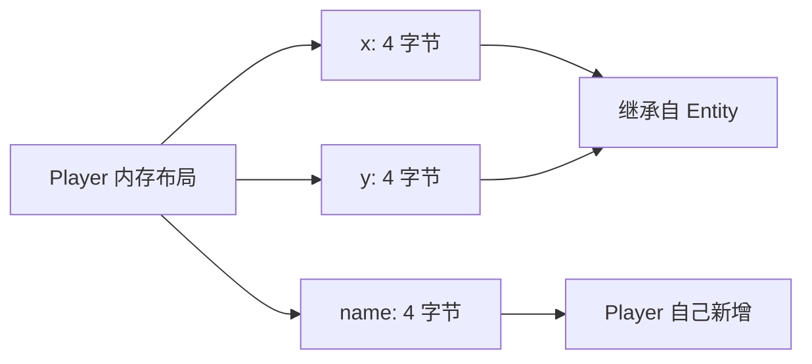
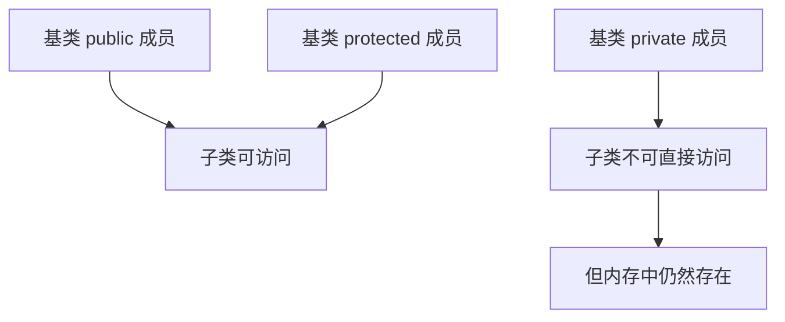
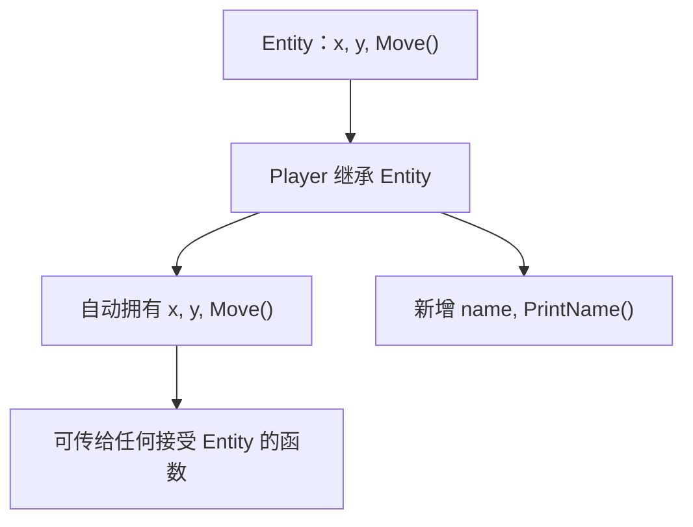

## 本节概述：继承就是"复制粘贴"的正规军

前两节讲了类的构造和析构，这节进入面向对象编程的核心——**继承（Inheritance）**。一句话概括：**把多个类共有的代码抽到一个基类里，子类自动拥有基类的一切，从此告别复制粘贴**。



## 为什么需要继承：代码重复的痛点

假设在写一个游戏，游戏里有一个**实体（Entity）**类，表示游戏中所有东西的基类：

```cpp
class Entity
{
public:
    float x, y;                          // 位置

    void Move(float xa, float yb)        // 移动
    {
        x += xa;
        y += yb;
    }
};
```

游戏中每种实体都有位置、都能移动。现在要创建一个新的实体类型——**玩家（Player）**。玩家也是实体，也有位置、也能移动，但玩家还有**名字**。

如果不用继承，就得把 Entity 的代码原封不动复制一遍：

```cpp
class Player
{
public:
    float x, y;                          // 又从 Entity 复制了一遍
    const char* name;                    // 玩家特有的新数据

    void Move(float xa, float yb)        // 又从 Entity 复制了一遍
    {
        x += xa;
        y += yb;
    }

    void PrintName()
    {
        std::cout << name << std::endl;
    }
};
```



问题很明显：**一旦 Entity 里的逻辑要改，所有复制过这份代码的类都得跟着改**。继承就是为了解决这个问题。

## 继承的语法

让 Player 继承 Entity，只需在类名后面加 `: public Entity`：

```cpp
class Player : public Entity
{
public:
    const char* name;

    void PrintName()
    {
        std::cout << name << std::endl;
    }
};
```



`public Entity` 的意思是：**Player 是 Entity 的子类（subclass），Entity 是 Player 的基类（base class）**。Player 自动继承 Entity 中所有非 `private` 的成员——`x`、`y`、`Move()` 全都有了，就好像把 Entity 的代码直接复制进了 Player 一样。

## 继承之后：一个对象，两种类型

继承之后发生了一件重要的事：**Player 不再只是 Player 类型，它同时也是 Entity 类型**。



这就是**多态（Polymorphism）**的基础——一个对象可以拥有多种类型。因为 Player 拥有 Entity 的一切，所以**任何接受 Entity 参数的地方，都可以直接传 Player**：

```cpp
void PrintPosition(Entity& e)
{
    std::cout << e.x << ", " << e.y << std::endl;
}

int main()
{
    Player player;
    player.x = 1.0f;
    player.y = 2.0f;
    player.name = "Hero";

    PrintPosition(player);     // Player 可以直接传给 Entity 参数
    player.Move(5.0f, 3.0f);   // 继承来的方法直接用
    player.PrintName();        // 自己新增的方法也能用

    std::cin.get();
}
```



> [!TIP]
> Player 是 Entity 的**超集（superset）**——Entity 有的 Player 全有，Player 还可能有更多。所以 Player 可以安全地"伪装"成 Entity 使用。

## 用 sizeof 验证继承

继承到底有多"彻底"？用 `sizeof` 打印一下就知道了：

```cpp
std::cout << sizeof(Entity) << std::endl;   // 8（两个 float）
std::cout << sizeof(Player) << std::endl;   // 12（两个 float + 一个指针）
```



Entity 有两个 `float`（各 4 字节），所以是 8 字节。Player 继承了 Entity 的两个 `float`，又加了一个 `const char*`（32 位程序中指针 4 字节），所以是 12 字节。**继承不是引用，是真的把基类的成员"装"进了子类**。



> [!WARNING]
> 如果子类重写了基类的虚函数，对象会额外维护一个**虚函数表（vtable）**指针，内存会再增加。这个后面讲多态时再细说。

## 继承的访问控制

`public` 继承意味着：

- 基类的 `public` 成员 → 子类中仍是 `public`
- 基类的 `protected` 成员 → 子类中仍是 `protected`
- 基类的 `private` 成员 → 子类**无法直接访问**（但仍然存在于子类对象中）



## 完整示例代码

```cpp
#include <iostream>

class Entity
{
public:
    float x, y;

    void Move(float xa, float yb)
    {
        x += xa;
        y += yb;
    }
};

class Player : public Entity
{
public:
    const char* name;

    void PrintName()
    {
        std::cout << name << std::endl;
    }
};

void PrintPosition(Entity& e)
{
    std::cout << e.x << ", " << e.y << std::endl;
}

int main()
{
    Entity e;
    e.x = 0.0f;
    e.y = 0.0f;

    Player player;
    player.x = 1.0f;
    player.y = 2.0f;
    player.name = "Hero";

    PrintPosition(e);            // 传 Entity
    PrintPosition(player);       // 传 Player，多态

    player.Move(5.0f, 3.0f);     // 调用继承来的方法
    player.PrintName();          // 调用自己的方法

    std::cout << sizeof(Entity) << std::endl;   // 8
    std::cout << sizeof(Player) << std::endl;   // 12

    std::cin.get();
}
```



## 本章小结

**继承的作用**：把多个类共有的代码抽到基类，子类自动拥有基类的一切，避免代码重复。

**语法**：`class 子类名 : public 基类名`，子类自动继承基类所有非 `private` 成员。

**多态基础**：子类对象同时是子类类型和基类类型，可以在任何需要基类的地方使用子类。

**内存验证**：`sizeof(子类)` = 基类成员大小 + 子类新增成员大小，继承是实打实的"装进去"。

**访问控制**：`public` 继承下，基类 `public` 和 `protected` 成员子类可直接访问，`private` 成员存在于内存中但子类不可直接访问。

**核心思想**：继承是面向对象编程最强大的特性之一，后续章节还会深入多态、虚函数、方法重写等概念。
