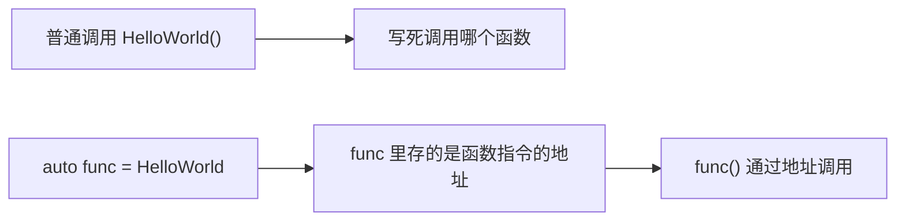
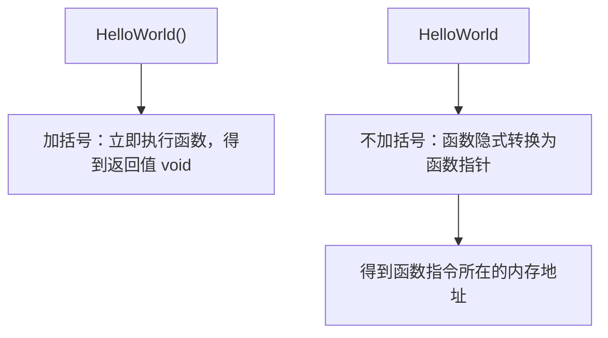
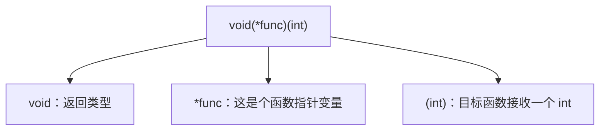
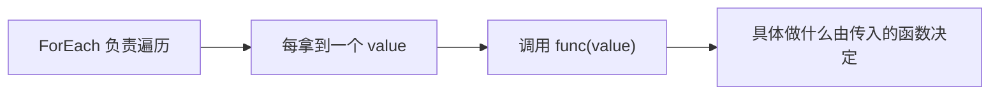

## 本节概述：函数指针就是把"函数"存进变量里

到目前为止函数都只是"被调用的符号"。实际上函数编译后就是一段存放在可执行文件里的 CPU 指令，它在内存中有地址。**函数指针（function pointer）就是保存这段指令地址的变量**——拿到它，就能把函数赋值给变量、当作参数传给另一个函数，甚至在运行时决定调用哪段逻辑。



本节讲的是源自 C 语言的原始函数指针写法；现代 C++ 的 `std::function`、lambda 等后续再讲。

## 第一个函数指针

```cpp
#include <iostream>

void HelloWorld()
{
    std::cout << "Hello World!" << std::endl;
}

int main()
{
    HelloWorld();                    // 普通调用

    auto function = HelloWorld;      // 不加括号：拿到函数指针
    function();                      // 通过变量调用
}
```

关键区别在**括号**：



写成 `auto function = HelloWorld();` 会报错——那是在调用函数，返回值是 void，无法赋给变量。显式写法也可以加取地址符 `&HelloWorld`，效果相同，不加也行（函数名会隐式转换为函数指针）。

## 函数指针的类型：签名要完全匹配

把鼠标悬停在 auto 变量上，能看到真实类型是 `void(*function)()`。手写出来长这样：

```cpp
void(*function)() = HelloWorld;
```

读法：`function` 是一个指针（`*`），指向一个**无参数、返回 void** 的函数。指针的类型必须和目标函数的签名完全匹配。

带参数的版本：

```cpp
void HelloWorld(int a)
{
    std::cout << "Value: " << a << std::endl;
}

int main()
{
    void(*function)(int) = HelloWorld;   // 签名：返回 void，参数一个 int
    function(8);                          // 输出 Value: 8
}
```



> [!WARNING]
> 括号不能省：`void* function(int)` 的含义完全不同——那是"一个返回 void* 的普通函数"。星号必须和变量名一起包在括号里，才表示函数指针。

## 用 typedef / using 起别名

原始写法又丑又容易看错，实际开发中通常给函数指针类型起个别名：

```cpp
// 老式写法
typedef void(*HelloWorldFunction)(int);

// 现代写法（推荐）
using HelloWorldFunction = void(*)(int);

int main()
{
    HelloWorldFunction function = HelloWorld;
    function(8);
}
```

起了别名后，类型看起来和普通变量类型一样，可读性好得多。

## 真正有用的例子：把函数当参数传

函数指针最大的价值是**回调**——调用别人写的遍历函数，但"每个元素要做什么"由你传入的函数决定。

```cpp
#include <iostream>
#include <vector>

void PrintValue(int value)
{
    std::cout << value << std::endl;
}

// 第二个参数是函数指针：接收 int、返回 void 的函数
void ForEach(const std::vector<int>& values, void(*func)(int))
{
    for (int value : values)
    {
        func(value);          // 对每个元素调用传入的函数
    }
}

int main()
{
    std::vector<int> values = { 1, 5, 4, 2, 3 };
    ForEach(values, PrintValue);   // 把函数本身传进去，不加括号
}
```



遍历时打印、求和、过滤……换一个传入函数，ForEach 一行都不用改。这就是标准库 `<algorithm>` 里大量算法的工作方式。

## 顺手认识一下 lambda

为一个只用一次的回调专门在外面定义 PrintValue 有点啰嗦，可以直接在调用处写一个**匿名函数（lambda）**：

```cpp
ForEach(values, [](int value) {
    std::cout << "Value: " << value << std::endl;
});
```

`[]` 是捕获子句（用来引入外部变量），`(int value)` 是参数，`{}` 是函数体。这个匿名函数能隐式转换成签名匹配的原始函数指针（无捕获时），所以直接传就行。lambda 还有 `std::function`、`std::bind` 等现代工具，后续专门讲。

## 完整示例代码

```cpp
#include <iostream>
#include <vector>

void HelloWorld(int a)
{
    std::cout << "Value: " << a << std::endl;
}

using HelloWorldFunction = void(*)(int);

void PrintValue(int value)
{
    std::cout << value << std::endl;
}

void ForEach(const std::vector<int>& values, void(*func)(int))
{
    for (int value : values)
    {
        func(value);
    }
}

int main()
{
    // 基本用法：函数赋值给变量
    auto func1 = HelloWorld;          // 不加括号才是函数指针
    func1(8);

    HelloWorldFunction func2 = HelloWorld;
    func2(10);

    // 回调：把函数传给函数
    std::vector<int> values = { 1, 5, 4, 2, 3 };
    ForEach(values, PrintValue);

    // 直接传 lambda（匿名函数）
    ForEach(values, [](int value) {
        std::cout << "Value: " << value << std::endl;
    });

    std::cin.get();
}
```

## 本章小结

**函数指针的本质**：函数编译后是存放在可执行文件中的一段 CPU 指令，函数指针保存这段指令的地址，可以存进变量、当作参数传递。

**取函数地址不加括号**：`HelloWorld` 或 `&HelloWorld` 得到函数指针；`HelloWorld()` 是立即调用，得到的是返回值。

**类型签名**：`void(*func)(int)` 表示指向"接收 int、返回 void"的函数的指针；星号和变量名必须一起包在括号里，赋值时签名要完全匹配。

**推荐起别名**：`using FuncType = void(*)(int);`，避免原始写法难读易错。

**核心用途是回调**：遍历/框架代码接收函数指针，具体动作由调用方传入；无捕获的 lambda 也能直接当原始函数指针传。
