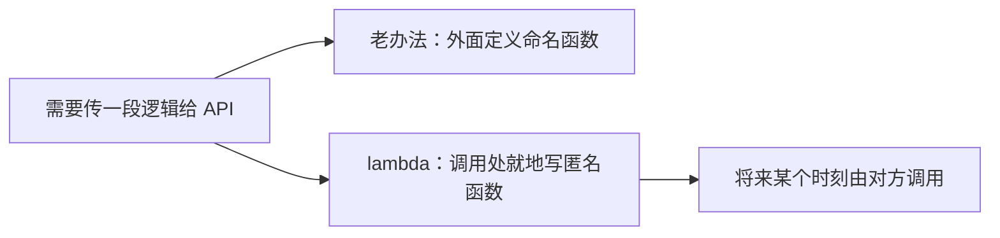
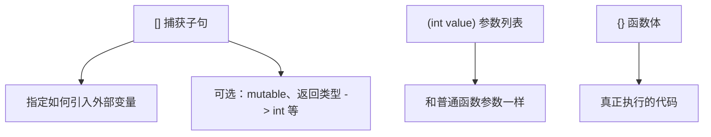
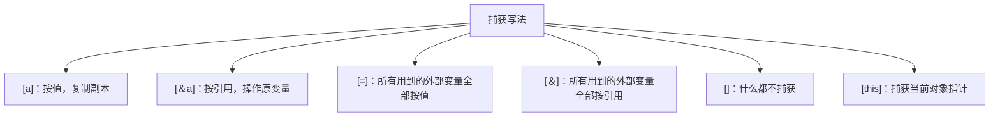
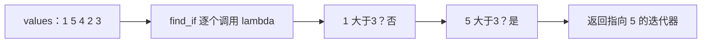

## 本节概述：lambda 就是随手写在代码里的一次性匿名函数

上一节的函数指针有个麻烦：想传一小段逻辑，还得在外面正经定义一个命名函数。**lambda（匿名函数）允许你直接在代码里就地写出一段"用完即扔"的函数**，不用起名字、不用单独声明。凡是需要函数指针（或函数对象）的地方，都可以传一个 lambda。



典型场景是**延迟执行**：现在数据还没准备好，或只是想指定"将来遍历时/条件满足时做什么"，于是把代码打包成 lambda 传进去。

## lambda 的语法解剖

```cpp
auto lambda = [](int value) {
    std::cout << "Value: " << value << std::endl;
};

ForEach(values, lambda);
```



完整形态是 `[捕获](参数) mutable -> 返回类型 { 函数体 }`，除了捕获子句和函数体外大多可省略。返回类型通常由函数体里的 return 自动推断。

## 捕获：把外部变量带进 lambda

lambda 里默认只能用自己的参数和全局的东西。想用外层作用域的局部变量，必须在 `[]` 里**捕获（capture）**。

```cpp
int a = 5;

auto lambda = [a]() {           // a 按值捕获：复制一份副本
    std::cout << a << std::endl;
};

auto lambda2 = [&a]() {         // a 按引用捕获：用的是外面的 a 本体
    a = 10;                     // 会修改外面的 a
};
```



按值适合 int 这类小变量；类、结构体这种不想复制的大对象，或者 lambda 里确实要修改原变量时，按引用捕获。

## 有捕获的 lambda 不能再当原始函数指针

上一节 ForEach 的参数是原始函数指针 `void(*func)(int)`。无捕获的 lambda 可以隐式转成它，但**一旦捕获了外部变量，就不能再传**——编译器会报错。

此时参数类型要改用标准库的 `std::function`：

```cpp
#include <functional>

void ForEach(const std::vector<int>& values,
             const std::function<void(int)>& func)
{
    for (int value : values)
    {
        func(value);
    }
}

int main()
{
    std::vector<int> values = { 1, 5, 4, 2, 3 };
    int a = 5;
    ForEach(values, [=](int value) {     // 有捕获 → 需要 std::function
        std::cout << a << ": " << value << std::endl;
    });
}
```

## mutable：允许修改按值捕获的副本

按值捕获来的变量，lambda 默认**不让改**——即使改的只是副本。普通函数的传值参数明明可以随便改，这里却不行，要加上 `mutable` 关键字：

```cpp
int a = 5;
auto lambda = [a]() mutable {
    a = 8;          // 不加 mutable 编译报错
    std::cout << a << std::endl;
};
```

注意改的仍然是 lambda 自己的副本，外面的 a 不受影响。

## 实战：std::find_if 配 lambda

`<algorithm>` 里的 `std::find_if` 在一个区间里查找**第一个满足条件**的元素，"条件是什么"正好用 lambda 表达：

```cpp
#include <algorithm>
#include <vector>

std::vector<int> values = { 1, 5, 4, 2, 3 };

// 在 [begin, end) 区间找第一个让谓词返回 true 的元素
auto it = std::find_if(values.begin(), values.end(),
    [](int value) { return value > 3; });

std::cout << *it << std::endl;   // 5：列表中第一个大于 3 的数
```



`find_if` 负责遍历，lambda 只负责回答"这个元素符不符合条件"（返回 bool 的函数叫谓词）。这等价于手写一个 `if (value > 3)` 的查找循环，但条件可以随时换，代码更紧凑。标准库里 `sort`、`remove_if`、`count_if` 等算法都是同样的用法。

## 完整示例代码

```cpp
#include <iostream>
#include <vector>
#include <algorithm>
#include <functional>

void ForEach(const std::vector<int>& values,
             const std::function<void(int)>& func)
{
    for (int value : values)
    {
        func(value);
    }
}

int main()
{
    std::vector<int> values = { 1, 5, 4, 2, 3 };

    int a = 5;

    // 全部按值捕获，有捕获所以需要 std::function 接收
    ForEach(values, [=](int value) {
        std::cout << a << ": " << value << std::endl;
    });

    // mutable：允许修改按值捕获的副本
    int b = 10;
    auto modifyCopy = [b]() mutable {
        b = 20;
        std::cout << "lambda 内 b = " << b << std::endl;
    };
    modifyCopy();
    std::cout << "外面 b = " << b << std::endl;   // 仍是 10

    // find_if：找第一个大于 3 的元素
    auto it = std::find_if(values.begin(), values.end(),
        [](int value) { return value > 3; });
    std::cout << *it << std::endl;                // 5

    std::cin.get();
}
```

## 本章小结

**lambda 是什么**：就地定义的匿名函数，语法为 `[捕获](参数){函数体}`，适合写只在一处使用的一次性逻辑，凡是要函数指针/回调的地方都能传。

**捕获子句 []**：`[a]` 按值、`[&a]` 按引用、`[=]` 全部按值、`[&]` 全部按引用、`[this]` 捕获当前对象、`[]` 不捕获。

**无捕获 lambda 可转原始函数指针；有捕获必须用 `std::function` 接收。**

**mutable**：按值捕获的变量默认不可修改，加 mutable 后可改副本，不影响外部原变量。

**实战价值**：配合 `find_if`、`sort` 等算法，遍历逻辑由标准库提供，筛选/比较条件由 lambda 就地给出。
