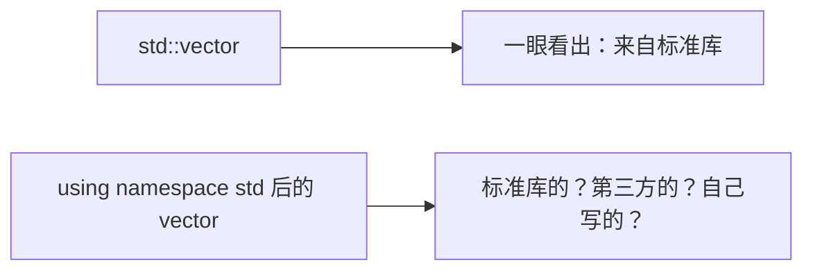
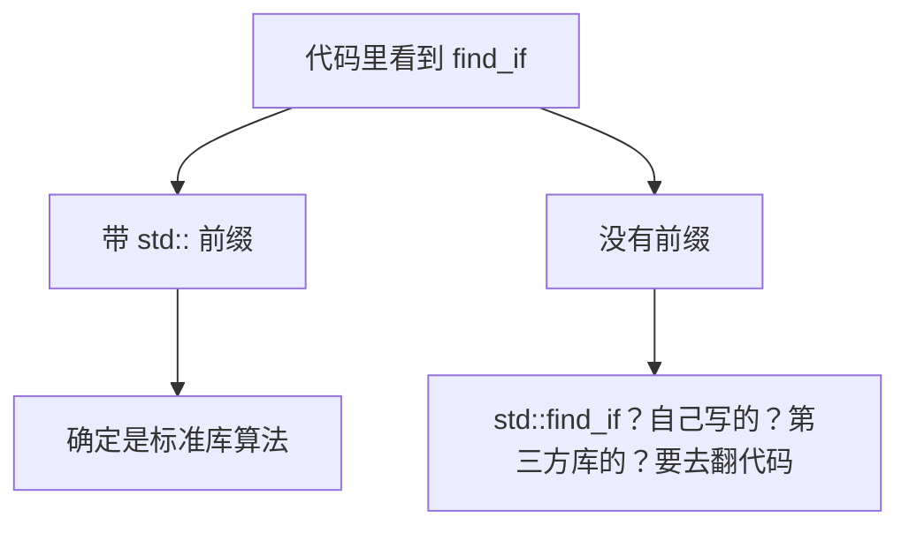
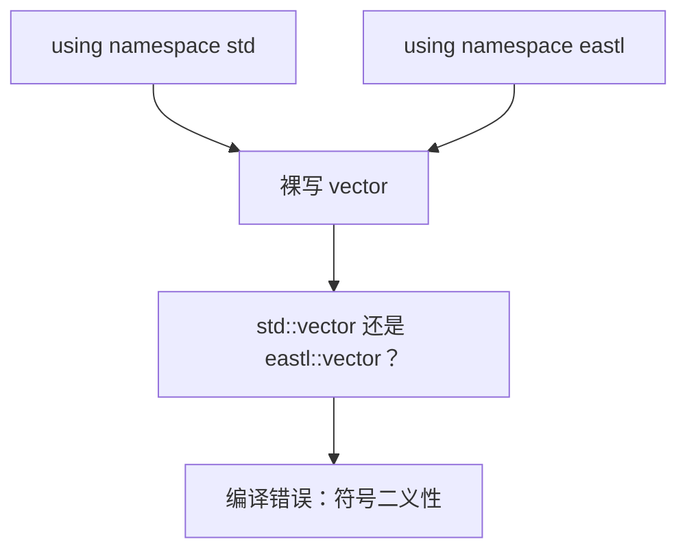
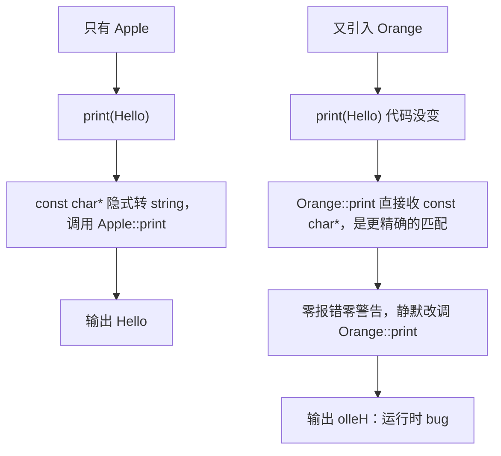
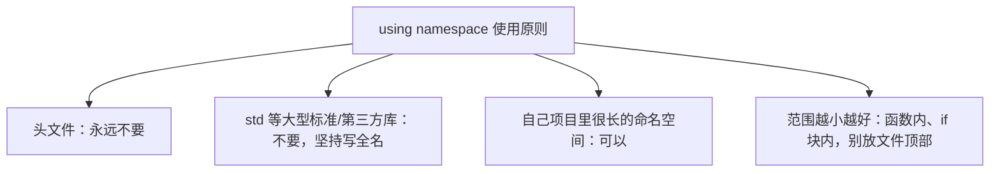

## 本节概述：省掉的是 std:: 五个字符，丢掉的是"这东西从哪来"的信息

用标准库的东西都要写前缀：`std::vector`、`std::cout`、`std::function`。在文件顶部加一句 `using namespace std;`，这些前缀全省了，代码看起来更短。但作者的做法是**从不 using namespace std**，每次都老老实实写 `std::`。这一节讲清楚为什么。



## using namespace 到底做了什么

命名空间里的名字正常要用 `命名空间::名字` 访问。`using namespace std;` 的作用是：在它生效的作用域内，std 里的所有名字都可以**不带前缀直接用**。

```cpp
#include <vector>
#include <iostream>

// 没有 using namespace，每次都要 std::
std::vector<int> values;
std::cout << "Hello" << std::endl;
```

```cpp
using namespace std;    // std 里的名字全部"倒"进当前作用域

vector<int> values;
cout << "Hello" << endl;
```

它不一定要写在文件顶部，**写在哪个作用域就只对哪个作用域生效**：

```cpp
int main()
{
    using namespace std;   // 只在 main 函数内有效
    vector<int> values;
}
```

对于自己项目里名字很长的命名空间，在小作用域内临时 using 一下完全合理；问题专门出在 std（以及大型第三方库）上。

## 理由一：看不出东西来自哪个库

带 `std::` 前缀时，扫一眼代码就知道哪些东西来自标准库，哪些是项目自己的。去掉前缀后，如果项目的命名风格恰好也是 snake_case（标准库风格），`find_if`、`for_each` 到底是标准库的还是本文件里自己写的函数，就分不清了。



真实例子：游戏引擎项目中同时用了标准库 STL 和 EA STL（艺电开源的标准库替代实现，API 刻意与标准库一致，类名也叫 vector，但在 `eastl` 命名空间里）。写一个裸 `vector`，根本不知道是 `std::vector` 还是 `eastl::vector`。

## 理由二：名字冲突直接编译报错

如果同时 `using namespace std;` 和 `using namespace eastl;`，两个命名空间里都有 vector，再写裸 `vector` 编译器就报**二义性错误（ambiguous symbol）**——它不知道你要哪个。



带上命名空间前缀则永远不会有这个问题。

## 理由三：更可怕——不报错，悄悄调错函数（运行时 bug）

这是最危险的情况。假设两个库里各有一个 print：

```cpp
namespace Apple
{
    void print(const std::string& text)
    {
        std::cout << text << std::endl;      // 正常打印
    }
}

namespace Orange
{
    void print(const char* text)
    {
        std::string s = text;
        std::reverse(s.begin(), s.end());
        std::cout << s << std::endl;          // 把字符串反转后打印
    }
}
```

一开始只引入了 Apple：

```cpp
using namespace Apple;

int main()
{
    print("Hello");   // const char* 隐式转换成 std::string，调用 Apple::print，输出 Hello
}
```

后来项目引入了 Orange 库，加上 `using namespace Orange;`，main 里的代码**一个字都没改**：

```cpp
print("Hello");   // 现在输出 olleH！
```



重载决议选择"不需要类型转换"的版本，于是调用被**静默切换**：没有编译错误、没有警告，程序行为却变了。如果始终写全名 `Apple::print("Hello");`，引入多少个新库都不受影响。

> [!WARNING]
> 头文件里绝对不要写 using namespace。头文件会被无数个源文件包含，一句 using 会污染所有包含它的文件，可能在完全不相干的地方引发二义性或静默调错，而且极难追踪。大型项目里为此耗费数小时排查编译错误的案例很常见。

## 合理的使用方式



`std::` 前缀同时是文档：看到 `std::string` 立刻知道这个类型来自 C++ 标准库，而不是别的库。这五个字符换来的确定性，远比少敲几个字有价值。

## 完整示例代码

```cpp
#include <iostream>
#include <string>
#include <algorithm>

namespace Apple
{
    void print(const std::string& text)
    {
        std::cout << text << std::endl;
    }
}

namespace Orange
{
    void print(const char* text)
    {
        std::string s = text;
        std::reverse(s.begin(), s.end());
        std::cout << s << std::endl;
    }
}

int main()
{
    // 推荐：始终带命名空间全名，行为不受新库影响
    Apple::print("Hello");    // Hello
    Orange::print("Hello");   // olleH

    // 小作用域内临时使用自己的命名空间，是可以接受的
    {
        using namespace Apple;
        print(std::string("World"));
    }

    std::cin.get();
}
```

## 本章小结

**using namespace 的作用**：把一个命名空间里的所有名字倒进当前作用域，省去 `std::` 前缀；作用域可大可小。

**不用 using namespace std 的理由**：一是失去 `std::` 前缀这个"来源标记"，分不清类型/函数来自标准库、第三方库还是项目自身；二是多个命名空间同名时产生二义性编译错误；三是结合隐式转换和重载决议，调用可能被静默切换，产生零警告的运行时 bug。

**头文件里永远禁止 using namespace**，因为污染会随 include 扩散到整个项目且难排查。

**可以接受的用法**：只针对自己项目的长命名空间，且范围尽可能小（函数内、代码块内），不写在文件顶部。
