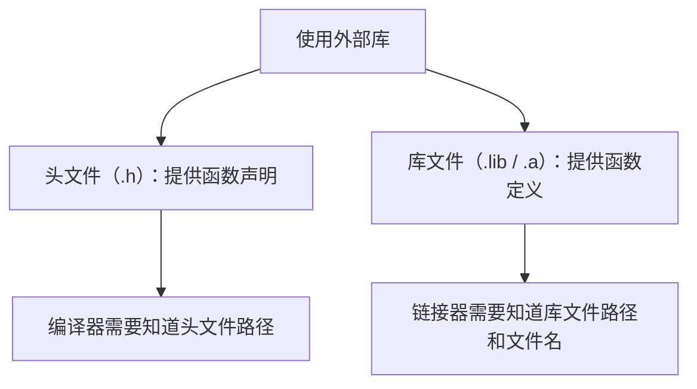
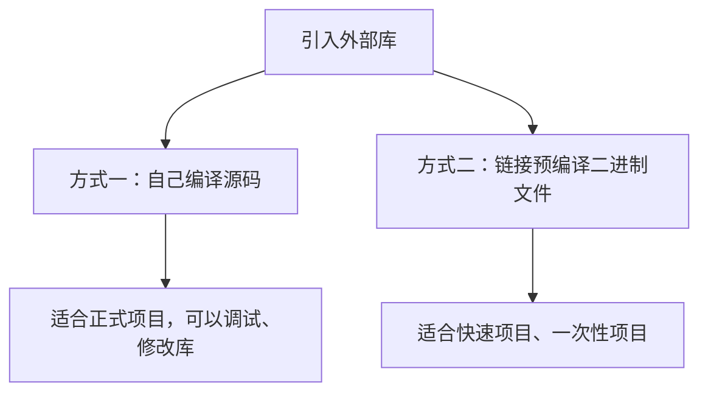
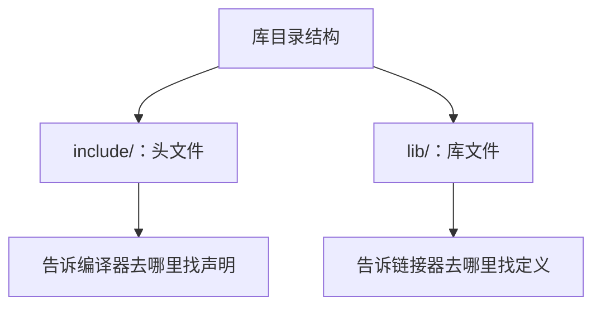
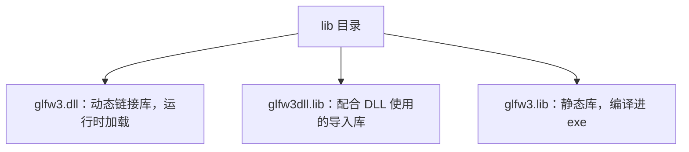
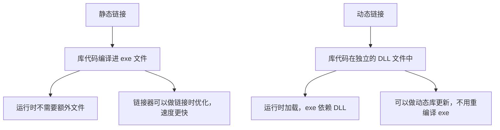
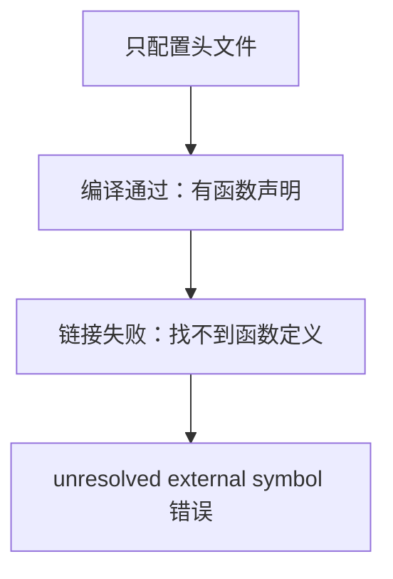

## 本节概述：C++ 引入外部库没有包管理器，需要手动链接

用过 Java、C#、Python 的话，引入第三方库很简单——包管理器一行命令搞定。C++ 没有这一套，需要手动配置编译器和链接器。其实不难，核心就两件事：**告诉编译器头文件在哪**、**告诉链接器库文件在哪**。



## 两种使用策略

引入外部库有两种方式：



正式项目推荐自己编译源码——可以调试进库内部、可以修改库的行为、和项目共用同一套编译配置。快速项目或只是试水的话，直接用预编译的二进制文件更快。

## 库的目录结构

典型的 C++ 库解压后有两个核心目录：



以 GLFW（一个 OpenGL 辅助库）为例，解压后 `include` 目录里有 `GLFW/glfw3.h` 头文件，`lib` 目录里有几种库文件：



## 静态链接 vs 动态链接



**通常优先选静态链接**——库代码直接编译进 exe，运行时不需要额外文件，而且链接器在链接时可以做更多优化（因为链接时就知道函数的实际代码），理论上更快。

## 选择 32 位还是 64 位

下载预编译库时要选对位数，注意这和你的操作系统无关，取决于**你的程序编译成什么**：


位数不匹配链接会报错。

## 配置 Visual Studio 项目

### 第一步：把库放进项目

在解决方案目录下创建 `dependencies` 文件夹，把库的 `include` 和 `lib` 目录放进去。这样代码 clone 到任何机器上都能编译，路径不依赖个人电脑。

### 第二步：设置附加包含目录

右键项目 → 属性 → C/C++ → 常规 → 附加包含目录：

```
$(SolutionDir)dependencies\GLFW\include
```

`$(SolutionDir)` 是 Visual Studio 的宏，指向解决方案所在目录。用相对路径，不要用绝对路径。

### 第三步：设置附加库目录

右键项目 → 属性 → 链接器 → 常规 → 附加库目录：

```
$(SolutionDir)dependencies\GLFW\lib-vc2015
```

### 第四步：指定要链接的库文件

链接器 → 输入 → 附加依赖项，填入库文件名：

```
glfw3.lib
```

## 包含头文件与调用

配置好后就可以 `#include` 并调用库函数：

```cpp
#include <GLFW/glfw3.h>   // 尖括号表示外部库

int main()
{
    int result = glfwInit();
    std::cout << result << std::endl;   // 1 表示初始化成功
}
```

## 尖括号 vs 引号

```cpp
#include "MyHeader.h"      // 引号：先查相对路径，再查编译器包含目录
#include <GLFW/glfw3.h>    // 尖括号：直接查编译器包含目录
```

习惯用法：项目内的文件用引号，外部库用尖括号，一眼就能看出是不是外部依赖。

## 只配置头文件会怎样：编译过、链接挂

只设置了包含目录但没配链接器的话，编译能通过（因为头文件里有函数声明），但**链接时报 unresolved external symbol**——编译器知道有这个函数，但找不到函数的实际实现。



## 头文件的本质：只是声明

头文件里只有函数声明，没有实现：

```cpp
// glfw3.h 里的内容
int glfwInit();   // 只有声明，没有函数体
```

链接器的工作就是找到这个函数的定义——要么在你自己的代码里，要么在库文件里。头文件只是让编译器知道"这个函数存在"，真正的实现在库文件里。

## extern "C"：C 库的名字修饰问题

GLFW 是用 C 写的，不是 C++。C++ 会对函数名做**名字修饰（name mangling）**来支持函数重载，C 不会。所以手动声明 C 库函数时需要加 `extern "C"`：

```cpp
extern "C" int glfwInit();   // 告诉编译器不要修饰这个名字
```

不过通常不需要手动声明——头文件里已经处理了。这只是为了说明头文件本质上就是一个声明文件，没有任何魔法。

## 完整示例代码

```cpp
#include <iostream>
#include <GLFW/glfw3.h>    // 外部库用尖括号

int main()
{
    int result = glfwInit();
    std::cout << result << std::endl;   // 1 = 初始化成功
    std::cin.get();
}
```

## 本章小结

**C++ 引入外部库的核心**：告诉编译器头文件在哪（包含目录），告诉链接器库文件在哪（库目录 + 库文件名）。

**静态链接 vs 动态链接**：静态链接把库代码编译进 exe，运行时不需要额外文件，链接时可以做优化；动态链接需要运行时加载 DLL。通常优先选静态链接。

**库的结构**：include 目录放头文件（声明），lib 目录放库文件（定义）。两个都要配。

**选位数**：32 位程序配 32 位库，64 位程序配 64 位库，和操作系统无关。

**头文件本质**：只是函数声明，没有实现。链接器负责找到实现——在你的代码里或库文件里。没有链接库就编译过但链接挂，报 unresolved external symbol。
