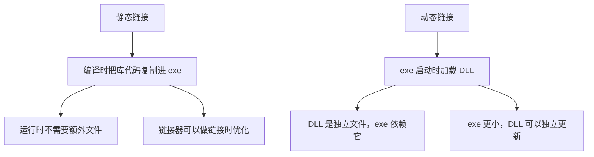
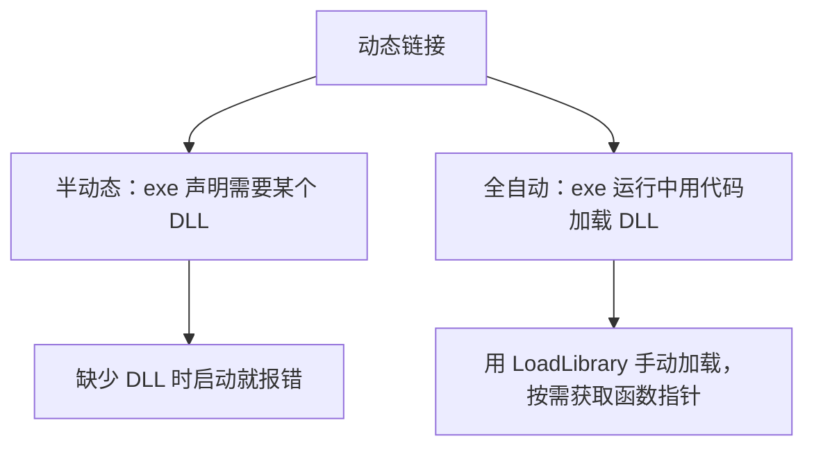
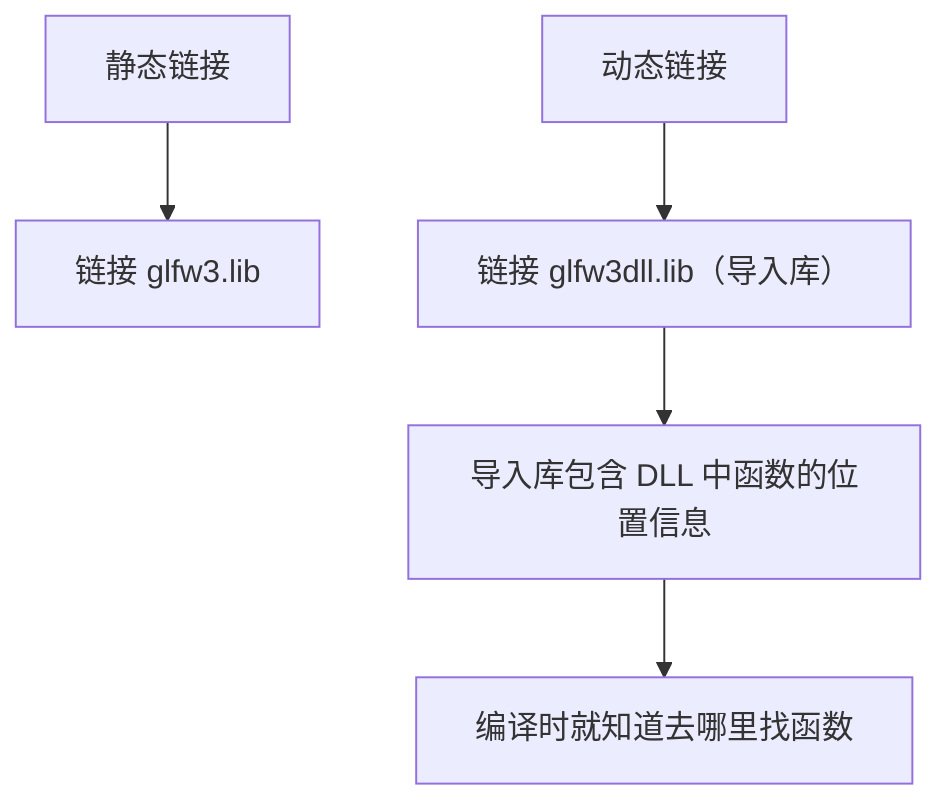
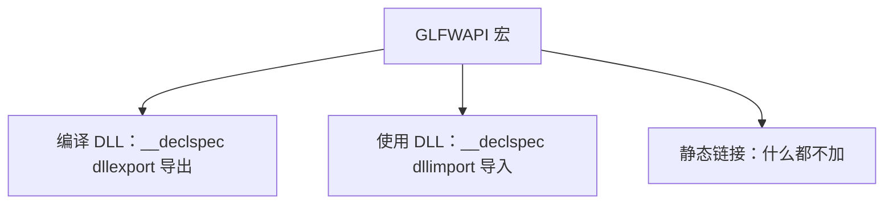

## 本节概述：动态链接在运行时加载库，不是编译时打包

上一节讲了静态链接——库代码直接编译进 exe。这一节讲**动态链接**：链接发生在运行时，库代码在独立的 DLL 文件中，exe 启动时才加载。



## 动态链接的两种方式



半动态是常见方式：exe 知道需要哪个 DLL，启动时自动加载。全自动方式更灵活——exe 完全不知道 DLL 的存在，运行时通过 `LoadLibrary` 手动加载，用 `GetProcAddress` 获取函数指针。本节只讲半动态。

## 从静态链接切换到动态链接

还是以 GLFW 为例。切换到动态链接只需改一个配置——把链接器输入从静态库换成**导入库（import library）**：



链接器 → 输入 → 附加依赖项，把 `glfw3.lib` 改成 `glfw3dll.lib`。

## 编译通过但运行报错

改完之后编译能成功，但**运行时报错**：

```
代码无法执行，因为找不到 glfw3.dll
```

这是因为 exe 声明了需要这个 DLL，但系统找不到它。

## 解决：把 DLL 放到 exe 旁边

最简单的方案：把 `glfw3.dll` 复制到和 exe 相同的目录下。exe 所在目录自动是 DLL 的搜索路径，不需要额外配置。


## 导入库的本质

`glfw3dll.lib` 是**导入库（import library）**——它不是真正的库代码，而是一系列指向 DLL 中函数的指针/位置信息。有了它，链接器编译时就知道每个函数在 DLL 的什么位置，不需要运行时再查找。

> [!WARNING]
> 导入库和 DLL 必须是同一版本、同时编译的。如果用不同版本的导入库配 DLL，函数地址会对不上，程序会崩溃或行为异常。

## 头文件里的玄机：GLFWAPI 宏

打开 GLFW 的头文件 `glfw3.h`，每个函数声明前面都有 `GLFWAPI`：

```cpp
GLFWAPI int glfwInit(void);
```

`GLFWAPI` 的定义根据编译方式不同而不同：

```cpp
#ifdef _WIN32
    #ifdef GLFW_BUILD_DLL
        #define GLFWAPI __declspec(dllexport)   // 编译 DLL 时：导出
    #elif defined(GLFW_DLL)
        #define GLFWAPI __declspec(dllimport)   // 使用 DLL 时：导入
    #else
        #define GLFWAPI                          // 静态链接时：什么都不加
    #endif
#endif
```



有趣的是，即使没有定义 `GLFW_DLL`（即 `GLFWAPI` 为空），程序也能正常运行——因为导入库 `glfw3dll.lib` 已经包含了函数位置信息，`__declspec(dllimport)` 只是告诉编译器"这些函数在 DLL 里"以便做额外优化，不加也能工作。

## 完整示例代码

```cpp
#include <iostream>
#include <GLFW/glfw3.h>    // 头文件不变，静态/动态链接通用

int main()
{
    int result = glfwInit();
    std::cout << result << std::endl;   // 1 = 初始化成功
    std::cin.get();
}
```

代码和静态链接完全一样，区别只在链接器配置和 DLL 文件的位置。

## 本章小结

**动态链接本质**：链接发生在运行时，exe 启动时加载 DLL，库代码不在 exe 内部。

**配置方式**：链接器输入改成导入库（`glfw3dll.lib`），导入库包含 DLL 中函数的位置信息。

**运行要求**：DLL 必须和 exe 在同一目录（或系统搜索路径中），否则启动时报"找不到 DLL"错误。

**导入库 vs 静态库**：导入库只是函数位置表，配合 DLL 使用；静态库包含完整代码，编译进 exe。

**GLFWAPI 宏**：根据编译方式展开为 `__declspec(dllexport)`、`__declspec(dllimport)` 或空。即使不定义 `GLFW_DLL`，导入库也能让程序正常工作。
