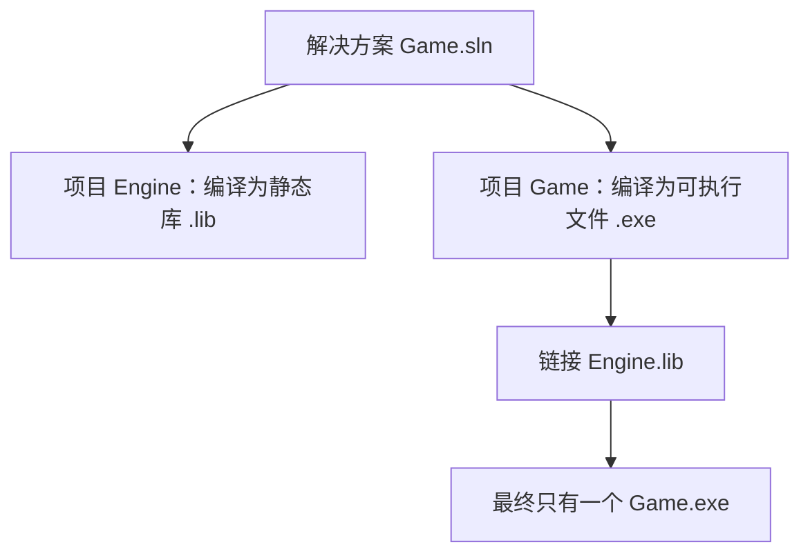
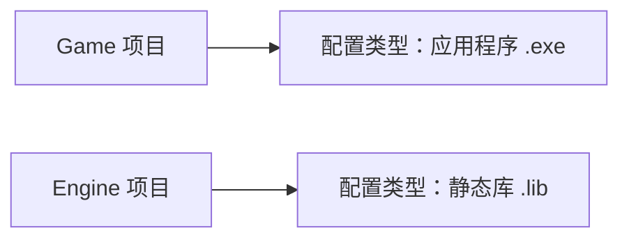
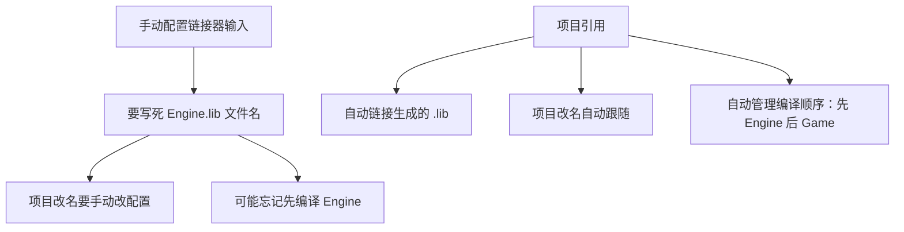

## 本节概述：一个解决方案里放多个项目，库和可执行文件分开管理

前两节讲了怎么链接别人的库。这一节讲怎么**自己创建库**——在 Visual Studio 里用一个解决方案（Solution）管理多个项目（Project），一个项目编译成静态库，另一个项目编译成可执行文件并链接它。

典型场景：写一个游戏引擎（Engine），编译成静态库；再写游戏（Game），编译成 exe，链接 Engine。



## 创建解决方案和项目

新建一个空项目叫 `Game`，这就是可执行文件项目。然后右键解决方案 → 添加 → 新建项目，创建第二个空项目叫 `Engine`。

目录结构：

```
Game/
├── Game.sln
├── Game/
│   └── src/
│       └── Application.cpp
└── Engine/
    └── src/
        ├── Engine.h
        └── Engine.cpp
```

## 设置项目类型

两个项目的**配置类型**不同：



右键 Engine → 属性 → 常规 → 配置类型，改成**静态库（.lib）**。Game 保持默认的应用程序即可。

## 编写库代码

Engine 项目里写一个简单的命名空间和函数：

```cpp
// Engine.h
#pragma once

namespace Engine
{
    void PrintMessage();
}
```

```cpp
// Engine.cpp
#include "Engine.h"
#include <iostream>

namespace Engine
{
    void PrintMessage()
    {
        std::cout << "Hello World" << std::endl;
    }
}
```

编译 Engine 项目会生成 `Engine.lib` 文件。

## 在 Game 中包含 Engine 的头文件

Game 的 `Application.cpp` 要调用 `Engine::PrintMessage()`，需要先包含头文件。

### 错误方式：相对路径

```cpp
#include "../../Engine/src/Engine.h"   // 能工作，但太脆弱
```

目录结构一变就全挂，不推荐。

### 正确方式：编译器包含目录

右键 Game → 属性 → C/C++ → 常规 → 附加包含目录：

```
$(SolutionDir)Engine\src
```

然后代码里直接写：

```cpp
#include "Engine.h"   // 干净简洁
```


## 引号 vs 尖括号的选择

```cpp
#include "Engine.h"         // 解决方案内的文件，用引号
#include <iostream>         // 外部库/标准库，用尖括号
```

个人习惯：解决方案内的代码用引号，外部依赖用尖括号，一眼看出文件归属。

## 链接库：用引用而不是手动配置

有了头文件还不够，还要链接 `Engine.lib`。上一节学的手动配置链接器输入当然可行，但 Visual Studio 提供了更好的方式——**项目引用**：

右键 Game → 添加 → 引用 → 勾选 Engine → 确定。



## 项目引用的好处：依赖管理

添加引用后，Visual Studio 知道 Game 依赖 Engine。编译 Game 时会**自动先编译 Engine**，确保链接的永远是最新的库。


不用手动关心编译顺序，也不用记 lib 文件的路径和名字。

## 静态链接的最终产物

因为 Engine 是静态库，编译进 Game.exe 后，最终的 `Game.exe` 是**完全独立的**——复制到任何目录双击就能运行，不需要额外文件。

## 完整示例代码

```cpp
// Engine/src/Engine.h
#pragma once

namespace Engine
{
    void PrintMessage();
}
```

```cpp
// Engine/src/Engine.cpp
#include "Engine.h"
#include <iostream>

namespace Engine
{
    void PrintMessage()
    {
        std::cout << "Hello World" << std::endl;
    }
}
```

```cpp
// Game/src/Application.cpp
#include <iostream>
#include "Engine.h"

int main()
{
    Engine::PrintMessage();
    std::cin.get();
}
```

## 本章小结

**多项目结构**：一个解决方案放多个项目，库项目和可执行项目分开管理，代码模块化。

**库项目配置**：配置类型设为静态库（.lib），编译后生成 .lib 文件。

**头文件引用**：用 `$(SolutionDir)` 宏设置编译器包含目录，不要用脆弱的相对路径。

**链接方式**：用项目引用而不是手动配置链接器——自动管理编译顺序、自动跟随项目改名、代码永远是最新的。

**静态链接的好处**：最终 exe 完全独立，复制到任何地方都能运行，不需要额外文件。
