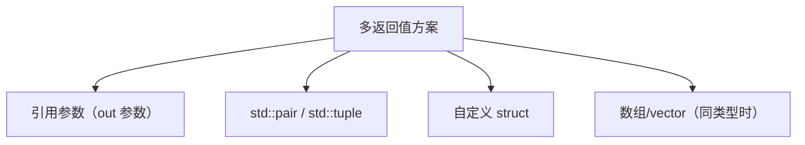
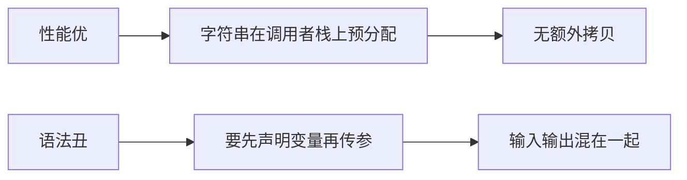
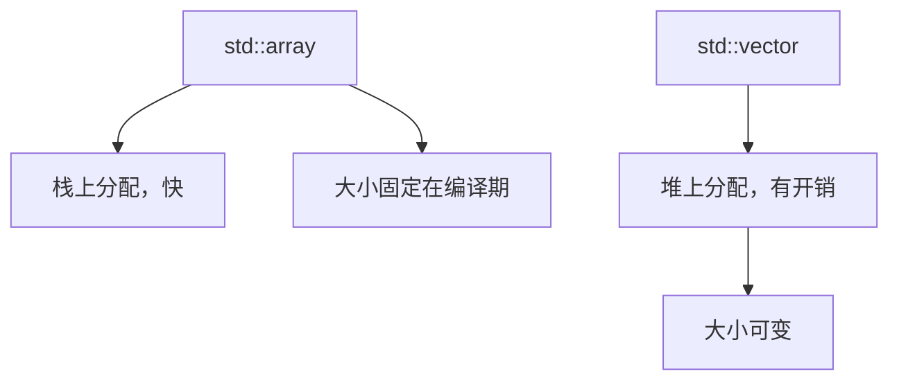
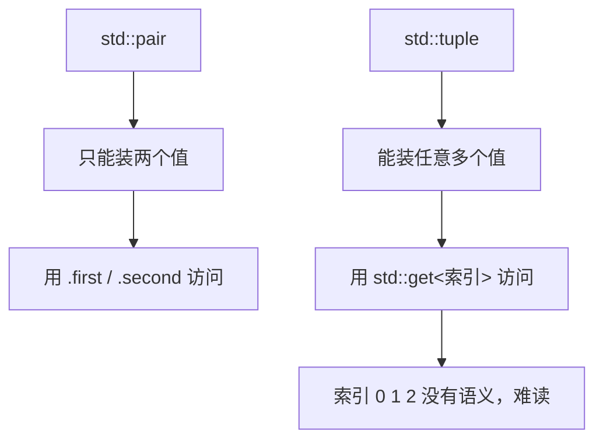
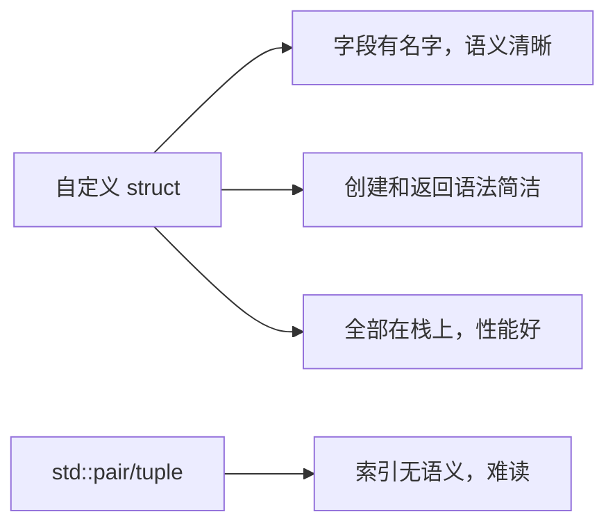

## 本节概述：C++ 函数只能返回一个值，多返回值有好几种方案

C++ 函数只能返回一个值。如果需要返回两个或多个不同类型的数据，有几种常见的处理方式。这一节以真实项目中的 shader 解析为例，逐一对比各种方案的优劣。



## 方案一：引用参数（out 参数）

函数返回 void，通过引用参数"写回"结果：

```cpp
void ParseShader(std::string& vertexSource, std::string& fragmentSource)
{
    vertexSource   = "vertex shader code...";
    fragmentSource = "fragment shader code...";
}

int main()
{
    std::string vs, fs;
    ParseShader(vs, fs);
}
```

优点：性能好——字符串在调用者栈帧里预先分配，函数里直接赋值写入，没有额外拷贝。

缺点：语法不够直观。调用前要先声明两个变量，然后传进去，第一眼看不清楚哪些是输入、哪些是输出。



## 方案二：指针参数

和引用参数类似，但用指针代替引用：

```cpp
void ParseShader(std::string* vertexSource, std::string* fragmentSource)
{
    if (vertexSource)
        *vertexSource = "vertex shader code...";
    if (fragmentSource)
        *fragmentSource = "fragment shader code...";
}

ParseShader(&vs, &fs);   // 传地址
ParseShader(nullptr, &fs); // 只关心 fragment，忽略 vertex
```

优点：可以传 `nullptr`，表示"我不需要这个返回值"。调用时取地址操作 `&` 让意图更明显。

缺点：语法更冗长，需要判空检查。

## 方案三：返回数组或 std::array（同类型时）

如果返回值类型相同，可以返回数组：

```cpp
std::array<std::string, 2> ParseShader()
{
    std::array<std::string, 2> result;
    result[0] = "vertex shader code...";
    result[1] = "fragment shader code...";
    return result;
}
```

或者用 `std::vector`：

```cpp
std::vector<std::string> ParseShader()
{
    std::vector<std::string> result;
    result.push_back("vertex shader code...");
    result.push_back("fragment shader code...");
    return result;
}
```

`std::array` 在栈上分配，返回速度快；`std::vector` 在堆上分配，有额外开销。两者都只适合**同类型**数据。



## 方案四：std::pair 和 std::tuple

C++ 标准库提供的通用多返回值方案：

```cpp
std::pair<std::string, std::string> ParseShader()
{
    return std::make_pair("vertex...", "fragment...");
}

auto sources = ParseShader();
sources.first;   // vertex
sources.second;  // fragment
```

`std::pair` 只能装两个值。`std::tuple` 可以装任意多个：

```cpp
std::tuple<std::string, std::string, int> ParseShader()
{
    return std::make_tuple("vertex...", "fragment...", 42);
}

auto sources = ParseShader();
std::get<0>(sources);   // vertex
std::get<1>(sources);   // fragment
std::get<2>(sources);   // 42
```



最大的问题是 `std::get<0>` 这种写法——索引没有任何语义，完全不知道哪个是 vertex、哪个是 fragment，代码可读性很差。

## 方案五：自定义 struct（推荐）

创建一个简单的结构体包装返回值：

```cpp
struct ShaderProgramSource
{
    std::string VertexSource;
    std::string FragmentSource;
};

ShaderProgramSource ParseShader()
{
    return { "vertex...", "fragment..." };
}

int main()
{
    auto source = ParseShader();
    std::cout << source.VertexSource << std::endl;
    std::cout << source.FragmentSource << std::endl;
}
```



优势：字段有名字（`VertexSource`、`FragmentSource`），语义清晰；创建和返回语法简洁（`return { vs, fs };`）；不需要额外头文件（`pair`、`tuple` 要包含头文件）；性能好，全部在栈上分配。

## 各种方案对比

| 方案 | 性能 | 可读性 | 灵活性 | 适用场景 |
| --- | --- | --- | --- | --- |
| 引用参数 | 高 | 一般 | 一般 | 性能敏感、返回值少 |
| 指针参数 | 高 | 一般 | 高（可传 null） | 可选返回值 |
| std::array | 高 | 一般 | 低（同类型） | 同类型固定数量 |
| std::vector | 一般 | 一般 | 中（同类型可变） | 同类型数量不定 |
| std::pair | 高 | 一般 | 低（两个值） | 两个值且不愿写 struct |
| std::tuple | 高 | 差 | 高（任意数量） | 快速原型 |
| **自定义 struct** | **高** | **好** | **高** | **正式项目首选** |

## 完整示例代码

```cpp
#include <iostream>
#include <string>

struct ShaderProgramSource
{
    std::string VertexSource;
    std::string FragmentSource;
};

ShaderProgramSource ParseShader()
{
    return { "vertex shader code", "fragment shader code" };
}

int main()
{
    auto source = ParseShader();
    std::cout << source.VertexSource << std::endl;
    std::cout << source.FragmentSource << std::endl;

    std::cin.get();
}
```

## 本章小结

**C++ 函数只能返回一个值**，多返回值没有原生支持，但有多种替代方案。

**引用参数**性能好但语法不够直观；**指针参数**允许传 `nullptr` 表示不需要某个返回值。

**std::array/vector**只适合同类型数据；**std::pair/tuple**通用但索引无语义，可读性差。

**自定义 struct 是推荐方案**——字段有名字、语义清晰、创建语法简洁、性能不损失，是正式项目处理多返回值的最佳选择。
