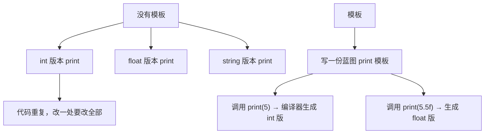
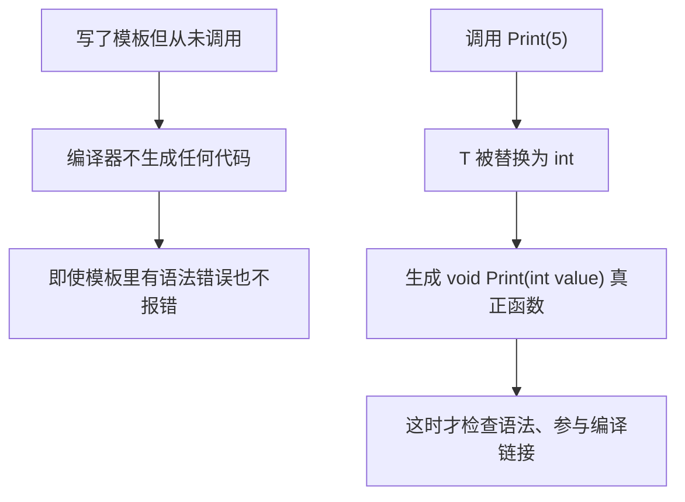
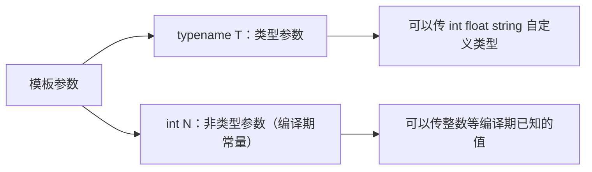
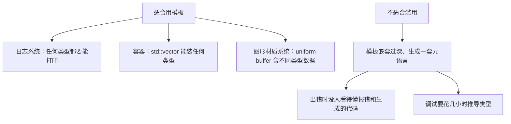

## 本节概述：模板就是让编译器按你的规则帮你写代码

假设要写一个 Print 函数，能打印 int、float、string……没有模板就得为每种类型写一遍重载，代码重复。模板的作用是：**写一份"蓝图"，编译器在你实际调用时根据传入的类型自动生成具体代码**。



## 函数模板

```cpp
template<typename T>
void Print(T value)
{
    std::cout << value << std::endl;
}
```

`template` 关键字声明这是一个模板；`<typename T>` 是模板参数，`T` 是类型名，可以叫任何名字（习惯用 `T`）；函数体里把 `T` 当类型用。

调用方式：

```cpp
Print(5);           // 编译器从实参推断 T = int
Print(5.5f);        // T = float
Print<std::string>("Hello");   // 显式指定 T
```

> [!TIP]
> `typename` 和 `class` 在模板参数里完全等价，习惯用 `typename`——`class` 容易让人误以为 T 必须是类类型，其实 int 这种基本类型也可以。

## 模板不是实际代码：用了才生成

模板本身**不是一个真正的函数**，它只是生成函数的蓝图。只有当你实际调用它时，编译器才会用具体类型替换 T，生成真正的函数。



> [!WARNING]
> 不同编译器行为有差异：MSVC 对未使用的模板不做深入检查，模板里有错也可能不报错；clang 会更积极地检查。不要依赖这种行为。

## 类模板：不只是类型，还能传整数

模板参数不局限于类型，还可以是**编译期常量**，比如整数。写一个栈上分配的定长数组：

```cpp
template<int N>
class Array
{
private:
    int m_Array[N];   // 大小 N 在编译期确定，才能栈分配
public:
    int GetSize() const { return N; }
};
```

```cpp
Array<5> array;          // 编译器生成 N = 5 的版本
std::cout << array.GetSize() << std::endl;   // 5
```

`Array<5>` 和 `Array<10>` 是两个完全不同的类型，编译器各生成一份代码。

## 多个模板参数：类型 + 大小

再进一步，让数组元素类型也可变：

```cpp
template<typename T, int N>
class Array
{
private:
    T m_Array[N];
public:
    int GetSize() const { return N; }
};
```

```cpp
Array<int, 5> a;                 // 5 个 int
Array<std::string, 50> b;        // 50 个 string
```

这正是标准库 `std::array<T, N>` 的工作方式——两个模板参数：类型和大小。



## 模板的本质：编译期元编程

普通编程是告诉程序**运行时**做什么；模板是告诉**编译器**在编译期做什么。编译器根据模板和实际用法生成代码，这就是一种元编程（meta programming），非常强大。

## 什么时候该用，什么时候别用



有些团队完全禁用模板，属于过度反应；但把模板玩得太复杂（层层嵌套、靠它生成整套 DSL）也会让代码脆弱难懂。合理的态度是：**用模板消除明确的重复，但别把所有逻辑都塞进模板魔法里**。

## 完整示例代码

```cpp
#include <iostream>
#include <string>

// 函数模板：一份蓝图，适配任意类型
template<typename T>
void Print(T value)
{
    std::cout << value << std::endl;
}

// 类模板：栈上定长数组，类型和大小都在编译期指定
template<typename T, int N>
class Array
{
private:
    T m_Array[N];
public:
    int GetSize() const { return N; }
};

int main()
{
    Print(5);                    // 自动推断 T = int
    Print(5.5f);                 // T = float
    Print<std::string>("Hello"); // 显式指定

    Array<int, 5> intArray;
    std::cout << intArray.GetSize() << std::endl;    // 5

    Array<std::string, 50> strArray;
    std::cout << strArray.GetSize() << std::endl;    // 50

    std::cin.get();
}
```

## 本章小结

**模板是什么**：一份代码蓝图，编译器根据实际调用时传入的类型/常量自动生成具体代码，避免为每种类型重复写函数或类。

**函数模板**：`template<typename T> void Print(T value)`，调用时可以显式写 `Print<int>(5)`，也可以让编译器从实参自动推断。

**模板按需生成**：模板本身不是实际代码，未被调用就不生成、不检查；调用时编译器才用具体类型替换 T。

**类模板与非类型参数**：模板参数可以是类型（`typename T`），也可以是编译期常量（`int N`），还能多个组合，如 `std::array<T, N>`。

**使用分寸**：模板适合消除容器、日志这类明显的类型重复；过度复杂的模板会让报错和调试变成灾难，不应滥用。
