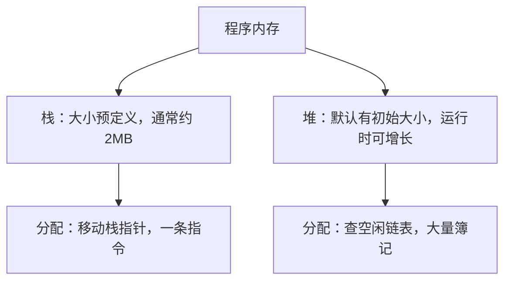
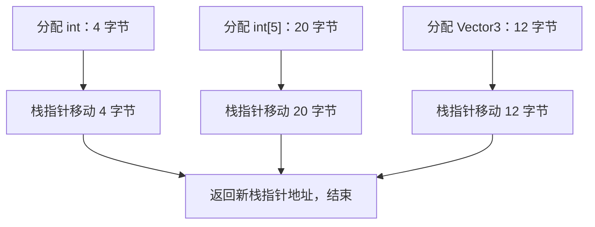
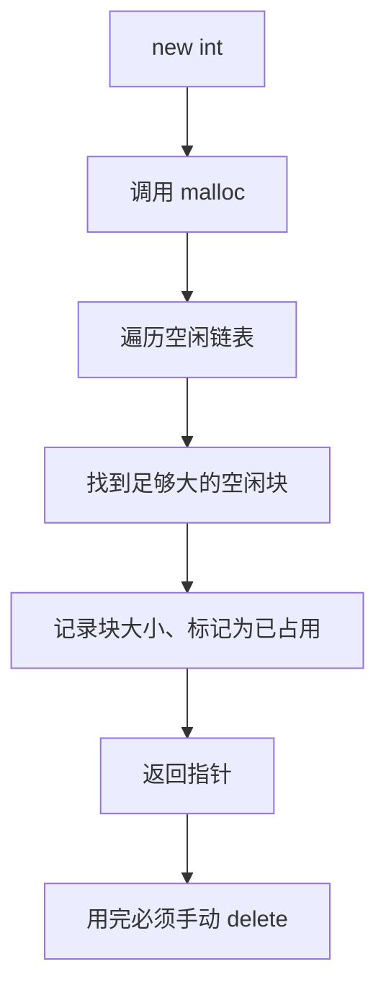
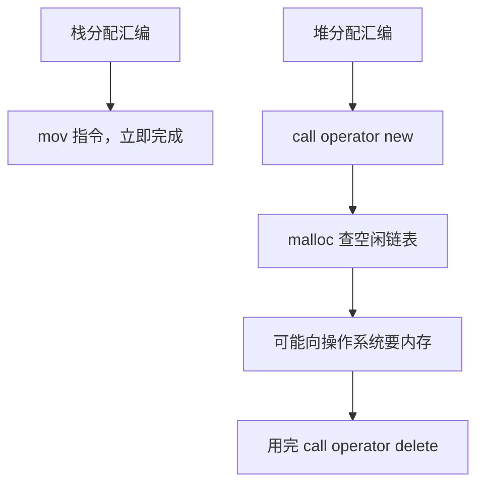
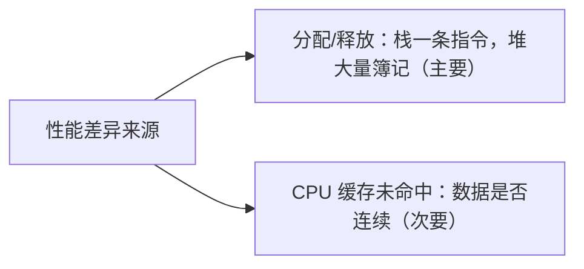
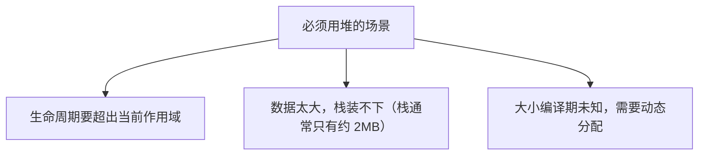

## 本节概述：栈分配是一条 CPU 指令，堆分配是一整套簿记流程

程序启动后，操作系统把程序载入内存并分配一批物理 RAM。内存被划分成多个区域，其中最常用的两块就是**栈（stack）**和**堆（heap）**。两者都在物理内存里，功能也一样——存数据，区别在于**分配和释放内存的方式**。



## 栈分配 vs 堆分配：写法对比

```cpp
// 栈分配：直接声明
int value = 5;
int array[5];
Vector3 vector;

// 堆分配：new 返回指针
int* hValue = new int;
*hValue = 5;
int* hArray = new int[5];
Vector3* hVector = new Vector3();
```

堆分配的标志是 `new` 关键字（智能指针的 `make_unique`/`make_shared` 内部也是调 new），拿到的是指针。

## 栈的工作原理：移动栈指针

栈上的变量在内存里**紧紧挨在一起**，像叠盘子一样堆叠。分配内存时 CPU 只做一件事：**移动栈指针**。



多数实现里栈向**低地址方向**生长，所以后分配的变量地址反而更低，但本质就是指针挪一下。这就是栈分配极快的原因——**一条 CPU 指令**。

## 栈的释放：作用域结束自动弹栈

任何作用域结束时（函数体、`{}` 空块、for 循环、if 语句），里面分配的栈变量全部自动释放——栈指针直接回到进入作用域之前的位置，同样是一条指令。


不需要写任何释放代码，也不花钱。

## 堆的工作原理：空闲链表 + 簿记

`new` 内部调用 `malloc`（memory allocate），malloc 再请求操作系统或从程序已持有的内存中分配。程序维护一张**空闲链表（free list）**，记录哪些内存块空闲、位置在哪、大小多少。



如果空闲链表里没有足够大的块，还要向操作系统申请更多内存——这一步代价极高。

> [!NOTE]
> 用了 `new` 就必须配对 `delete`；数组用 `new[]` 就要用 `delete[]`。智能指针会自动处理。

```cpp
delete hValue;
delete[] hArray;
delete hVector;
```

## 汇编层面的差异

栈上一个 `int value = 5` 编译后基本就是一条"把 5 移到栈指针偏移位置"的指令。堆分配则是 `call operator new`——进入一个完整函数，走空闲链表、查块、记账，delete 时同样要走一整套回收流程。



## 缓存因素：次要差异

栈上的数据连续紧凑，容易落在同一条 CPU 缓存行上，而且栈被频繁访问通常是"热"的；堆上多次分配的数据散落在内存各处，可能产生缓存未命中。但只有几次访问时这个差异几乎感觉不到——**真正的性能差距在分配本身，不在访问**。



> [!TIP]
> 如果在程序启动时一次性在堆上预分配一大块内存（比如 1GB），之后只从这块内存里取用，那"分配"开销基本消失，栈堆访问速度几乎一样。游戏引擎里的内存池就是这个思路。

## 什么时候用堆

能用栈就用栈。只有这些情况才需要堆：



比如一张 15MB 的贴图放不进栈，必须放堆上；一个对象要在函数返回后继续被使用，也只能放堆上（配合智能指针管理）。

## 完整示例代码

```cpp
#include <iostream>

struct Vector3
{
    float x = 10.0f;
    float y = 11.0f;
    float z = 12.0f;
};

int main()
{
    // 栈分配：作用域结束自动释放
    int value = 5;
    int array[5] = { 1, 2, 3, 4, 5 };
    Vector3 vector;

    // 堆分配：必须手动 delete（实际项目用智能指针）
    int* hValue = new int;
    *hValue = 5;
    int* hArray = new int[5];
    Vector3* hVector = new Vector3();

    std::cout << *hValue << std::endl;

    delete hValue;       // 配对释放
    delete[] hArray;
    delete hVector;

    std::cin.get();
}
```

## 本章小结

**栈**：大小预定义（约 2MB），分配就是移动栈指针，一条 CPU 指令；作用域结束自动弹栈释放，也是一条指令；数据连续，缓存友好。

**堆**：大小可动态增长，`new` 内部走 malloc + 空闲链表查找 + 簿记，必要时还要向操作系统申请，开销大；必须 `delete` 手动释放，否则泄漏。

**性能差距主要在分配/释放**，不在访问本身；几次缓存未命中可以忽略，上百万次才明显。

**选型原则**：能上栈就上栈；只有生命周期要超出作用域、数据过大、或大小运行时才知道时，才用堆。
