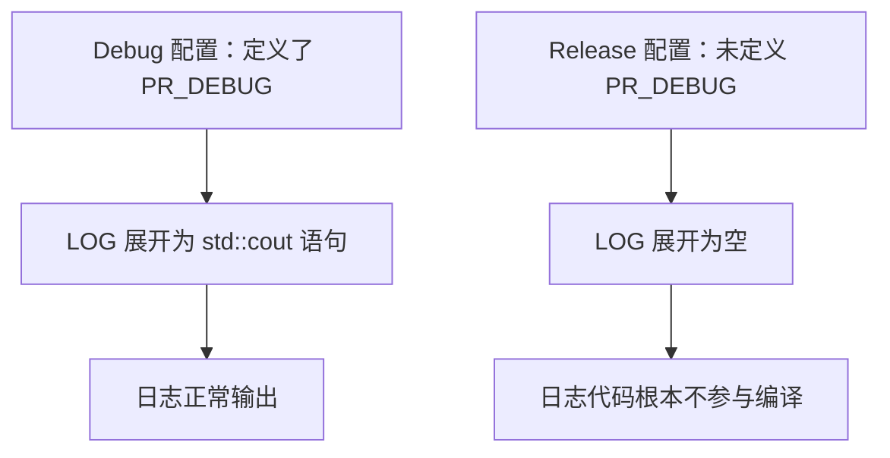
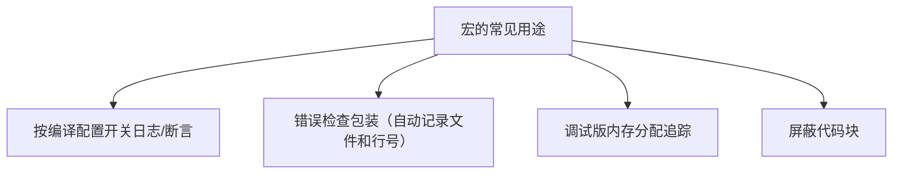

## 本节概述：宏就是预处理器做的纯文本查找替换

编译 C++ 程序的第一步是**预处理**：所有以 `#` 开头的语句（预处理指令）先被处理，处理完的文本才交给真正的编译器。宏（macro）就是在这个阶段做的**文本查找替换**——它不懂 C++ 语法，纯粹是文本层面的替换，而且可以带参数。


## 最简单的宏：#define

```cpp
#include <iostream>

#define WAIT std::cin.get()

int main()
{
    WAIT;
}
```

预处理器看到 `WAIT`，就把它替换成 `std::cin.get()`，编译器实际看到的是原来的完整代码。

注意定义时**不要带分号**，分号写在使用处——这样代码看起来才像正常的 C++ 语句。如果把分号写进宏，`WAIT;` 展开后就变成两条语句，很别扭。

> [!WARNING]
> 这个例子只是演示原理，实际别这么干。如果 `WAIT` 定义在别的文件里，读代码的人看到一个孤零零的 `WAIT` 根本不知道是什么，还要去翻定义。直接写 `std::cin.get()` 更清楚——写代码不是混淆比赛。

宏可以替换任何文本，包括一个花括号（虽然没有任何意义），因为预处理器完全不关心 C++ 语法。

## 带参数的宏

宏可以接收参数，把参数文本粘贴进替换内容：

```cpp
#define LOG(x) std::cout << x << std::endl

int main()
{
    LOG("Hello");   // 展开为 std::cout << "Hello" << std::endl;
}
```

预处理器把括号里的内容原样复制到替换文本中 `x` 的位置。

## 真正有用的场景：按配置开关日志

宏最有价值的用途之一：**调试版本保留日志，发布版本彻底删除日志代码**。

先在项目属性的预处理定义里，为 Debug 配置定义 `PR_DEBUG=1`（PR 是项目前缀，像命名空间一样防止和别的宏冲突）。然后：

```cpp
#ifdef PR_DEBUG
    #define LOG(x) std::cout << x << std::endl
#else
    #define LOG(x)   // 替换成什么都没有
#endif

int main()
{
    LOG("Hello");
}
```



发布版本里 `LOG("Hello")` 被替换成空白，**这段代码连编译都不参与**——既不会泄露调试信息，也没有任何性能开销。这比运行时 `if` 判断更彻底。

### 更好的写法：用值而不是 ifdef

```cpp
#define PR_DEBUG 1

#if PR_DEBUG == 1
    #define LOG(x) std::cout << x << std::endl
#else
    #define LOG(x)
#endif
```

用 `#if PR_DEBUG == 1` 判断值，好处是想关掉时不用删掉或注释整个定义，把 1 改成 0 就行，意图更清晰。也可以在项目属性里定义 `PR_DEBUG=1`，效果一样。

## 屏蔽整段代码

```cpp
#if 0
    // 这里的代码全部不参与编译
    LOG("this won't compile");
#endif
```

`#if 0` 相当于恒假，可以快速禁用一大段代码（比注释更可靠，不怕嵌套注释问题）。

## 多行宏：反斜杠续行

宏默认必须写在一行。多行宏用行尾的**反斜杠 `\`** 续行——它转义了换行符，让预处理器把下一行也当作宏的一部分：

```cpp
#define MAIN int main() \
{ \
    std::cin.get(); \
}

MAIN
```

> [!WARNING]
> 反斜杠后面必须**直接换行**，不能有空格。有空格的话转义的是空格而不是换行，宏会提前结束。

## 预处理器内置符号

预处理器提供了一些内置宏，常用于调试日志：

```cpp
__FILE__       // 当前文件名
__LINE__       // 当前行号
__FUNCTION__   // 当前函数名
```

结合自定义宏，可以自动记录"哪个文件、哪一行"输出的日志。

## 宏的实际用途



比如内存调试：Debug 版把 `new` 替换成自定义分配宏，自动记录"哪个文件第几行分配了多少字节"；OpenGL 调试可以把每个 API 调用包进宏里自动做错误检查。这些场景利用的是宏在预处理阶段就能拿到文件名、行号，并能按配置整体消失的能力，普通 C++ 代码做不到。

## 宏 vs 模板

模板在编译阶段处理，是真正的 C++ 类型系统的一部分；宏在预处理阶段处理，只是文本替换，编译器在替换之后才介入。两者不是一回事。

## 完整示例代码

```cpp
#include <iostream>

#define PR_DEBUG 1

#if PR_DEBUG == 1
    #define LOG(x) std::cout << x << std::endl
#else
    #define LOG(x)
#endif

int main()
{
    LOG("Hello");              // Debug 版输出，Release 版消失
    std::cout << __FILE__ << std::endl;    // 文件名
    std::cout << __LINE__ << std::endl;    // 行号

    std::cin.get();
}
```

## 本章小结

**宏的本质**：预处理器在编译前做的纯文本查找替换，不懂 C++ 语法，可以带参数。

**基本语法**：`#define 名称 替换内容`，定义里通常不写分号；带参数写成 `#define LOG(x) ...`。

**核心用途**：配合 `#if`/`#ifdef` 按编译配置开关代码——Debug 保留日志，Release 把日志替换为空，连编译都不参与。

**多行宏**用行尾反斜杠续行，反斜杠后必须直接换行。

**使用态度**：宏主要用于调试和条件编译，不要用它给普通语句起别名，那只会让代码难懂；能用正常 C++ 特性（const、inline、模板）解决的，就别用宏。
