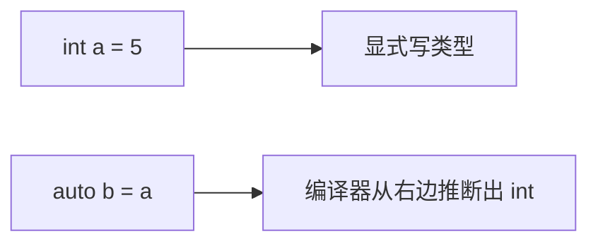
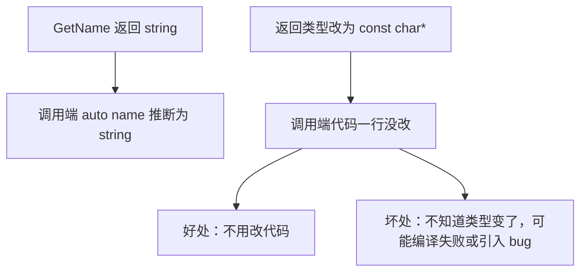
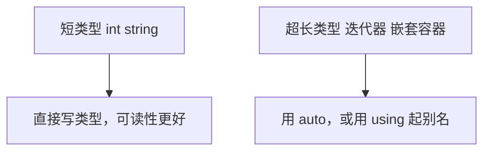
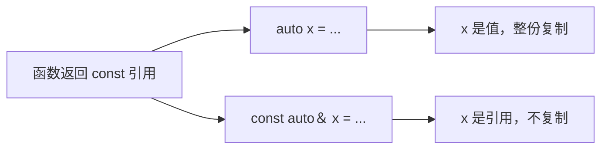
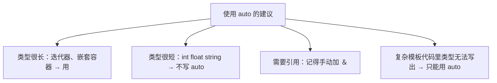

## 本节概述：auto 让编译器从右边的表达式自动推断类型

前面写变量都要显式写类型：int、float、std::string……C++ 提供了 `auto` 关键字，让编译器根据初始化表达式**自动推断**变量的类型，不必再手写。概念非常简单，这一节主要讨论它的好处、坏处和使用分寸。



## auto 的基本用法

```cpp
auto a = 5;          // 数字字面量 5 默认是 int → a 是 int
auto b = a;          // a 是 int → b 也是 int

auto l = 5L;         // 5L 是 long → l 是 long
auto f = 5.5f;       // 5.5f 是 float → f 是 float
auto s = "Cherno";   // 字符串字面量是 const char* → s 是 const char*
```

在编辑器里把鼠标悬停在变量上，智能提示会显示推断出的真实类型。

## 场景一：接收函数返回值

```cpp
std::string GetName()
{
    return "Cherno";
}

int main()
{
    std::string name1 = GetName();   // 显式写类型
    auto name2 = GetName();          // 编译器知道返回 string，自动推断
}
```

好处是：**如果哪天把 GetName 的返回类型改了（比如改成 const char\*），调用端不用改**。

但这也是坏处——类型"悄悄"变了，调用端可能毫无察觉。如果代码依赖 `name.size()` 这类 std::string 特有操作，返回类型变成 const char\* 后就会编译失败；更麻烦的是某些类型之间存在隐式转换，编译能过却引入了运行时 bug（比如序列化时 sizeof 变了）。



> [!TIP]
> 像 int、string 这种一眼能看清的短类型，作者建议直接写出来。读代码时看到 `auto name` 还得悬停或跳到函数定义去查类型，降低可读性；显式写类型还能让 API 变更在编译期立刻暴露。

## 场景二：类型名又长又臭

这才是 auto 真正发挥价值的地方。比如迭代器：

```cpp
std::vector<std::string> strings = { "Apple", "Orange" };

// 不用 auto：类型名又长又重复
for (std::vector<std::string>::iterator it = strings.begin();
     it != strings.end(); ++it)
{
    std::cout << *it << std::endl;
}

// 用 auto：清爽
for (auto it = strings.begin(); it != strings.end(); ++it)
{
    std::cout << *it << std::endl;
}
```

再比如一个多层嵌套的容器：

```cpp
std::unordered_map<std::string, std::vector<Device*>> GetDevices() const;

// 不用 auto，类型长到一行放不下
const std::unordered_map<std::string, std::vector<Device*>>& devices = dm.GetDevices();

// 用 auto
const auto& devices = dm.GetDevices();
```



> [!NOTE]
> 另一种做法是用类型别名缩短类型名：`using DeviceMap = std::unordered_map<std::string, std::vector<Device*>>;`（老式写法是 typedef）。别名可以放进 DeviceManager 类里随头文件一起提供，比 auto 更明确。

## auto 不会自动带上引用：注意复制陷阱

这是用 auto 最容易踩的坑：**即使函数返回的是引用，auto 推断出的也只是值类型，会发生复制**。

```cpp
const auto devices = dm.GetDevices();   // 复制整个 map！
const auto& devices = dm.GetDevices();  // 引用，不复制
```



需要引用或 const 引用时，必须自己写上 `&` 或 `const auto&`，auto 只负责推断**基础类型**，引用和 const 限定要手动加。

## auto 的其他用途

auto 还用于函数声明的**尾置返回类型**（trailing return type），C++14 起甚至可以让函数返回类型也由编译器推断。这些属于进阶用法，本节只讨论变量类型推断。

## 使用分寸



有些重度模板的代码库里类型根本无法手写出来，只能用 auto。但如果代码已经复杂到连类型都看不懂、维护者自己都讲不清运行机制，那问题往往不在 auto，而在整体设计过度复杂。

## 完整示例代码

```cpp
#include <iostream>
#include <string>
#include <vector>
#include <unordered_map>

class Device {};

class DeviceManager
{
private:
    std::unordered_map<std::string, std::vector<Device*>> m_Devices;
public:
    const std::unordered_map<std::string, std::vector<Device*>>& GetDevices() const
    {
        return m_Devices;
    }
};

std::string GetName()
{
    return "Cherno";
}

int main()
{
    auto a = 5;                  // int
    auto f = 5.5f;               // float

    auto name = GetName();       // std::string

    std::vector<std::string> strings = { "Apple", "Orange" };
    for (auto it = strings.begin(); it != strings.end(); ++it)
    {
        std::cout << *it << std::endl;
    }

    DeviceManager dm;
    const auto& devices = dm.GetDevices();   // const 引用，不复制

    std::cin.get();
}
```

## 本章小结

**auto 的作用**：编译器根据初始化表达式自动推断变量类型，`auto a = 5;` 推断为 int，`auto s = GetName();` 推断为函数返回类型。

**优点**：接收超长类型（迭代器、嵌套容器）时代码明显更简洁；API 返回类型改变时调用端无需修改。

**缺点**：短类型用 auto 降低可读性，读代码要悬停或跳转查类型；类型被悄悄改变时可能引入运行时 bug。

**引用陷阱**：auto 默认推断为值类型会复制，需要引用必须显式写 `auto&` 或 `const auto&`。

**使用建议**：短类型直接写，超长类型用 auto（或用 using 起别名）；类型无法手写的复杂模板场景才必须依赖 auto。
