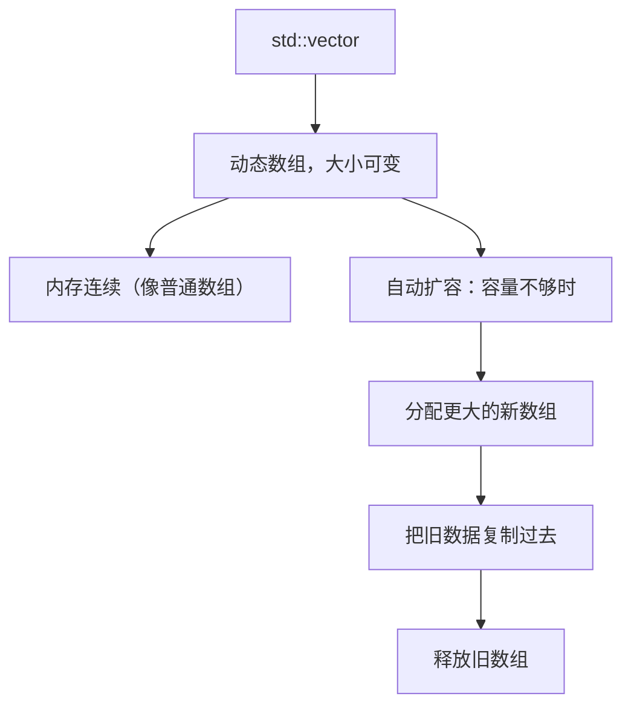
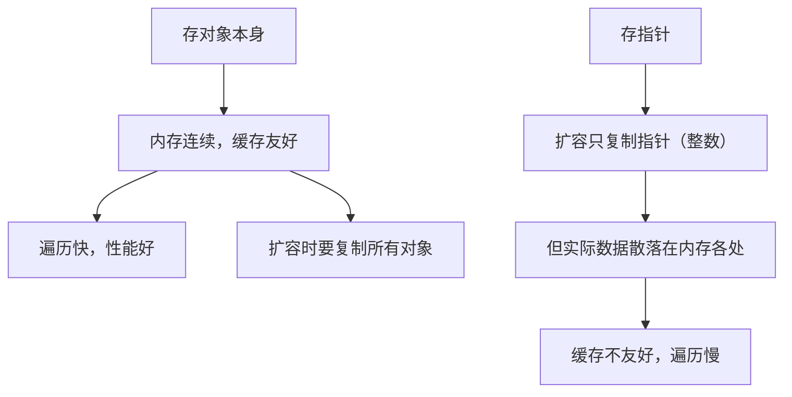
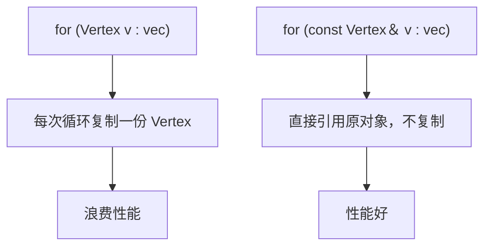
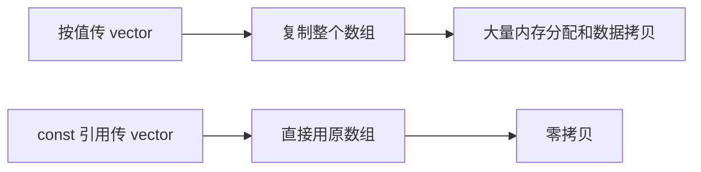

## 本节概述：std::vector 就是会自动扩容的数组

`std::vector` 是标准模板库（STL）里的**动态数组**——和普通数组不同，它不需要预先指定大小，往里放元素时会自动增长。名字叫"vector"其实有点误导，它和数学向量没关系，本质上就是能自动扩容的数组。



## 基本使用

创建 vector 时指定元素类型：

```cpp
#include <vector>

std::vector<Vertex> vertices;   // 存 Vertex 类型的动态数组
```

可以存基本类型，也可以存自定义类型——模板决定了它能装任何类型。

## 存对象还是存指针？

`vector` 可以存对象本身，也可以存指向对象的指针，两者有性能差异：



**优先存对象**，因为连续内存对 CPU 缓存更友好。只有当对象很大、扩容频繁、复制成本太高时，才考虑存指针。指针总是最后的选择。

## 添加元素：push_back

```cpp
vertices.push_back({1, 2, 3});
vertices.push_back({4, 5, 6});
```

`push_back` 把元素加到数组末尾，需要时自动扩容。

## 获取大小与访问元素

```cpp
for (int i = 0; i < vertices.size(); i++)
{
    std::cout << vertices[i] << std::endl;
}
```

`size()` 返回元素个数，`operator[]` 按下标访问，和普通数组一样。

## 范围 for 循环：用引用避免拷贝

```cpp
for (const Vertex& v : vertices)   // const 引用，不复制
{
    std::cout << v << std::endl;
}
```



> [!TIP]
> 范围 for 循环一律用 `const` 引用，除非确实需要修改或副本。

## 清空与删除

清空整个数组：

```cpp
vertices.clear();    // 大小归零
```

删除单个元素用 `erase`，参数是迭代器：

```cpp
vertices.erase(vertices.begin() + 1);   // 删除第二个元素（下标 1）
```

`erase` 的签名看着吓人（`const_iterator` 之类），其实就是传一个指向要删元素的迭代器。`begin()` 返回第一个元素的迭代器，加偏移量就能定位。

## 传参：一定用 const 引用

vector 传参和其他对象一样，**必须用 `const` 引用**，否则会复制整个数组：

```cpp
void Print(const std::vector<Vertex>& vertices)   // const 引用
{
    for (const Vertex& v : vertices)
        std::cout << v << std::endl;
}
```



## 完整示例代码

```cpp
#include <iostream>
#include <vector>

struct Vertex
{
    float x, y, z;
};

std::ostream& operator<<(std::ostream& stream, const Vertex& v)
{
    stream << v.x << ", " << v.y << ", " << v.z;
    return stream;
}

void PrintVertices(const std::vector<Vertex>& vertices)
{
    for (const Vertex& v : vertices)
        std::cout << v << std::endl;
}

int main()
{
    std::vector<Vertex> vertices;
    vertices.push_back({1, 2, 3});
    vertices.push_back({4, 5, 6});
    vertices.push_back({7, 8, 9});

    PrintVertices(vertices);

    std::cout << "size: " << vertices.size() << std::endl;   // 3

    vertices.erase(vertices.begin() + 1);   // 删除第二个
    PrintVertices(vertices);                 // 1 2 3 / 7 8 9

    vertices.clear();
    std::cout << "after clear size: " << vertices.size() << std::endl;  // 0

    std::cin.get();
}
```

## 本章小结

**std::vector 本质**：动态数组，内存连续，大小可变，容量不够时自动分配新内存并复制数据。

**存对象优先**：对象连续存储对缓存友好，遍历快；存指针只在对象大、扩容频繁时考虑。

**常用操作**：`push_back` 加元素、`size()` 取大小、`operator[]` 访问、`clear()` 清空、`erase(iterator)` 删除单个。

**避免拷贝**：范围 for 循环用 `const` 引用；vector 传参一律 `const` 引用。
