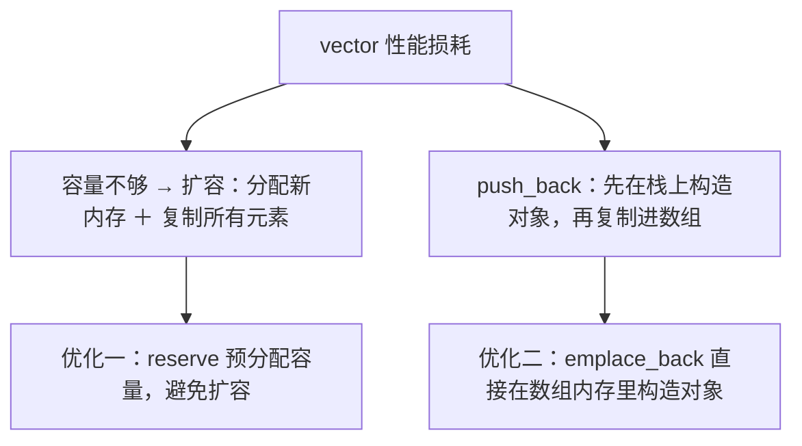
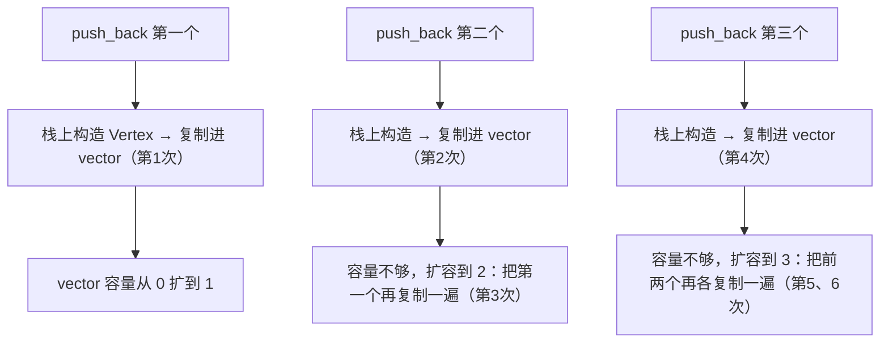
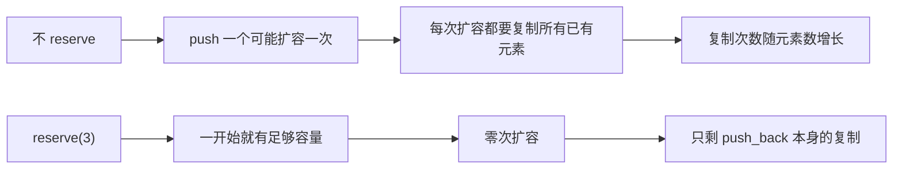
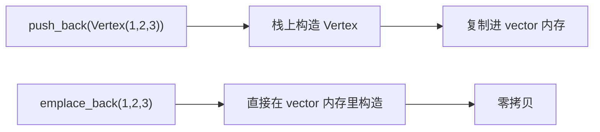

## 本节概述：优化 vector 的关键是知道它什么时候在拷贝

上一节学了 `std::vector` 的基本用法。这一节讲优化——核心原则是**了解你的环境**：知道 vector 内部怎么工作，才能避开性能坑。

vector 慢的根源有两个：**扩容时要复制已有元素**、**push_back 时要把临时对象复制进数组**。优化就是尽量避免这两种复制。



## 追踪拷贝：给类加拷贝构造函数

先看默认用法有多少次拷贝。给 `Vertex` 加一个打印"Copied!"的拷贝构造函数：

```cpp
struct Vertex
{
    float x, y, z;
    Vertex(float x, float y, float z) : x(x), y(y), z(z) {}
    Vertex(const Vertex& other) : x(other.x), y(other.y), z(other.z)
    {
        std::cout << "Copied!" << std::endl;   // 每次拷贝都打印
    }
};
```

然后 push 三个元素：

```cpp
std::vector<Vertex> vertices;
vertices.push_back(Vertex(1, 2, 3));
vertices.push_back(Vertex(4, 5, 6));
vertices.push_back(Vertex(7, 8, 9));
```

运行会输出**六次** "Copied!"。为什么这么多？



六次拷贝的来源：三次是栈对象复制进数组，三次是扩容时旧元素复制到新内存。

## 优化一：reserve 预分配容量

如果事先知道要放多少元素，用 `reserve` 预先分配足够容量，就不需要中途扩容了：

```cpp
std::vector<Vertex> vertices;
vertices.reserve(3);                    // 预留 3 个元素的容量
vertices.push_back(Vertex(1, 2, 3));
vertices.push_back(Vertex(4, 5, 6));
vertices.push_back(Vertex(7, 8, 9));
```

现在只剩**三次**拷贝——少了一半。扩容时的复制全没了。



> [!TIP]
> `reserve` 和构造函数传参、`resize` 不一样。`vector<Vertex> v(3)` 或 `v.resize(3)` 会**实际构造 3 个对象**（需要默认构造函数）；`reserve(3)` 只分配内存，不构造对象，size 仍然是 0。

## 优化二：emplace_back 原地构造

还剩三次拷贝，因为对象先在 main 的栈帧里构造，再被复制进 vector。如果能**直接在 vector 的内存里构造对象**，这三次拷贝也省了——用 `emplace_back`：

```cpp
std::vector<Vertex> vertices;
vertices.reserve(3);
vertices.emplace_back(1, 2, 3);     // 直接传构造函数参数
vertices.emplace_back(4, 5, 6);
vertices.emplace_back(7, 8, 9);
```

`emplace_back` 接收构造函数的参数列表，在 vector 分配好的内存里**直接构造**对象，不经过"栈上构造 ＋ 复制"。运行结果：**零次拷贝**。



## 完整示例代码

```cpp
#include <iostream>
#include <vector>

struct Vertex
{
    float x, y, z;
    Vertex(float x, float y, float z) : x(x), y(y), z(z) {}
    Vertex(const Vertex& other) : x(other.x), y(other.y), z(other.z)
    {
        std::cout << "Copied!" << std::endl;
    }
};

int main()
{
    // 朴素写法：6 次拷贝
    {
        std::vector<Vertex> vertices;
        vertices.push_back(Vertex(1, 2, 3));
        vertices.push_back(Vertex(4, 5, 6));
        vertices.push_back(Vertex(7, 8, 9));
    }
    std::cout << "---" << std::endl;

    // 加 reserve：3 次拷贝
    {
        std::vector<Vertex> vertices;
        vertices.reserve(3);
        vertices.push_back(Vertex(1, 2, 3));
        vertices.push_back(Vertex(4, 5, 6));
        vertices.push_back(Vertex(7, 8, 9));
    }
    std::cout << "---" << std::endl;

    // reserve + emplace_back：0 次拷贝
    {
        std::vector<Vertex> vertices;
        vertices.reserve(3);
        vertices.emplace_back(1, 2, 3);
        vertices.emplace_back(4, 5, 6);
        vertices.emplace_back(7, 8, 9);
    }

    std::cin.get();
}
```

## 本章小结

**优化的前提**：了解 vector 怎么工作——容量超了会扩容（复制所有元素），push_back 会把临时对象复制进数组。

**优化一 reserve**：事先知道元素数量时，`reserve(n)` 预分配容量，避免中途扩容复制。`reserve` 只分配内存不构造对象，区别于 `resize`。

**优化二 emplace_back**：用 `emplace_back(构造参数...)` 代替 `push_back(对象)`，直接在 vector 内存里构造对象，省去一次拷贝。

**效果对比**：朴素写法 6 次拷贝 → 加 reserve 剩 3 次 → 再加 emplace_back 归零。
