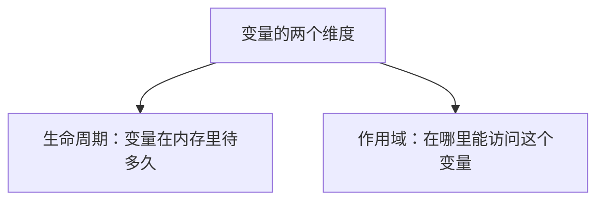
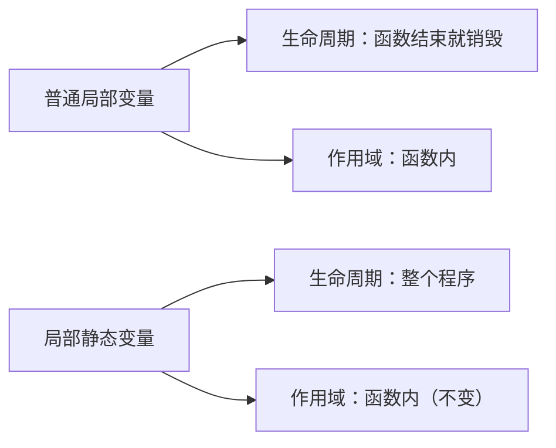
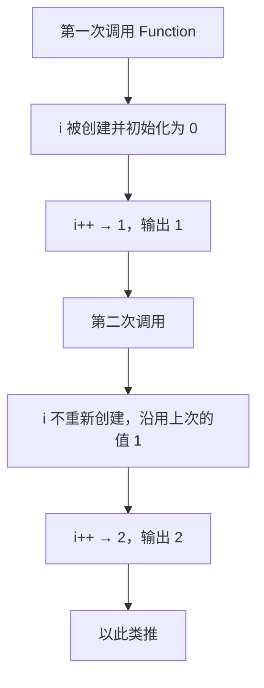
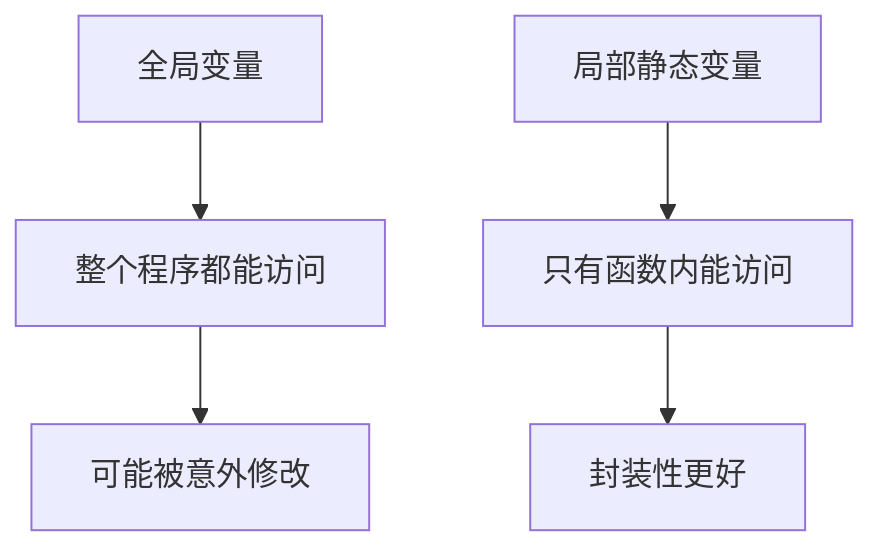
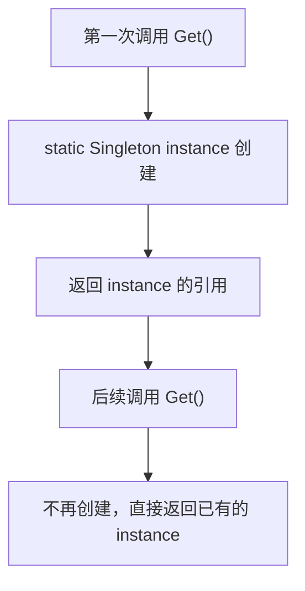
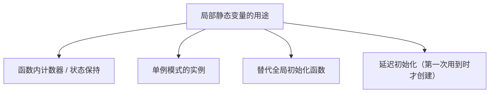

## 本节概述：局部静态变量生命周期等于整个程序，但作用域只在函数内

前面学过 `static` 用于全局变量（内部链接）和类成员（所有实例共享）。这一节讲 `static` 的第三种用法——**局部静态变量（local static）**，用在函数或某个作用域内部。

要理解它，先区分两个概念：



**局部静态变量** = 生命周期是整个程序，但作用域只限于声明它的那个作用域（函数、if 块等）。



## 基本示例：计数器

```cpp
void Function()
{
    int i = 0;          // 普通局部变量
    i++;
    std::cout << i << std::endl;
}

int main()
{
    Function();   // 1
    Function();   // 1
    Function();   // 1
}
```

每次调用 `Function`，`i` 都重新创建、赋值为 0，所以永远输出 1。

加上 `static` 之后：

```cpp
void Function()
{
    static int i = 0;   // 局部静态变量
    i++;
    std::cout << i << std::endl;
}

int main()
{
    Function();   // 1
    Function();   // 2
    Function();   // 3
    Function();   // 4
    Function();   // 5
}
```

第一次调用时 `i` 被初始化为 0，之后调用不再重新创建，而是沿用上一次的值。



## 和全局变量的区别

把 `i` 提到全局也能达到同样效果：

```cpp
int i = 0;          // 全局变量

void Function()
{
    i++;
    std::cout << i << std::endl;
}
```

但全局变量**任何地方都能访问和修改**，比如在两次 `Function()` 调用之间写一句 `i = 10`，行为就乱了。

局部静态变量把作用域限制在函数内，**外部看不到也改不了**，更安全。



## 典型应用：单例模式

**单例（Singleton）** 是只能有一个实例的类。传统写法需要一个静态成员指针，还要在类外定义：

```cpp
class Singleton
{
private:
    static Singleton* s_Instance;          // 静态成员指针
public:
    static Singleton& Get() { return *s_Instance; }
    void Hello() { std::cout << "Hello" << std::endl; }
};

Singleton* Singleton::s_Instance = nullptr;   // 类外定义
```

用局部静态变量可以大幅简化：

```cpp
class Singleton
{
public:
    static Singleton& Get()
    {
        static Singleton instance;   // 局部静态变量
        return instance;
    }
    void Hello() { std::cout << "Hello" << std::endl; }
};
```

第一次调用 `Get()` 时创建 `instance`，之后每次都返回同一个实例。



> [!WARNING]
> 这里的 `instance` 必须是 `static`，否则函数结束时栈对象就被销毁了，返回的引用就变成悬空引用。`static` 把它的生命周期延长到整个程序，引用才一直有效。

## 使用建议

局部静态变量不是什么洪水猛兽，它能让代码更干净。常见用途包括：



有些人不鼓励使用它，认为可以用其他方式实现同样的行为。但就像类一样——不用类也能写程序，用了只是让代码更清晰。局部静态变量同理，合理使用能让代码更简洁。

## 完整示例代码

```cpp
#include <iostream>

void Function()
{
    static int i = 0;   // 局部静态变量，跨调用保持值
    i++;
    std::cout << i << std::endl;
}

class Singleton
{
public:
    static Singleton& Get()
    {
        static Singleton instance;   // 第一次调用时创建，之后复用
        return instance;
    }
    void Hello() { std::cout << "Hello from Singleton" << std::endl; }
};

int main()
{
    Function();   // 1
    Function();   // 2
    Function();   // 3

    Singleton::Get().Hello();   // 同一个实例
    Singleton::Get().Hello();   // 同一个实例

    std::cin.get();
}
```

## 本章小结

**局部静态变量**：在函数或作用域内用 `static` 声明的变量，生命周期等于整个程序，但作用域仅限于声明它的作用域。

**与普通局部变量的区别**：普通局部变量每次进入作用域都重新创建；局部静态变量只在第一次进入时创建，之后调用沿用之前的值。

**与全局变量的区别**：全局变量整个程序都能访问；局部静态变量只有所在作用域能访问，封装性更好。

**典型应用**：单例模式——`Get()` 里声明 `static Singleton instance;` 并返回引用，第一次调用时创建，后续复用，代码比传统静态成员指针写法简洁得多。

**注意**：返回局部静态变量的引用是安全的，因为它的生命周期是整个程序；如果不是 static，函数结束对象就销毁了，返回引用会悬空。
