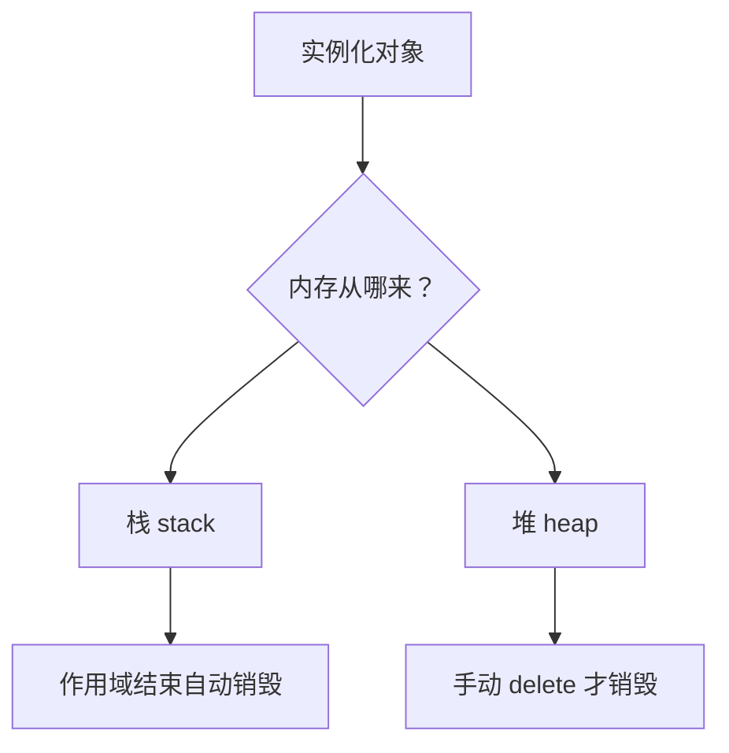
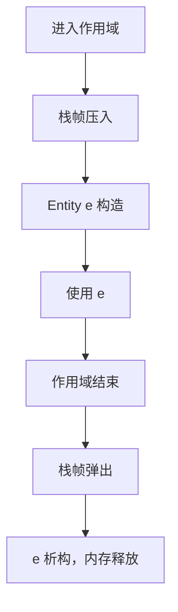
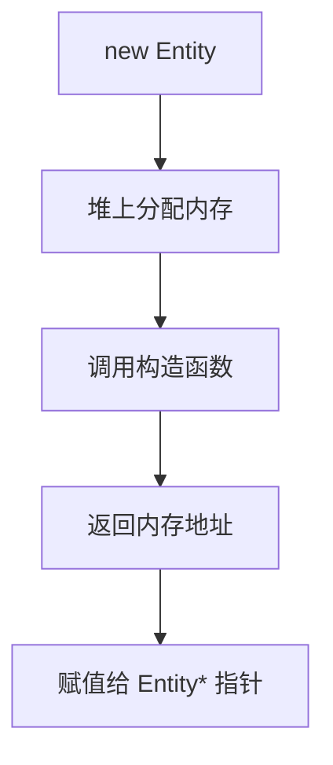
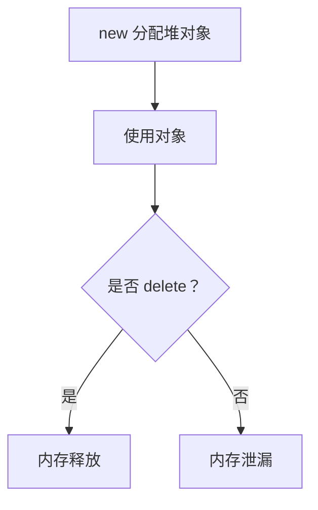
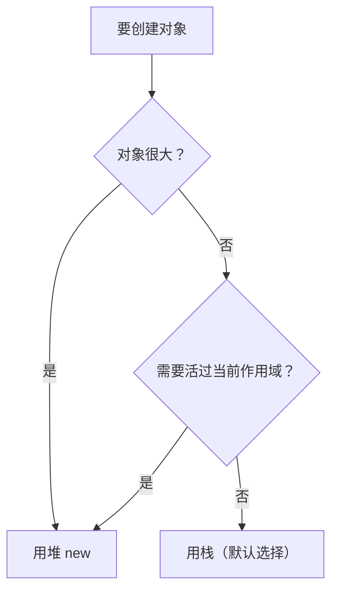

## 本节概述：对象要么建在栈上，要么建在堆上，优先选栈

写好一个类之后，真正要用它的时候就得**实例化（instantiate）**——创建一个对象。C++ 给了两种方式，核心区别只有一个：**内存从哪来**——栈（stack）还是堆（heap）。

哪怕一个类完全是空的、没有任何成员，实例化出来的对象也至少占 1 字节内存。有成员的类更不用说，成员变量总得找个地方存。应用程序的内存大致分成两块：栈和堆（还有代码段等其他区域，以后再聊）。



## 栈分配：默认选择，最快最省心

栈上创建对象的语法非常简单——写类型，空格，写名字：

```cpp
class Entity
{
public:
    std::string m_Name;

    Entity()                        // 默认构造函数
    {
        m_Name = "Unknown";
    }

    Entity(const std::string& name) // 带参构造函数
    {
        m_Name = name;
    }

    const std::string& GetName() const { return m_Name; }
};

int main()
{
    Entity e;                       // 调用默认构造函数
    std::cout << e.GetName() << std::endl;   // 输出 Unknown

    Entity e2("Cherno");            // 调用带参构造函数
    std::cout << e2.GetName() << std::endl;  // 输出 Cherno
}
```

> [!TIP]
> 从 Java 或 C# 过来的人看到 `Entity e;` 会慌——"这不是没初始化吗？会空指针吧？"不会。只要类有默认构造函数，这就是合法代码，对象已经在栈上建好了。

带参数的构造函数也可以用 `=` 的写法：

```cpp
Entity e2 = Entity("Cherno");   // 等价于 Entity e2("Cherno");
```

栈对象的生命周期由**作用域（scope）**控制。作用域不一定是函数，`if`、`for`、甚至一对空 `{}` 都是作用域。一旦作用域结束，栈帧弹出，里面所有局部变量（包括对象）全部销毁：



## 栈对象的局限：活不出作用域

栈对象离开作用域就死。如果想让一个对象活到作用域之外，栈做不到：

```cpp
Entity* e;
{
    Entity parent("Cherno");     // 栈上创建
    e = &parent;                 // 指针指向栈对象
    std::cout << e->GetName() << std::endl;  // 正常：Cherno
}                                // 作用域结束，parent 被销毁
std::cout << e->GetName() << std::endl;      // 危险：e 指向已释放的内存
```


第二个 `cout` 去读 `e` 指向的内存，那块内存已经被栈回收了——**悬空指针（dangling pointer）**，行为未定义。

除了生命周期，栈的另一个限制是**容量小**，通常只有 1~2 MB。如果类特别大、或者要创建成千上万个对象，栈可能装不下。

## 堆分配：new 出来，手动管

堆分配用 `new` 关键字：

```cpp
Entity* e = new Entity("Cherno");   // 堆上创建，返回指针
std::cout << e->GetName() << std::endl;
delete e;                            // 手动释放
```

`new Entity("Cherno")` 干了三件事：在堆上分配内存、调用构造函数、返回这块内存的地址（指针）。所以左边必须是 `Entity*` 指针类型来接收。



堆上的对象不会自动消失，直到你**手动 `delete`**。这既是优点（可以精确控制生命周期），也是负担（忘了 delete 就内存泄漏）。



> [!WARNING]
> 从 Java/C# 过来的人最容易犯的错就是到处写 `new`。在 Java 里所有对象都在堆上，C++ 多了栈这个选项——**绝大多数情况应该用栈**，更快、更省心、不用手动释放。

## 栈 vs 堆：怎么选

| 对比项 | 栈 | 堆 |
| --- | --- | --- |
| 语法 | `Entity e;` | `Entity* e = new Entity();` |
| 生命周期 | 作用域结束自动销毁 | 手动 `delete` 才销毁 |
| 性能 | 快（只是移动栈指针） | 慢（要找空闲块） |
| 容量 | 小（1~2 MB） | 大（受限于系统内存） |
| 释放 | 自动 | 手动，忘了解放就泄漏 |



结论很简单：**能用栈就用栈**。只有两种情况必须上堆：对象太大装不进栈，或者需要让对象活过当前作用域。

> [!TIP]
> 堆分配不一定非要手动 `delete`——C++ 提供了**智能指针**（`std::unique_ptr`、`std::shared_ptr`），可以在堆上分配对象的同时享受自动释放。后面会专门讲。

## 完整示例代码

```cpp
#include <iostream>
#include <string>

class Entity
{
public:
    std::string m_Name;

    Entity()
    {
        m_Name = "Unknown";
    }

    Entity(const std::string& name)
    {
        m_Name = name;
    }

    const std::string& GetName() const { return m_Name; }
};

int main()
{
    // 栈分配
    Entity e1;
    std::cout << e1.GetName() << std::endl;        // Unknown

    Entity e2("Cherno");
    std::cout << e2.GetName() << std::endl;        // Cherno

    // 堆分配
    Entity* e3 = new Entity("Heap");
    std::cout << e3->GetName() << std::endl;       // Heap
    delete e3;                                      // 手动释放

    std::cin.get();
}
```

## 本章小结

**两种分配方式**：栈（`Entity e;`）和堆（`Entity* e = new Entity();`），核心区别是内存来源和生命周期管理方式。

**栈分配**：作用域结束自动销毁，速度快、省心，是默认选择。从 Java/C# 过来的人要改掉"动不动就 new"的习惯。

**栈的局限**：对象活不出作用域（悬空指针风险），且栈容量小（通常 1~2 MB），装不下超大对象或大量对象。

**堆分配**：用 `new` 分配，返回指针，必须手动 `delete` 释放，忘了就内存泄漏。适合需要控制生命周期或对象很大的场景。

**选型原则**：能用栈就用栈；只有对象太大或需要活过当前作用域时才用堆。堆分配可以配合智能指针实现自动释放。
