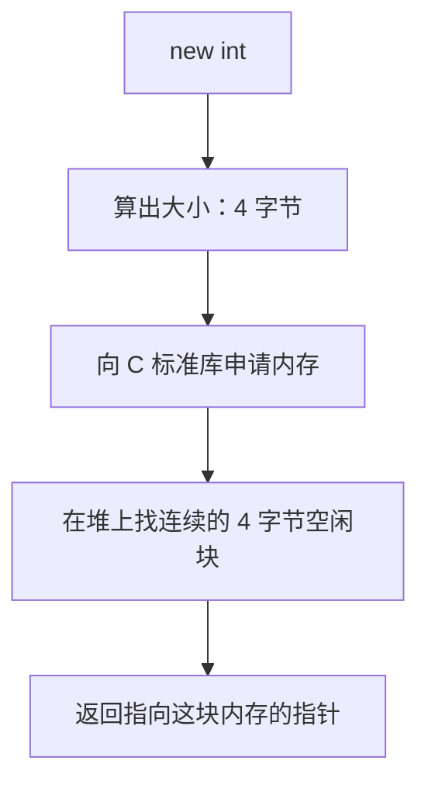
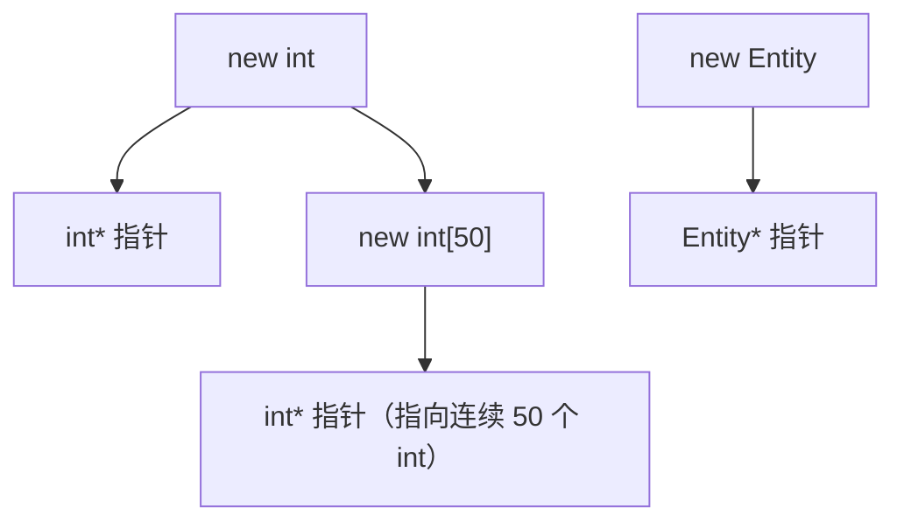
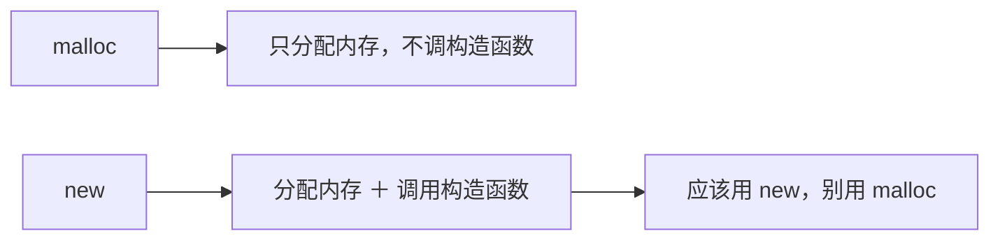
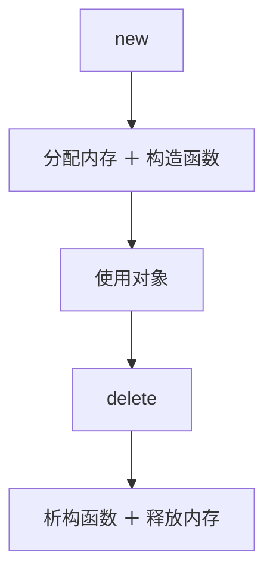
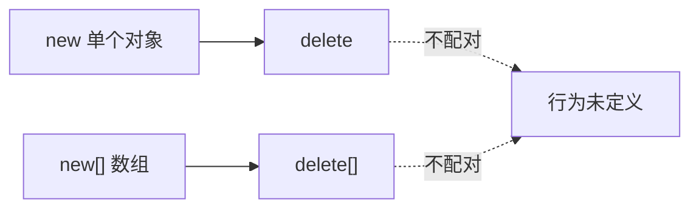
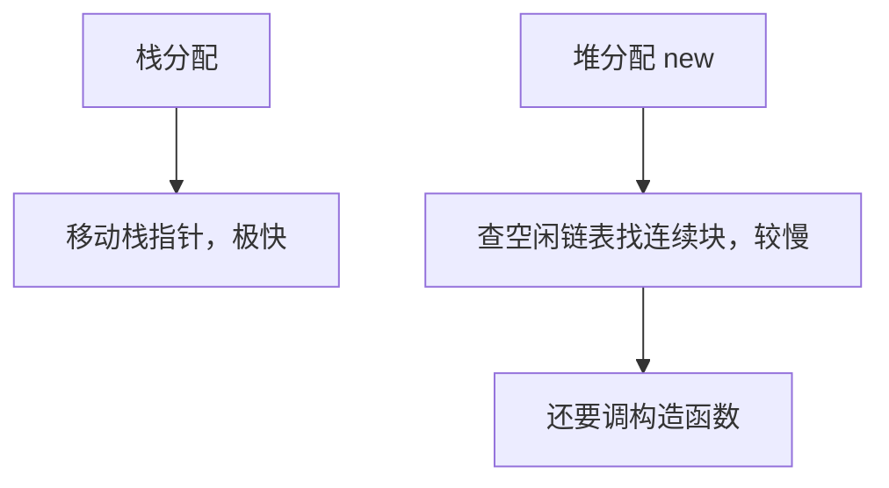

## 本节概述：new 不只是分配内存，还会调构造函数

上一节讲了创建对象有栈和堆两种方式。这节专门讲堆分配用的 `new` 关键字——很多人写了无数遍 `new` 却没仔细想过它到底干了什么。

`new` 的核心目的：**在堆上分配内存**。写 `new` 加上类型（类、基本类型、数组都行），它根据类型算出需要多少字节，然后去找一块连续的空闲内存，最后把地址给你。



## new 做了几件事

以 `new Entity` 为例，`new` 干了两件事：


第一，分配足够存放一个 `Entity` 的内存；第二，调用构造函数初始化这块内存。两个动作缺一不可。

如果是数组 `new Entity[50]`，就分配 `50 * sizeof(Entity)` 字节的连续内存，并对 50 个对象依次调用构造函数。

## 基本用法

```cpp
int* b = new int;                  // 堆上分配 4 字节 int
int* arr = new int[50];            // 堆上分配 50 个 int（200 字节）
Entity* e = new Entity("Cherno");  // 堆上分配 Entity 并调用带参构造函数
Entity* entities = new Entity[50]; // 堆上分配 50 个 Entity
```

`new` 返回的是**指针**，所以左边必须是对应类型的指针变量。



## new 背后：本质是 operator new ＋ malloc

`new` 其实是一个**运算符（operator）**，和 `+`、`-`、`=` 一样。既然是运算符，就可以重载。

在底层，`operator new` 通常会调用 C 标准库的 `malloc` 函数——只负责分配内存，返回 `void*` 指针。`new` 比 `malloc` 多做的一步就是**调用构造函数**：

```cpp
Entity* e = new Entity("Cherno");

// 大致等价于：
Entity* e = (Entity*)malloc(sizeof(Entity));  // 只分配内存
e->Entity("Cherno");                            // 调用构造函数（伪代码）
```



> [!WARNING]
> 写 C++ 应该用 `new`，不要用 `malloc`。`malloc` 只分配内存不调构造函数，对象处于未初始化状态，而且代码可读性也差。只有极少数特殊场景（比如自己实现内存池）才会直接用 `malloc`。

## 别忘了 delete

用 `new` 分配的内存不会自动释放，必须手动 `delete`：

```cpp
int* b = new int;
delete b;                        // 释放单个对象

Entity* e = new Entity("Cherno");
delete e;                        // 释放并调用析构函数
```

`delete` 和 `new` 对应：`new` 调构造函数分配内存，`delete` 调析构函数释放内存。`delete` 底层调用 C 的 `free`。



## 数组配对：new[] 配 delete[]

如果用 `new[]` 分配数组，释放时必须用 `delete[]`，不能用普通 `delete`：

```cpp
Entity* entities = new Entity[50];
delete[] entities;               // 正确：配对 new[]
// delete entities;              // 错误：行为未定义
```



> [!TIP]
> `new` 配 `delete`，`new[]` 配 `delete[]`，一一对应，别搞混。`new[]` 和 `delete[]` 是两个不同的运算符重载。

## 关于性能

`new` 比栈分配慢，因为它要在堆的**空闲链表（free list）**里找一块足够大的连续内存。栈分配只是移动栈指针，几乎零成本。不过堆分配也不是"遍历整个内存"那么笨，空闲链表维护着可用块的地址，查找效率还行，但比栈还是慢不少。



## placement new（简单了解）

`new` 还有一种特殊形式叫 **placement new**——不分配新内存，而是在你指定的地址上调用构造函数：

```cpp
Entity* e = new (address) Entity("Cherno");  // 在 address 处构造 Entity
```

这在写内存池、对象池之类的优化场景时很有用，先分配一大块内存，再用 placement new 在里面按需构造对象。现在知道有这么回事就行，后面用到再细讲。

## 完整示例代码

```cpp
#include <iostream>
#include <string>

class Entity
{
public:
    std::string m_Name;

    Entity()
    {
        m_Name = "Unknown";
        std::cout << "Created Entity" << std::endl;
    }

    Entity(const std::string& name)
    {
        m_Name = name;
        std::cout << "Created Entity: " << name << std::endl;
    }

    ~Entity()
    {
        std::cout << "Destroyed Entity: " << m_Name << std::endl;
    }
};

int main()
{
    // 基本类型
    int* b = new int;
    *b = 5;
    std::cout << *b << std::endl;
    delete b;

    // 数组
    int* arr = new int[50];
    arr[0] = 1;
    delete[] arr;

    // 单个对象
    Entity* e = new Entity("Cherno");
    std::cout << e->m_Name << std::endl;
    delete e;

    // 对象数组
    Entity* entities = new Entity[3];
    delete[] entities;

    std::cin.get();
}
```

## 本章小结

**new 的作用**：在堆上分配内存，对类类型还会调用构造函数，返回指向分配内存的指针。

**new 做了两件事**：分配内存（底层调 `malloc`）和调用构造函数。`malloc` 只分配内存不调构造函数，C++ 里应该用 `new` 而不是 `malloc`。

**必须配对释放**：`new` 配 `delete`，`new[]` 配 `delete[]`。不配对或忘记释放会导致内存泄漏或未定义行为。

**性能**：`new` 比栈分配慢，因为要查空闲链表找连续内存块。栈分配只是移动栈指针。

**placement new**：在指定内存地址上调用构造函数，不分配新内存，用于内存池等高级场景。
