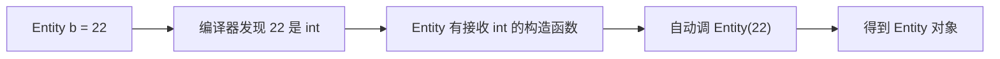
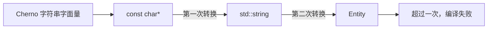
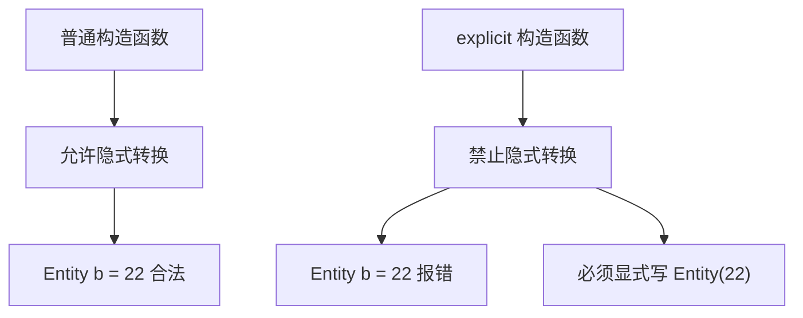
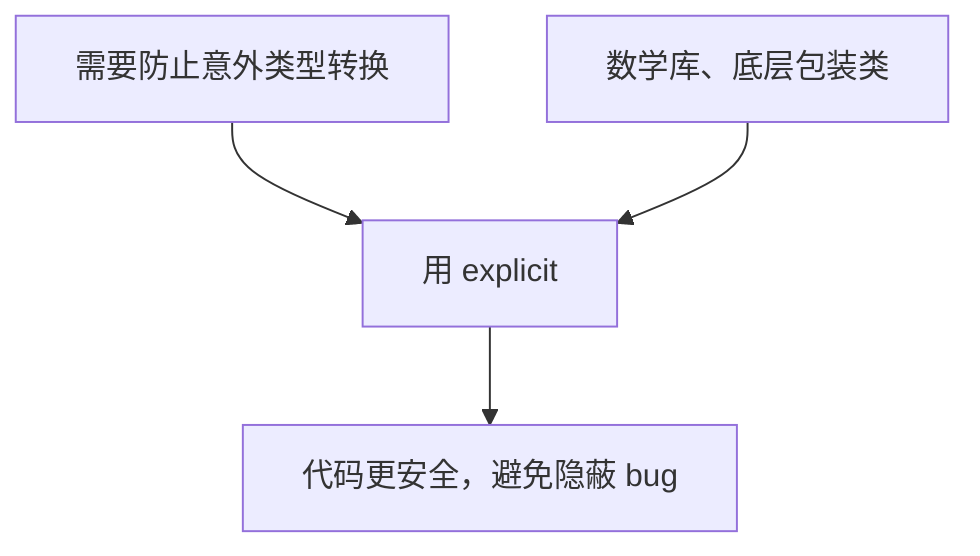

## 本节概述：编译器会偷偷帮你转一次类型，explicit 就是关掉这个开关

C++ 允许编译器做**隐式转换（implicit conversion）**——你没写强制转换，编译器自动帮你把一个类型转成另一个。规则只有一条：**最多隐式转一次**。

这节讲两件事：隐式转换怎么工作，以及 `explicit` 关键字怎么关掉它。

## 隐式转换：编译器偷偷调构造函数

假设有个 `Entity` 类，有两个构造函数：一个收 `std::string`（名字），一个收 `int`（年龄）。

```cpp
class Entity
{
private:
    std::string m_Name;
    int m_Age;

public:
    Entity(const std::string& name)   // 收名字的构造函数
        : m_Name(name), m_Age(-1) {}

    Entity(int age)                    // 收年龄的构造函数
        : m_Name("Unknown"), m_Age(age) {}
};
```

正常创建对象是这样：

```cpp
Entity a("Cherno");
Entity b(22);
```

但 C++ 允许你这么写：

```cpp
Entity a = "Cherno";     // 隐式转换：const char* → std::string → Entity
Entity b = 22;           // 隐式转换：int → Entity
```



`Entity b = 22` 看起来很奇怪——`b` 是 `Entity`，右边却是 `int`。但编译器发现 `Entity` 有个接收 `int` 的构造函数，就自动用 `22` 调了那个构造函数，把 `int` 隐式转成了 `Entity`。

## 函数传参也能隐式转换

隐式转换不止发生在赋值，函数传参时也会发生：

```cpp
void PrintEntity(const Entity& entity)
{
    // 打印 entity 的信息
}

PrintEntity(22);        // 合法：22 隐式转成 Entity
```

`PrintEntity` 只接收 `Entity`，但传 `22` 也能编译——编译器自动把 `22` 转成 `Entity` 再传进去。

## 只能隐式转一次

C++ 只允许**一次**隐式转换。来看一个失败的例子：

```cpp
PrintEntity("Cherno");  // 编译错误！
```

`"Cherno"` 的类型是 `const char*`（字符串字面量），要变成 `Entity` 需要两步：



`const char*` → `std::string` 是一次转换，`std::string` → `Entity` 又是一次，加起来两次，超过了限制，所以编译失败。

想让它通过，就得减少到一次隐式转换——手动完成其中一步：

```cpp
PrintEntity(std::string("Cherno"));  // 手动转成 string，剩下一次隐式转换
PrintEntity(Entity("Cherno"));       // 手动构造 Entity，无需隐式转换
```

## explicit 关键字：关掉隐式转换

如果不想让某个构造函数参与隐式转换，在前面加 `explicit`：

```cpp
class Entity
{
public:
    Entity(const std::string& name) : m_Name(name), m_Age(-1) {}

    explicit Entity(int age) : m_Name("Unknown"), m_Age(age) {}  // 加了 explicit
};
```

加了 `explicit` 之后，下面这些就都编译失败了：

```cpp
Entity b = 22;           // 错误：不能隐式转换
PrintEntity(22);         // 错误：不能隐式转换
```

必须显式调用构造函数或者显式转换：

```cpp
Entity b(22);                       // 正确：显式调用构造函数
Entity b = Entity(22);              // 正确：显式构造
PrintEntity(Entity(22));            // 正确：显式构造
PrintEntity((Entity)22);            // 正确：显式转换（C 风格）
```



## 什么时候用 explicit

`explicit` 的用途是**防止意外的隐式转换**。比如写数学库的时候，你不希望一个 `Vector3` 被随手赋成一个数字，也不希望 `int` 偷偷变成 `Vector3` 导致逻辑 bug。



日常开发中 `explicit` 用得不算特别多，但必须知道它的存在和作用。最重要的是**意识到隐式转换是存在的**，不然看到 `Entity b = 22` 会一头雾水。

## 完整示例代码

```cpp
#include <iostream>
#include <string>

class Entity
{
private:
    std::string m_Name;
    int m_Age;

public:
    Entity(const std::string& name)
        : m_Name(name), m_Age(-1) {}

    explicit Entity(int age)   // 加了 explicit，禁止隐式转换
        : m_Name("Unknown"), m_Age(age) {}

    const std::string& GetName() const { return m_Name; }
    int GetAge() const { return m_Age; }
};

void PrintEntity(const Entity& entity)
{
    std::cout << "Name: " << entity.GetName()
              << ", Age: " << entity.GetAge() << std::endl;
}

int main()
{
    Entity a("Cherno");
    PrintEntity(a);

    // Entity b = 22;           // 错误：explicit 禁止隐式转换
    Entity b(22);               // 正确：显式调用
    PrintEntity(b);

    // PrintEntity(22);         // 错误：explicit 禁止隐式转换
    PrintEntity(Entity(22));    // 正确：显式构造

    // PrintEntity("Cherno");   // 错误：需要两次隐式转换
    PrintEntity(std::string("Cherno"));  // 正确：手动完成第一步转换

    std::cin.get();
}
```

## 本章小结

**隐式转换**：C++ 编译器允许在赋值和传参时自动做一次类型转换，前提是存在对应的单参数构造函数。

**只能转一次**：从 `const char*` 到 `Entity` 需要两次转换（`const char*` → `std::string` → `Entity`），超过一次就编译失败。手动完成其中一步即可。

**explicit 关键字**：加在构造函数前，禁止该构造函数参与隐式转换。之后必须显式调用构造函数或显式转换。

**使用场景**：写数学库、底层包装类等需要防止意外类型转换的地方，用 `explicit` 提高代码安全性。日常代码用得不多，但要知道它的存在。
