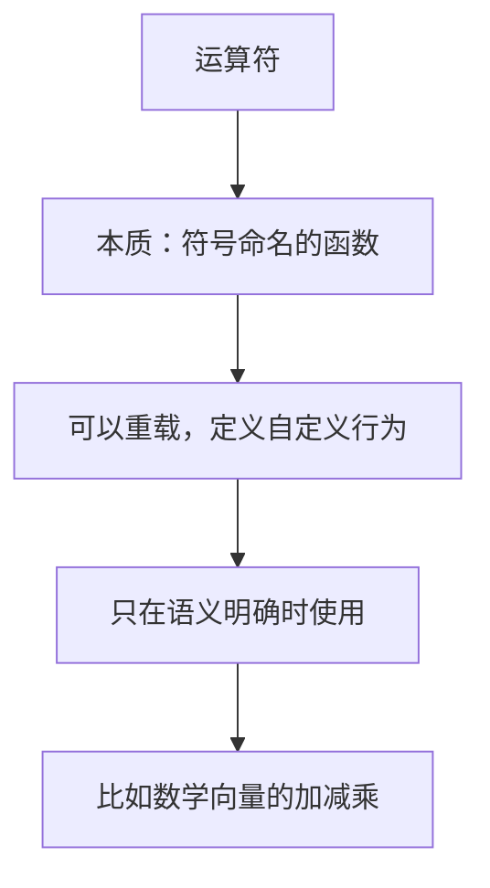
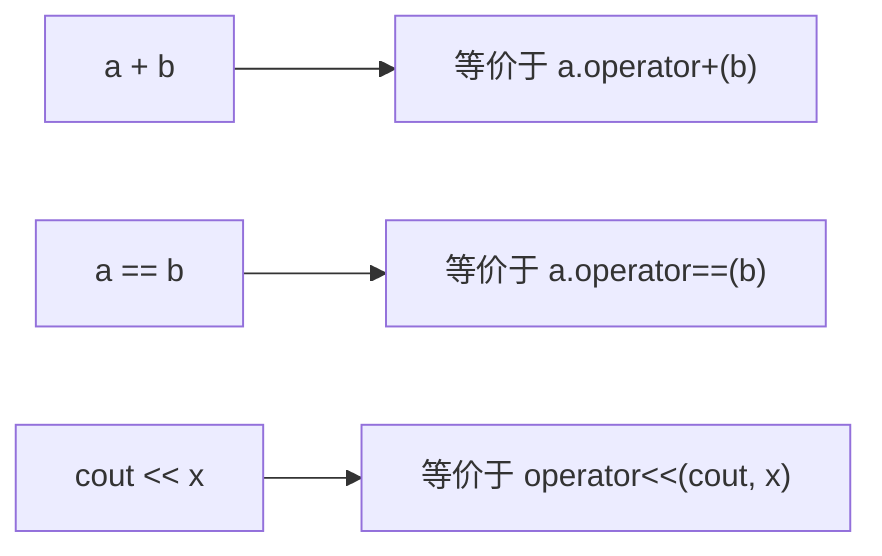
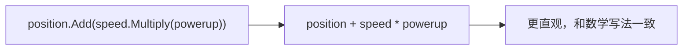
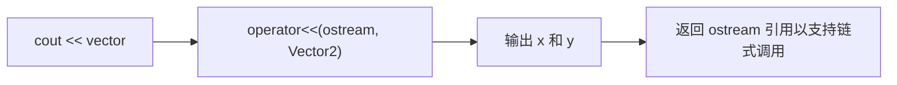
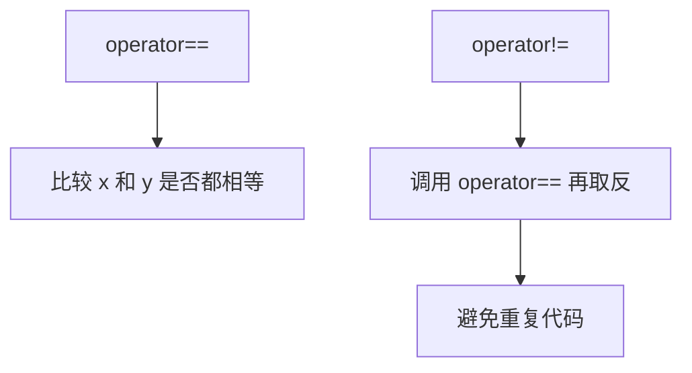
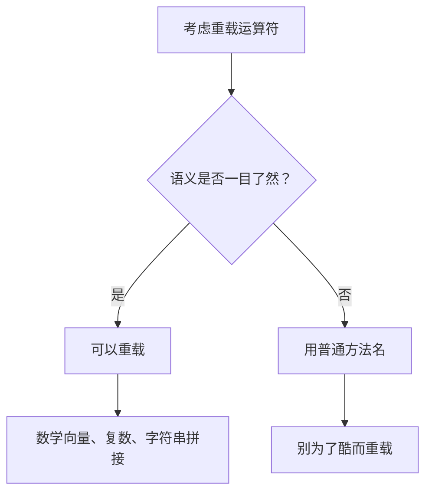

## 本节概述：运算符就是符号版的函数，重载让自定义类型也能用 `+` `==`

**运算符（operator）** 是用来代替函数名的符号。不只是加减乘除，还包括解引用 `*`、箭头 `->`、取地址 `&`、`<<`（输出）、`new`、`delete`，甚至逗号和括号都是运算符。

**运算符重载（operator overloading）** 让你给自定义类型定义运算符的行为。Java 完全不支持，C# 部分支持，C++ 给你完全控制权。



## 运算符就是函数

运算符和普通函数没区别，只是把函数名换成了符号。比如 `a + b` 本质上就是 `a.operator+(b)`。



## 不用重载的写法：Add 方法

假设有个二维向量 `Vector2`：

```cpp
struct Vector2
{
    float x, y;

    Vector2(float x, float y) : x(x), y(y) {}

    Vector2 Add(const Vector2& other) const
    {
        return Vector2(x + other.x, y + other.y);
    }

    Vector2 Multiply(const Vector2& other) const
    {
        return Vector2(x * other.x, y * other.y);
    }
};
```

使用时：

```cpp
Vector2 position(0.0f, 0.0f);
Vector2 speed(1.5f, 2.5f);
Vector2 powerup(2.0f, 2.0f);

Vector2 result = position.Add(speed.Multiply(powerup));
```

功能没问题，但 `position.Add(speed.Multiply(powerup))` 读起来很绕。

## 用运算符重载：更直观

用 `operator+` 和 `operator*` 替换 `Add` 和 `Multiply`：

```cpp
struct Vector2
{
    float x, y;

    Vector2(float x, float y) : x(x), y(y) {}

    Vector2 operator+(const Vector2& other) const
    {
        return Vector2(x + other.x, y + other.y);
    }

    Vector2 operator*(const Vector2& other) const
    {
        return Vector2(x * other.x, y * other.y);
    }
};
```

现在可以这么写：

```cpp
Vector2 result = position + speed * powerup;
```



运算符优先级正常工作——`*` 比 `+` 先算，所以 `speed * powerup` 先执行，结果再和 `position` 相加。

## 运算符可以当普通函数调用

虽然运算符用符号写，但本质是函数，也可以用函数式语法调用：

```cpp
Vector2 result = position.operator+(speed);   // 等价于 position + speed
```

不过没人这么写，看着别扭。但知道这个等价关系有助于理解。

## 重载 operator<<：让 cout 支持自定义类型

想直接 `std::cout << vector` 输出自定义类型，需要重载 `<<`。这个运算符左边是 `std::ostream`，右边是你的类型，所以要在类外面定义：

```cpp
std::ostream& operator<<(std::ostream& stream, const Vector2& other)
{
    stream << other.x << ", " << other.y;
    return stream;
}
```



返回 `std::ostream&` 是为了支持链式调用，比如 `std::cout << v1 << std::endl << v2;`。

## 重载 operator== 和 operator!=

比较两个对象是否相等：

```cpp
bool operator==(const Vector2& other) const
{
    return x == other.x && y == other.y;
}

bool operator!=(const Vector2& other) const
{
    return !(*this == other);   // 复用 operator==，取反
}
```



Java 里得写 `.equals()` 方法，到处都是 `.equals()` 很啰嗦。C++ 直接重载 `==`，写 `a == b` 就行。

## 使用原则：少用，用对地方

> [!WARNING]
> 运算符重载能力很强，但别滥用。如果别人看 `a + b` 还得翻定义才知道干了什么，那就是失败的重载。只在语义非常明确的地方用，比如数学向量的加减乘。



写库的时候可以同时提供方法和运算符，让调用者自己选喜欢的风格。

## 完整示例代码

```cpp
#include <iostream>

struct Vector2
{
    float x, y;

    Vector2(float x, float y) : x(x), y(y) {}

    Vector2 operator+(const Vector2& other) const
    {
        return Vector2(x + other.x, y + other.y);
    }

    Vector2 operator*(const Vector2& other) const
    {
        return Vector2(x * other.x, y * other.y);
    }

    bool operator==(const Vector2& other) const
    {
        return x == other.x && y == other.y;
    }

    bool operator!=(const Vector2& other) const
    {
        return !(*this == other);
    }
};

std::ostream& operator<<(std::ostream& stream, const Vector2& other)
{
    stream << other.x << ", " << other.y;
    return stream;
}

int main()
{
    Vector2 position(0.0f, 0.0f);
    Vector2 speed(1.5f, 2.5f);
    Vector2 powerup(2.0f, 2.0f);

    Vector2 result = position + speed * powerup;
    std::cout << result << std::endl;        // 3, 5

    Vector2 result2(3.0f, 5.0f);
    std::cout << (result == result2) << std::endl;  // 1 (true)
    std::cout << (result != result2) << std::endl;  // 0 (false)

    std::cin.get();
}
```

## 本章小结

**运算符本质**：就是符号命名的函数，`a + b` 等价于 `a.operator+(b)`。

**运算符重载**：给自定义类型定义运算符行为，让代码更直观（如数学向量的 `+` `*`）。Java 不支持，C# 部分支持，C++ 完全支持。

**常见重载**：`operator+`、`operator*` 做算术运算；`operator==`、`operator!=` 做比较；`operator<<` 让 `std::cout` 支持自定义类型（需在类外定义，返回 `ostream&` 以支持链式调用）。

**使用原则**：只在语义明确的地方重载，别滥用。如果看代码还得翻定义才知道运算符做了什么，就该用普通方法名。
