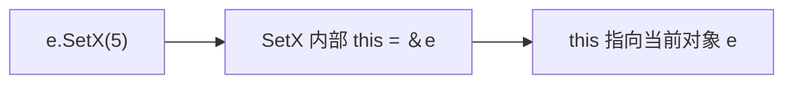
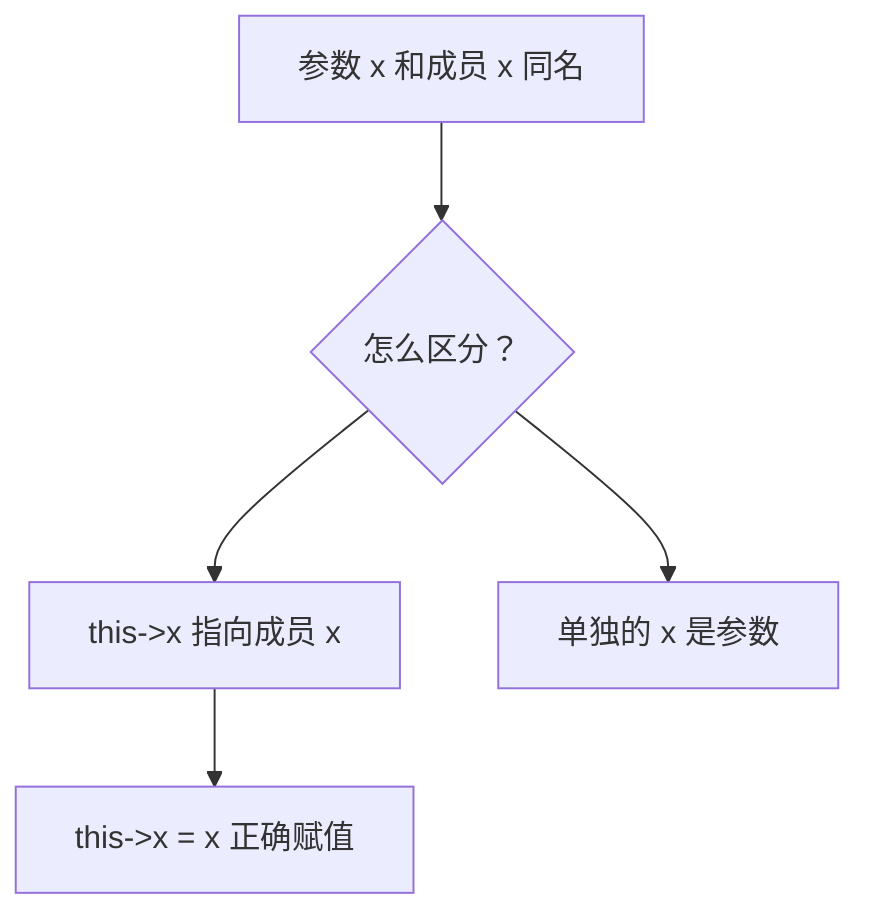
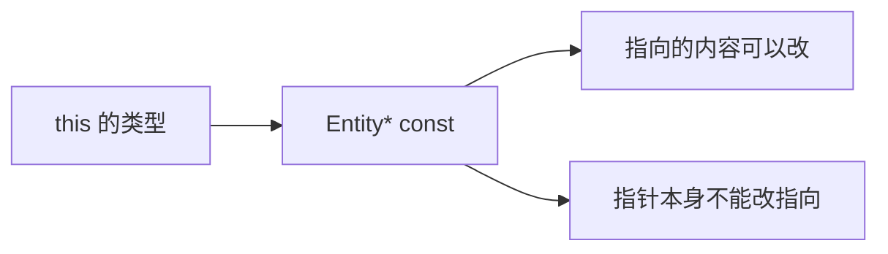
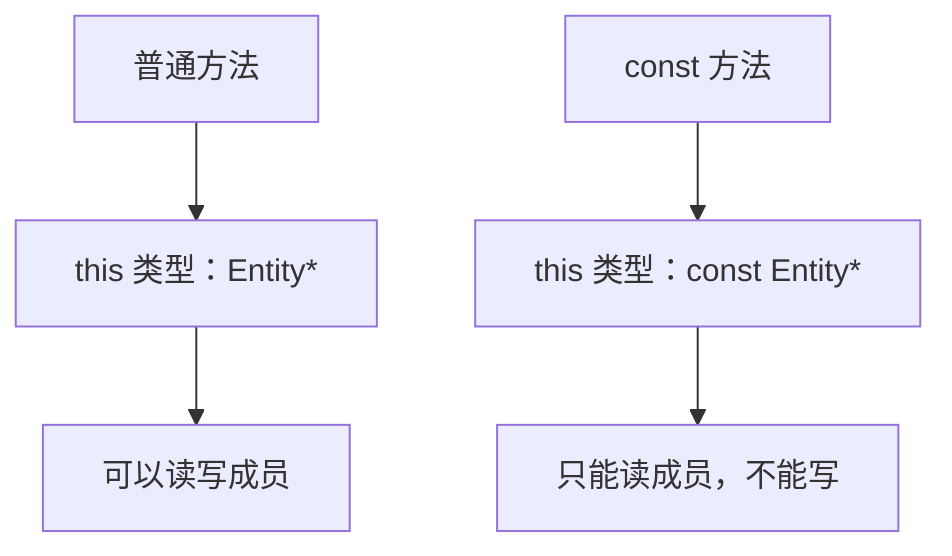
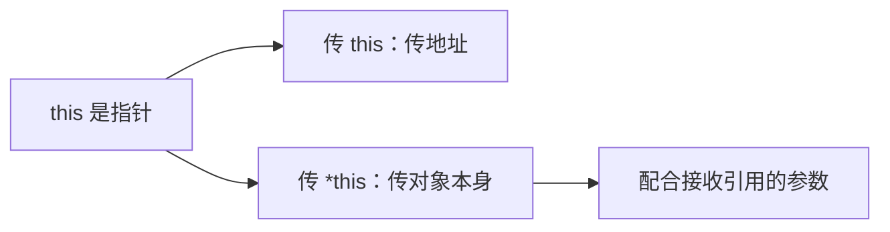
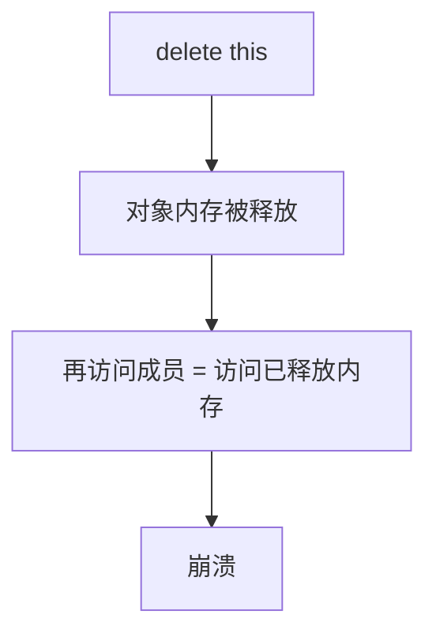

## 本节概述：this 就是指向当前对象的指针

`this` 是 C++ 的关键字，只能在类的**成员函数（非静态）**里使用。它指向调用这个方法的**当前对象实例**。

换句话说，`e.SetX(5)` 执行时，`SetX` 方法里的 `this` 就是 `&e`——指向对象 `e` 的指针。



## 主要用途：解决同名冲突

构造函数参数和成员变量同名时，直接写 `x = x` 是自己赋给自己，啥也没干：

```cpp
class Entity
{
public:
    int x, y;

    Entity(int x, int y)
    {
        x = x;   // 错：参数 x 赋给参数 x，成员 x 没被赋值
        y = y;   // 错
    }
};
```

用 `this` 就能区分：

```cpp
class Entity
{
public:
    int x, y;

    Entity(int x, int y)
    {
        this->x = x;   // this->x 是成员，右边的 x 是参数
        this->y = y;
    }
};
```



> [!TIP]
> 构造函数里用**初始化列表**也能绕开同名问题：`Entity(int x, int y) : x(x), y(y) {}`，初始化列表里的 `x(x)` 左边是成员，右边是参数，编译器能正确区分。

## this 的类型

`this` 是一个指针，类型是 `Entity* const`——指针本身是 const，不能改指向：

```cpp
Entity* e = this;          // 可以，this 是 Entity* const
// this = nullptr;         // 错误：this 是 const 指针，不能改指向
```



## const 方法里的 this

如果成员函数标记为 `const`，说明这个方法不修改对象。此时 `this` 的类型变成 `const Entity*`——指向的内容也不能改：

```cpp
int GetX() const
{
    // this 的类型是 const Entity*
    // this->x = 5;   // 错误：const 方法不能修改成员
    return x;         // 可以读
}
```



## 把当前对象传给外部函数

类的方法里需要把当前对象传给外部函数时，直接传 `this`（指针）或 `*this`（对象本身）：

```cpp
void PrintEntity(const Entity& e);   // 外部函数，接收引用

class Entity
{
public:
    int x, y;

    void Print()
    {
        PrintEntity(*this);          // 解引用 this，传对象引用
    }
};
```



## delete this：可以但别这么干

技术上可以在成员函数里写 `delete this` 释放当前对象，但极度危险：

```cpp
void Destroy()
{
    delete this;   // 释放当前对象
    // 之后再访问任何成员都会崩溃
}
```



只有极少数特殊场景（如自定义引用计数）才会用到，日常开发千万别这么写。

## 完整示例代码

```cpp
#include <iostream>

class Entity
{
public:
    int x, y;

    Entity(int x, int y)
    {
        this->x = x;      // 用 this 区分成员和参数
        this->y = y;
    }

    int GetX() const       // const 方法，this 是 const Entity*
    {
        return this->x;
    }

    void Print();          // 声明，定义在类外
};

void PrintEntity(const Entity& e)
{
    std::cout << "x: " << e.x << ", y: " << e.y << std::endl;
}

void Entity::Print()
{
    PrintEntity(*this);    // 解引用 this，传当前对象的引用
}

int main()
{
    Entity e(5, 6);
    std::cout << e.GetX() << std::endl;   // 5
    e.Print();                             // x: 5, y: 6

    std::cin.get();
}
```

## 本章小结

**this 的含义**：成员函数里指向当前对象实例的指针，等价于调用方法的那个对象的地址。

**主要用途**：当参数名和成员变量同名时，用 `this->成员名` 明确指定成员变量。

**this 的类型**：普通方法里是 `Entity* const`（指针本身不能改）；const 方法里是 `const Entity*`（指向的内容也不能改）。

**传递当前对象**：传 `this` 是传指针，传 `*this` 是传对象本身（配合引用参数）。

**delete this**：技术上可行但危险，释放后再访问成员就崩溃，日常代码避免使用。
