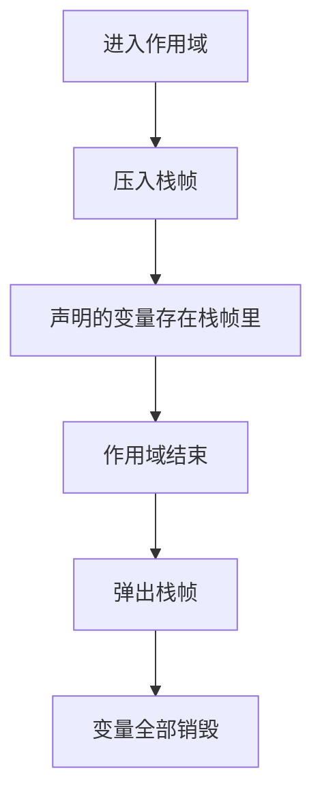
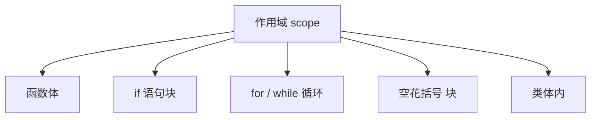
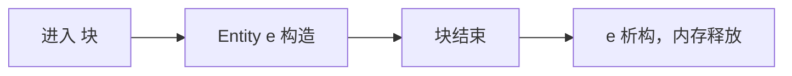
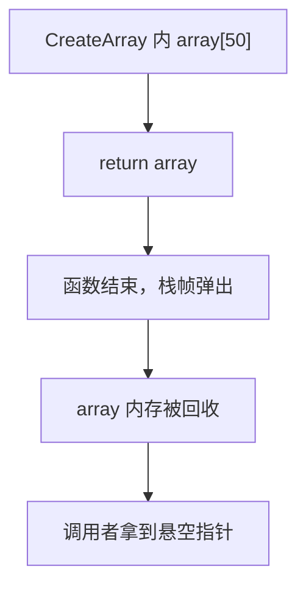
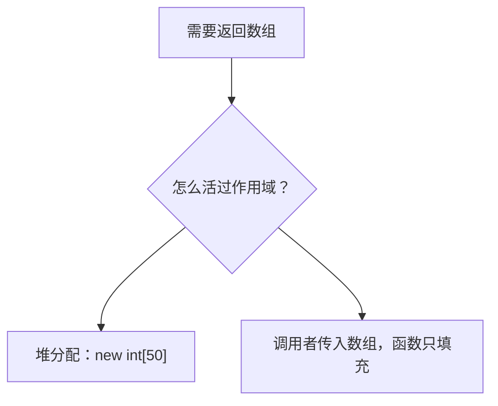
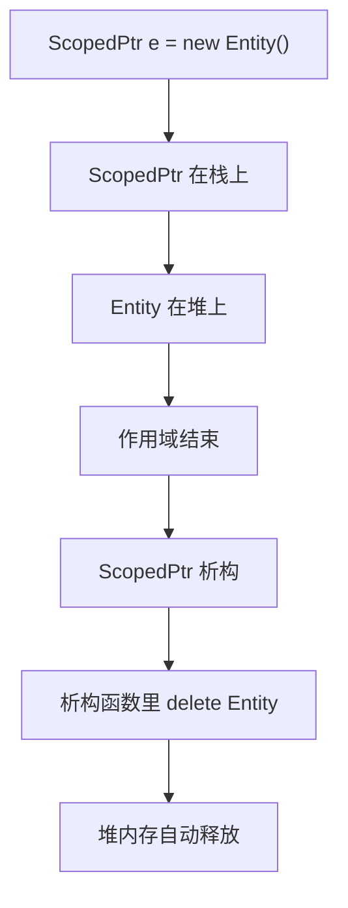
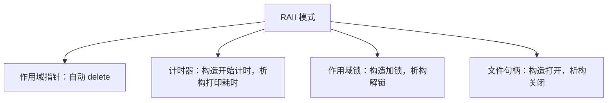

## 本节概述：栈变量离开作用域就死，利用这个特性可以做自动化

栈（stack）可以想象成一摞书：想拿中间的书，得先把上面的拿走。C++ 每次进入一个作用域，就往栈上压一个栈帧（stack frame），作用域里声明的变量都放在这个栈帧里。作用域结束，栈帧弹出，里面所有变量全部销毁。



## 什么是作用域

作用域不一定是函数，以下都是作用域：



类体内的成员变量也属于类的作用域——对象销毁时，成员跟着销毁。

## 栈对象：离开作用域自动销毁

```cpp
class Entity
{
public:
    Entity()  { std::cout << "Created Entity" << std::endl; }
    ~Entity() { std::cout << "Destroyed Entity" << std::endl; }
};

int main()
{
    {
        Entity e;          // 构造：Created Entity
    }                      // 作用域结束，析构：Destroyed Entity

    std::cin.get();
}
```



## 堆对象：不会自动销毁

```cpp
{
    Entity* e = new Entity();   // 构造：Created Entity
}                               // 作用域结束，但 e 指向的堆对象没被销毁
// 内存泄漏，直到程序结束 OS 才回收
```


栈对象作用域结束就死，堆对象得手动 `delete`——这就是两者生命周期的核心区别。

## 经典坑：返回栈变量的指针

```cpp
int* CreateArray()
{
    int array[50];          // 栈上分配
    return array;           // 返回栈内存的指针
}                           // 函数结束，array 已销毁
```

`array` 在栈上，函数返回后栈帧弹出，那块内存被回收。调用者拿到的是**悬空指针**，读出来的是垃圾数据。



修复有两个办法：



**办法一**：堆分配，让调用者负责释放：

```cpp
int* CreateArray()
{
    return new int[50];     // 堆分配，调用者记得 delete[]
}
```

**办法二**：调用者先在栈上开好数组，传指针进来填充：

```cpp
void FillArray(int* array, int size)
{
    for (int i = 0; i < size; i++)
        array[i] = i;
}

int main()
{
    int array[50];
    FillArray(array, 50);   // array 在 main 的栈上，活得好好的
}
```

## 利用栈生命周期：RAII

栈对象自动析构这个特性非常有用。核心思路：**把资源管理封装到类里，构造时获取资源，析构时释放资源**。这样资源的生命周期就和栈对象绑定，离开作用域自动释放，永远不会忘。这个模式叫 **RAII**（Resource Acquisition Is Initialization）。

### 示例：作用域指针（Scoped Pointer）

写一个包装类，构造时 `new`，析构时 `delete`：

```cpp
class ScopedPtr
{
private:
    Entity* m_Ptr;

public:
    ScopedPtr(Entity* ptr) : m_Ptr(ptr) {}
    ~ScopedPtr() { delete m_Ptr; }
};

int main()
{
    {
        ScopedPtr e = new Entity();   // 构造时 new Entity
    }                                  // 作用域结束，ScopedPtr 析构，自动 delete Entity
}
```



这就是 `std::unique_ptr` 的基本原理——用栈对象的自动析构来管理堆内存，既享受堆分配的灵活性，又不用手动 `delete`。

### 其他 RAII 应用



计时器的例子：在函数开头创建一个 `Timer` 对象，构造时记录开始时间，析构时算差值并打印。整个函数自动被计时，不用手动调 `stop()`。

## 完整示例代码

```cpp
#include <iostream>

class Entity
{
public:
    Entity()  { std::cout << "Created Entity" << std::endl; }
    ~Entity() { std::cout << "Destroyed Entity" << std::endl; }
};

class ScopedPtr
{
private:
    Entity* m_Ptr;

public:
    ScopedPtr(Entity* ptr) : m_Ptr(ptr) {}
    ~ScopedPtr() { delete m_Ptr; }
};

void FillArray(int* array, int size)
{
    for (int i = 0; i < size; i++)
        array[i] = i;
}

int main()
{
    // 栈对象：作用域结束自动销毁
    {
        Entity e;
    }

    // 堆对象：用 ScopedPtr 自动管理
    {
        ScopedPtr e = new Entity();
    }

    // 正确的数组填充方式
    int array[50];
    FillArray(array, 50);
    std::cout << array[0] << ", " << array[49] << std::endl;

    std::cin.get();
}
```

## 本章小结

**栈的工作方式**：每次进入作用域压入栈帧，变量存在栈帧里；作用域结束弹出栈帧，变量全部销毁。

**栈 vs 堆生命周期**：栈对象离开作用域自动销毁；堆对象必须手动 `delete`，否则泄漏（程序结束时 OS 才回收）。

**经典错误**：函数返回栈变量的指针，函数结束后栈内存被回收，指针悬空。修复方法：堆分配（调用者负责释放）或由调用者传入数组。

**RAII 模式**：把资源管理封装到类里，构造获取、析构释放，利用栈对象自动析构实现自动化管理。典型应用：作用域指针（`std::unique_ptr`）、计时器、作用域锁、文件句柄。
