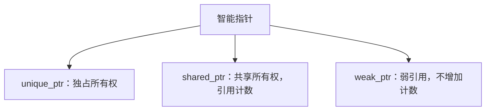
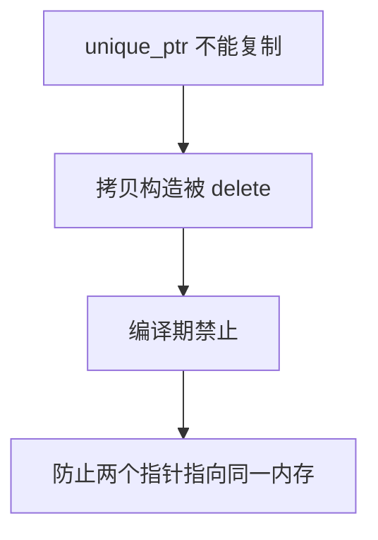
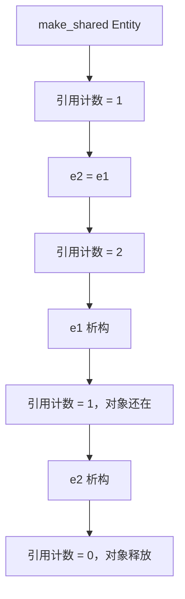
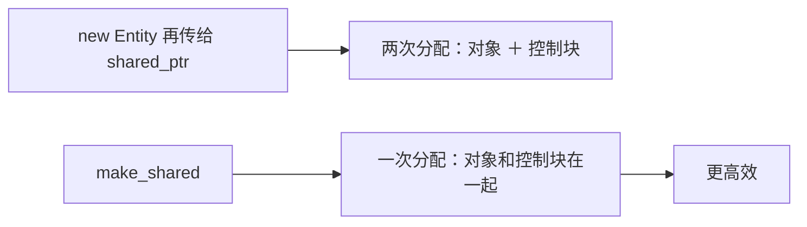
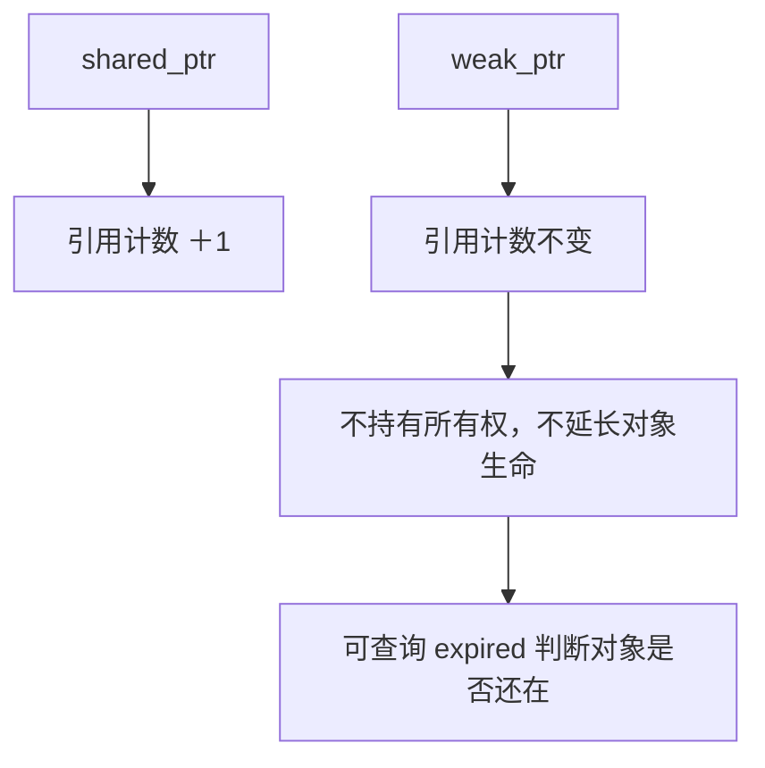
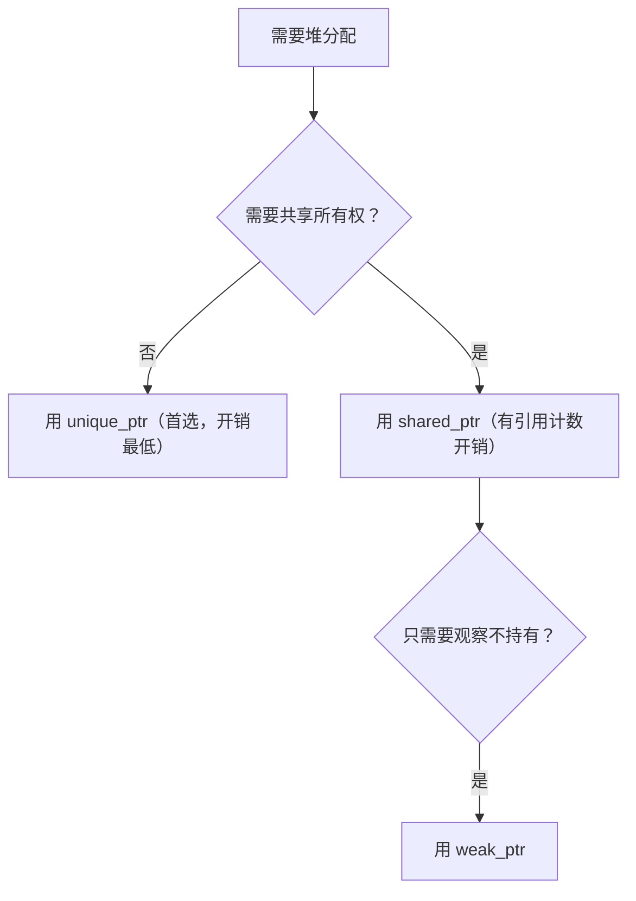

## 本节概述：智能指针是 new/delete 的自动化包装器

前面学了 `new` 分配堆内存、`delete` 释放。问题是容易忘 `delete`，导致内存泄漏。**智能指针（smart pointer）** 就是来解决这个的——它是原始指针的包装类，自动在适当时机调用 `delete`，让你不用手动管理内存。

C++11 提供三种智能指针：`std::unique_ptr`、`std::shared_ptr`、`std::weak_ptr`，都在 `<memory>` 头文件里。



## unique_ptr：独占，不能复制

`unique_ptr` 是最简单的智能指针——作用域结束自动 `delete`。它叫"unique"是因为**所有权独占**，不能复制。

```cpp
#include <memory>

std::unique_ptr<Entity> entity = std::make_unique<Entity>();
entity->SomeMethod();    // 用法和原始指针一样
```


创建 `unique_ptr` 有两种方式，推荐用 `std::make_unique`：

```cpp
std::unique_ptr<Entity> e1(new Entity());      // 可以，但不推荐
std::unique_ptr<Entity> e2 = std::make_unique<Entity>();  // 推荐，异常安全
```

`make_unique` 更安全——如果构造函数抛异常，不会留下没人管的指针。

> [!WARNING]
> `unique_ptr` 的拷贝构造函数和拷贝赋值运算符都被 `delete` 了，不能复制。如果两个 `unique_ptr` 指向同一块内存，一个析构释放后另一个就变成悬空指针，所以编译期就禁止复制。



## shared_ptr：共享，引用计数

如果需要多个指针共享同一个对象，用 `shared_ptr`。它通过**引用计数（reference counting）** 管理生命周期：每多一个 `shared_ptr` 指向它，计数加一；每销毁一个，计数减一；计数归零时释放内存。

```cpp
std::shared_ptr<Entity> e1 = std::make_shared<Entity>();
std::shared_ptr<Entity> e2 = e1;   // 引用计数变成 2
```



创建 `shared_ptr` 强烈推荐用 `std::make_shared`：

```cpp
std::shared_ptr<Entity> e = std::make_shared<Entity>();  // 推荐
```

原因是 `shared_ptr` 需要额外的**控制块（control block）**来存引用计数。`make_shared` 会把对象和控制块**一次性分配**在同一块内存里，效率更高。如果先 `new Entity()` 再传给 `shared_ptr` 构造函数，就得分配两次（对象一次、控制块一次）。



## weak_ptr：不持有所有权

`weak_ptr` 配合 `shared_ptr` 使用，它指向对象但**不增加引用计数**，也不负责释放。适合只需要"观察"对象、不想延长其生命周期的场景。

```cpp
std::shared_ptr<Entity> shared = std::make_shared<Entity>();
std::weak_ptr<Entity> weak = shared;   // 引用计数不增加
```



如果所有 `shared_ptr` 都析构了，对象就被释放，此时 `weak_ptr` 变成悬空的。可以用 `expired()` 检查对象是否还活着：

```cpp
if (!weak.expired())
{
    // 对象还在，可以安全使用
    std::shared_ptr<Entity> locked = weak.lock();  // 临时提升为 shared_ptr
}
```

## 选型原则



> [!TIP]
> 优先用 `unique_ptr`，开销几乎为零。只有确实需要多个所有者共享时才用 `shared_ptr`。智能指针没有完全取代 `new`/`delete`，但在大多数日常场景下应该用智能指针。

## 完整示例代码

```cpp
#include <iostream>
#include <memory>

class Entity
{
public:
    Entity()  { std::cout << "Created Entity" << std::endl; }
    ~Entity() { std::cout << "Destroyed Entity" << std::endl; }
};

int main()
{
    // unique_ptr：独占，作用域结束自动释放
    {
        std::unique_ptr<Entity> e = std::make_unique<Entity>();
        // std::unique_ptr<Entity> e2 = e;  // 错误：不能复制
    }  // Entity 被销毁

    // shared_ptr：共享，引用计数
    {
        std::shared_ptr<Entity> e1;
        {
            std::shared_ptr<Entity> e2 = std::make_shared<Entity>();
            e1 = e2;   // 引用计数 = 2
        }               // e2 析构，引用计数 = 1，对象还在
    }                   // e1 析构，引用计数 = 0，对象销毁

    // weak_ptr：不增加引用计数
    {
        std::shared_ptr<Entity> shared = std::make_shared<Entity>();
        std::weak_ptr<Entity> weak = shared;
        std::cout << "expired: " << weak.expired() << std::endl;  // 0（未过期）
    }

    std::cin.get();
}
```

## 本章小结

**智能指针本质**：原始指针的包装类，利用栈对象自动析构的特性，在析构时自动调用 `delete`，避免内存泄漏。

**unique_ptr**：独占所有权，不能复制，作用域结束自动释放。开销最低，是首选。用 `std::make_unique` 创建。

**shared_ptr**：共享所有权，通过引用计数管理，计数归零时释放。可以复制。用 `std::make_shared` 创建（对象和控制块一次分配，更高效）。

**weak_ptr**：弱引用，不增加引用计数，不持有所有权。用于只观察对象而不延长其生命周期的场景，可通过 `expired()` 检查对象是否有效。

**选型**：优先 `unique_ptr`，需要共享时用 `shared_ptr`，只观察不持有用 `weak_ptr`。
