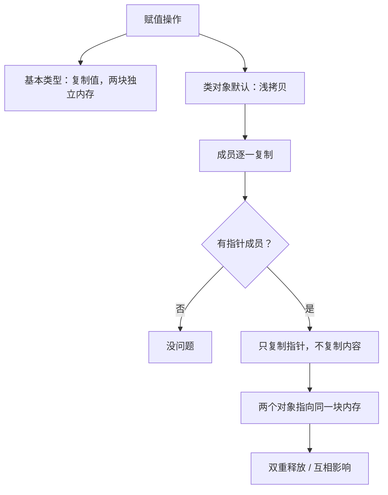
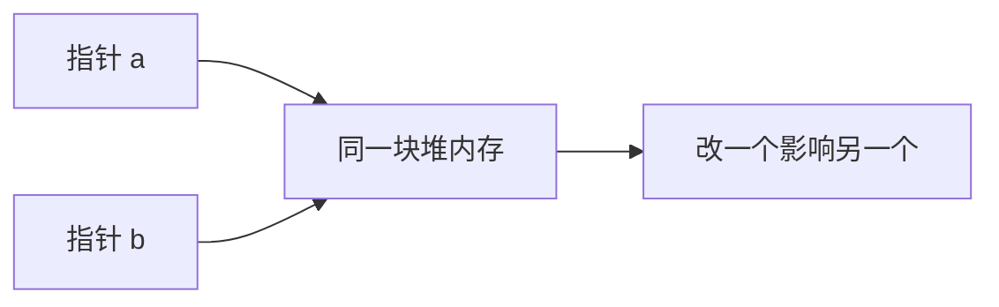
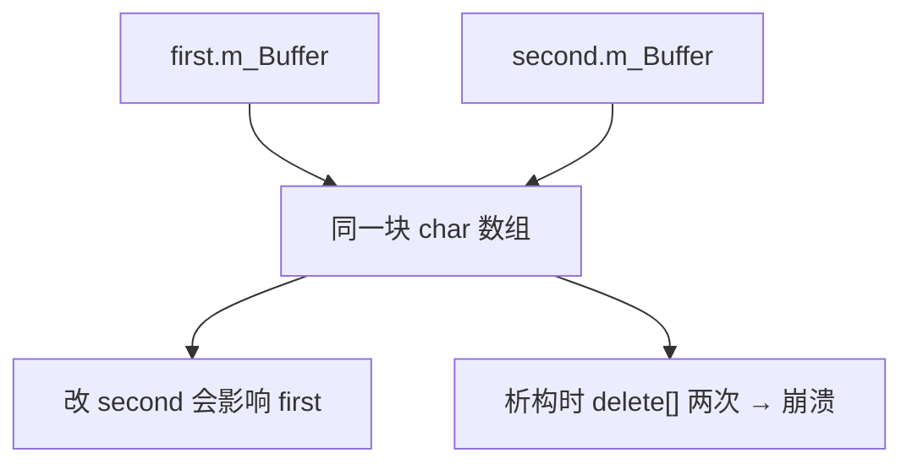
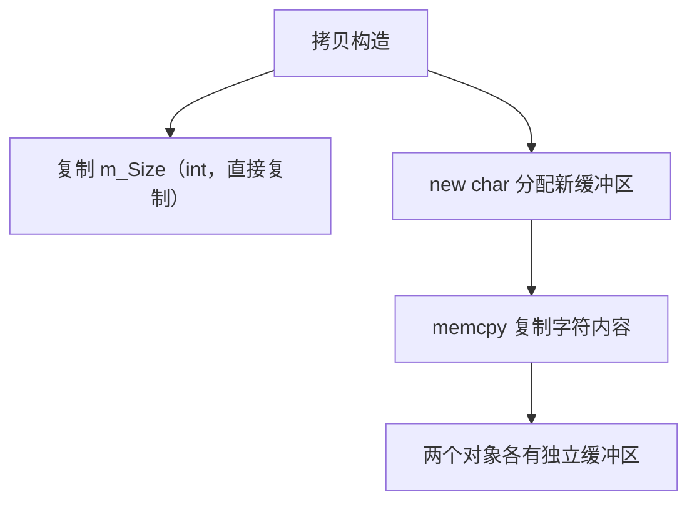
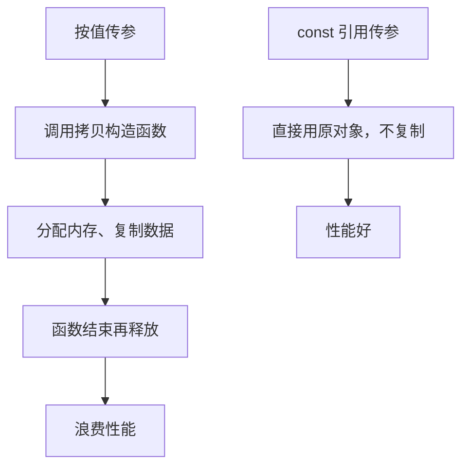

## 本节概述：赋值就是复制，含指针的类要写拷贝构造函数做深拷贝

**复制（copying）** 就是把一份数据在内存里再存一份。基本类型复制很简单——`int b = a` 之后 `a` 和 `b` 是两块独立内存，改 `b` 不影响 `a`。类对象默认也是这个行为，但如果类里有指针成员，默认复制只复制指针的值（地址），不复制指针指向的内容，这就出问题了。



## 基本类型和简单类的复制

基本类型复制是值复制：

```cpp
int a = 2;
int b = a;    // b 是 a 的副本，独立内存
b = 3;        // 改 b 不影响 a，a 仍然是 2
```

只有基本类型成员的类也一样，默认逐成员复制：

```cpp
struct Vector2 { float x, y; };

Vector2 a = {2.0f, 3.0f};
Vector2 b = a;    // b.x=2, b.y=3，独立内存
b.x = 5.0f;       // 改 b.x 不影响 a.x
```

## 指针复制的陷阱

如果是指针，复制的是**地址**，不是指向的内容：

```cpp
Vector2* a = new Vector2{2, 3};
Vector2* b = a;    // b 和 a 指向同一个 Vector2
b->x = 5;          // 通过 b 修改，a->x 也变成 5
```



## 自定义 String 类：浅拷贝的灾难

写一个简单的 String 类，内部用 `char*` 存字符数据：

```cpp
class String
{
private:
    char* m_Buffer;
    unsigned int m_Size;

public:
    String(const char* string)
    {
        m_Size = strlen(string);
        m_Buffer = new char[m_Size + 1];          // 留位置给空终止符
        memcpy(m_Buffer, string, m_Size + 1);     // 连空终止符一起复制
    }

    ~String()
    {
        delete[] m_Buffer;                         // 析构释放内存
    }

    char& operator[](unsigned int index)           // 下标运算符
    {
        return m_Buffer[index];
    }

    friend std::ostream& operator<<(std::ostream& stream, const String& string);
};
```

现在试试复制：

```cpp
String first = "Cherno";
String second = first;   // 复制
```

C++ 默认提供的拷贝构造函数做的是**浅拷贝**——只复制 `m_Buffer` 指针的值和 `m_Size`。结果 `first` 和 `second` 的 `m_Buffer` 指向**同一块内存**。



两个后果：改 `second[2] = 'a'`，`first` 也变了；作用域结束时两个析构函数都 `delete[]` 同一块内存，**双重释放（double free）崩溃**。

## 深拷贝：写自己的拷贝构造函数

要让每个 String 对象拥有独立的缓冲区，必须写**拷贝构造函数**，分配新内存再复制内容：

```cpp
String(const String& other)
{
    m_Size = other.m_Size;
    m_Buffer = new char[m_Size + 1];              // 分配新内存
    memcpy(m_Buffer, other.m_Buffer, m_Size + 1); // 复制内容
}
```



拷贝构造函数的签名固定：`类名(const 类名& other)`。参数必须是**同类型的 const 引用**。


> [!WARNING]
> 拷贝构造函数的参数必须是引用。如果按值传参，传参本身就要调用拷贝构造函数，拷贝构造函数又要按值传参……无限递归。

## 禁止拷贝：= delete

如果类不应该被复制（比如 `unique_ptr`），把拷贝构造函数设为 `delete`：

```cpp
String(const String& other) = delete;
```

这样 `String second = first;` 会编译失败。`std::unique_ptr` 就是这么干的。

## 避免不必要的拷贝：传 const 引用

复制有开销（分配内存、复制数据、释放内存）。如果函数只是读取对象，没必要复制，用 **const 引用**传参：

```cpp
void PrintString(String string)        // 按值传参：每次调用都复制
{
    std::cout << string << std::endl;
}

void PrintString(const String& string) // const 引用：不复制
{
    std::cout << string << std::endl;
}
```



> [!TIP]
> 经验法则：对象传参一律用 `const` 引用。需要副本时在函数内部再显式复制，而不是让调用方替你复制。

## 完整示例代码

```cpp
#include <iostream>
#include <cstring>

class String
{
private:
    char* m_Buffer;
    unsigned int m_Size;

public:
    String(const char* string)
    {
        m_Size = strlen(string);
        m_Buffer = new char[m_Size + 1];
        memcpy(m_Buffer, string, m_Size + 1);
    }

    String(const String& other)   // 拷贝构造函数：深拷贝
    {
        m_Size = other.m_Size;
        m_Buffer = new char[m_Size + 1];
        memcpy(m_Buffer, other.m_Buffer, m_Size + 1);
    }

    ~String()
    {
        delete[] m_Buffer;
    }

    char& operator[](unsigned int index)
    {
        return m_Buffer[index];
    }

    friend std::ostream& operator<<(std::ostream& stream, const String& string)
    {
        stream << string.m_Buffer;
        return stream;
    }
};

void PrintString(const String& string)   // const 引用，避免拷贝
{
    std::cout << string << std::endl;
}

int main()
{
    String first = "Cherno";
    String second = first;   // 深拷贝，各有独立缓冲区

    second[2] = 'a';         // 改 second 不影响 first

    PrintString(first);      // Cherno
    PrintString(second);     // Charno

    std::cin.get();
}
```

## 本章小结

**默认复制行为**：C++ 自动提供的拷贝构造函数做浅拷贝，逐成员复制内存。对基本类型和无指针成员的类没问题。

**浅拷贝的问题**：类含指针成员时，浅拷贝只复制指针地址，两个对象指向同一块内存，导致互相影响和双重释放崩溃。

**深拷贝**：自己写拷贝构造函数，分配新内存并复制指针指向的内容，让每个对象拥有独立资源。签名：`类名(const 类名& other)`。

**禁止拷贝**：`拷贝构造函数 = delete;`，如 `unique_ptr` 就禁止复制。

**避免不必要拷贝**：函数传参用 `const` 引用而非按值传参，减少无谓的内存分配和复制。
