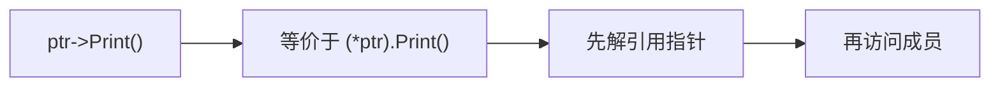
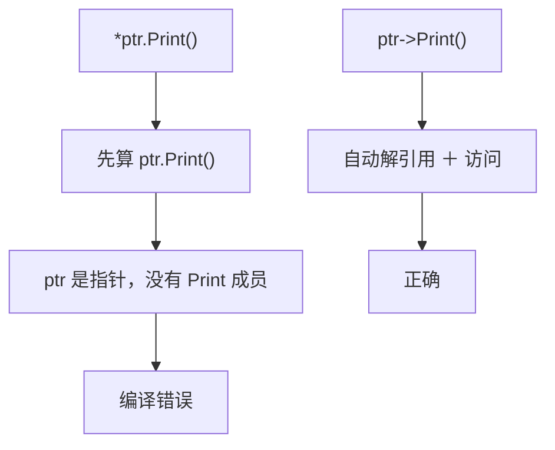
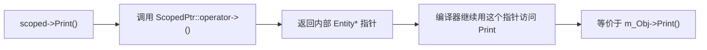
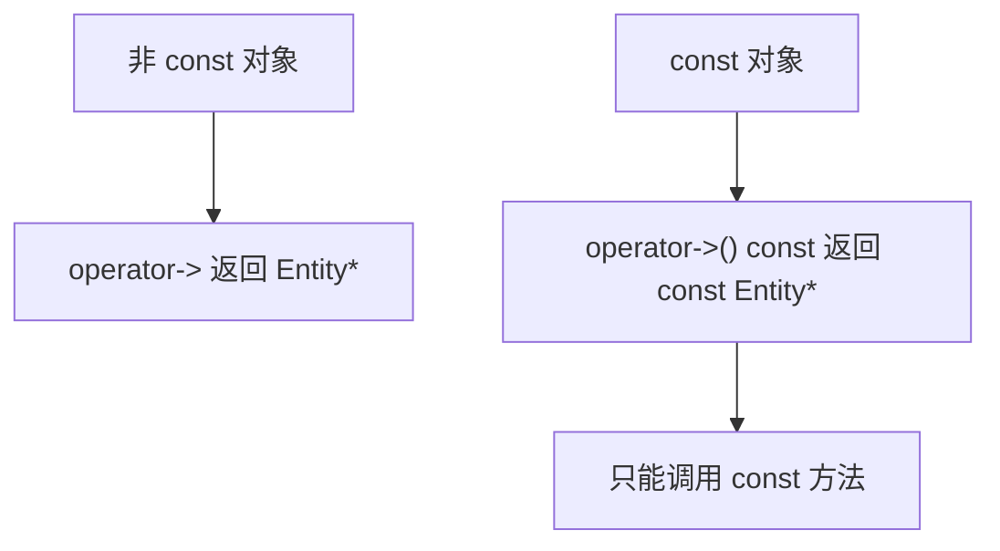
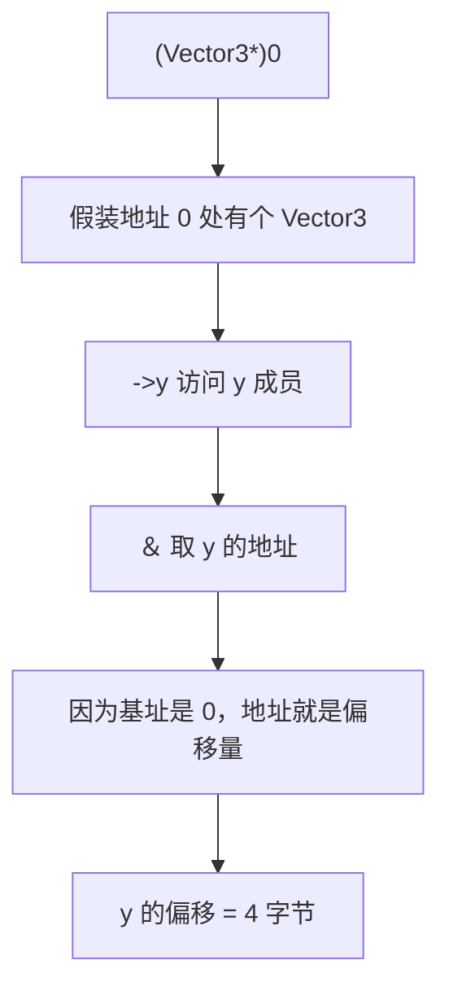

## 本节概述：箭头运算符就是"解引用 ＋ 点"的快捷写法

访问对象成员用点 `.`，但如果对象是指针，就得先解引用再用点：`(*ptr).Print()`。写起来啰嗦，还有运算符优先级的坑。箭头运算符 `->` 就是这两步的快捷写法：`ptr->Print()`。



## 基本用法

普通对象用点：

```cpp
Entity e;
e.Print();
```

指针对象必须先解引用：

```cpp
Entity* ptr = &e;

// 写法一：先解引用成引用，再用点
Entity& ref = *ptr;
ref.Print();

// 写法二：括号包住解引用，再用点
(*ptr).Print();

// 写法三：箭头运算符，最简洁
ptr->Print();
```

> [!WARNING]
> 不能写 `*ptr.Print()`，因为 `.` 优先级比 `*` 高，编译器会先算 `ptr.Print()`，而 `ptr` 是指针没有 `Print` 成员，编译失败。必须写成 `(*ptr).Print()` 或直接用 `ptr->Print()`。



## 重载 operator->

`->` 是运算符，可以重载。最常见的用途是智能指针——让包装类用起来和原始指针一样。

假设有个简单的作用域指针类：

```cpp
class ScopedPtr
{
private:
    Entity* m_Obj;

public:
    ScopedPtr(Entity* obj) : m_Obj(obj) {}
    ~ScopedPtr() { delete m_Obj; }
};
```

现在想让 `ScopedPtr` 也能用 `->` 访问 `Entity` 的成员，重载 `operator->`，返回内部的原始指针：

```cpp
Entity* operator->()
{
    return m_Obj;
}
```



这样 `ScopedPtr` 用起来就和原始指针一样了：

```cpp
ScopedPtr e = new Entity();
e->Print();    // 自动调用 operator->，再访问 Print
e->x = 5;      // 也能访问成员变量
```

## const 版本的 operator->

如果对象是 const 的，需要提供 const 版本的 `operator->`，返回 const 指针：

```cpp
const Entity* operator->() const
{
    return m_Obj;
}
```



## 进阶技巧：用箭头运算符算成员偏移

箭头运算符还有一个妙用——计算结构体成员在内存中的偏移量。方法是把地址 `0` 强转成结构体指针，然后用 `->` 访问成员，再取地址：

```cpp
struct Vector3
{
    float x, y, z;
};

int offsetX = (int)&((Vector3*)0)->x;   // 0
int offsetY = (int)&((Vector3*)0)->y;   // 4
int offsetZ = (int)&((Vector3*)0)->z;   // 8
```



因为 `float` 占 4 字节，`x` 在偏移 0，`y` 在偏移 4，`z` 在偏移 8。这个技巧在序列化、字节流处理时很有用。

## 完整示例代码

```cpp
#include <iostream>

class Entity
{
public:
    int x = 0;

    void Print() const
    {
        std::cout << "Hello! x = " << x << std::endl;
    }
};

class ScopedPtr
{
private:
    Entity* m_Obj;

public:
    ScopedPtr(Entity* obj) : m_Obj(obj) {}
    ~ScopedPtr() { delete m_Obj; }

    Entity* operator->()             { return m_Obj; }
    const Entity* operator->() const { return m_Obj; }
};

struct Vector3
{
    float x, y, z;
};

int main()
{
    // 基本用法：指针用 -> 访问成员
    Entity* e = new Entity();
    e->x = 5;
    e->Print();
    delete e;

    // 重载 operator->：ScopedPtr 用起来像指针
    ScopedPtr sp = new Entity();
    sp->x = 10;
    sp->Print();

    // 成员偏移量
    std::cout << "offset x: " << (int)&((Vector3*)0)->x << std::endl;  // 0
    std::cout << "offset y: " << (int)&((Vector3*)0)->y << std::endl;  // 4
    std::cout << "offset z: " << (int)&((Vector3*)0)->z << std::endl;  // 8

    std::cin.get();
}
```

## 本章小结

**箭头运算符作用**：`ptr->member` 等价于 `(*ptr).member`，是"解引用 ＋ 点"的快捷写法，避免运算符优先级的坑。

**重载 operator->**：返回内部维护的原始指针，让智能指针等包装类用起来和原始指针一样。需要同时提供非 const 和 const 两个版本。

**成员偏移技巧**：`&((Struct*)0)->member` 可以算出成员在结构体中的字节偏移，利用基址为 0 的特性，常用于序列化和底层内存操作。
